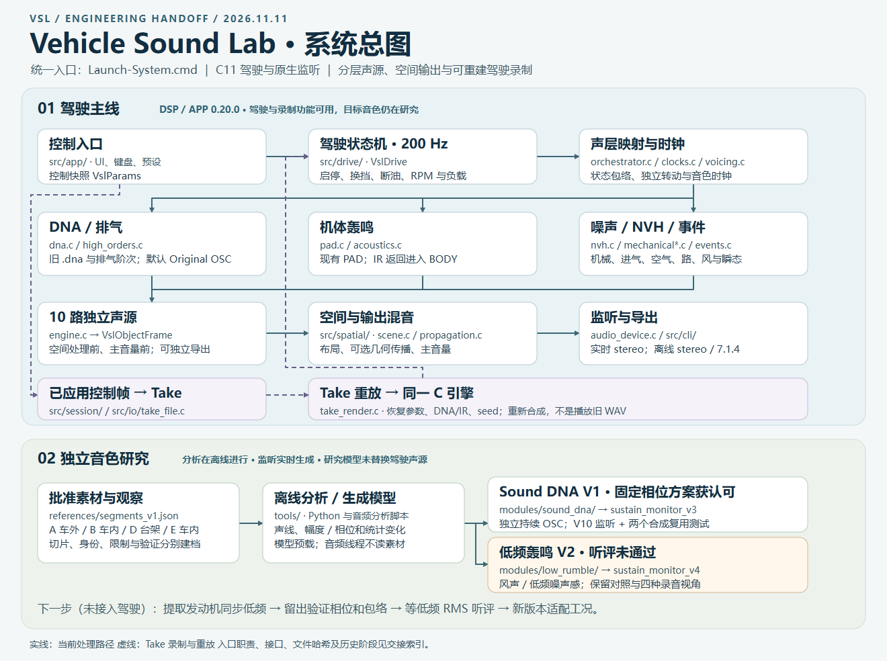

# Vehicle Sound Lab

Windows C11 声浪工程。仓库包含驾驶 DSP / App 0.20.0、独立 Sound DNA V1、低频轰鸣 V2 历史对照，以及新 DNA／相干低频联合监听、源码、测试、模型和交接文档。



## 构建和运行

安装 Visual Studio 2022 的「使用 C++ 的桌面开发」工作负载（MSVC x64、Windows SDK）和 CMake 3.21+。从工程根目录的 PowerShell 执行：

```powershell
.\Build-System.ps1
.\Launch-System.cmd rebuilt
```

构建脚本会执行30项CTest，覆盖驾驶、DNA／空间接口、监听混音、多锚点与新驾驶适配器。运行入口可打开驾驶、DNA监听、低频对照、新声源联合监听与新DNA驾驶监听，无需Python或Max。联合监听可运行 `Launch-New-Monitor.cmd`，新驾驶监听运行 `Launch-DNA-Drive.cmd`；均默认停止。旧驾驶支持录制回放、实时stereo和离线7.1.4导出，旧0.15.0回退版本随本地交接包提供。

## 完整素材与开发证据

原始录音、清洗音轨、48 个冻结版本和全部渲染见 [完整交接 Release](https://github.com/Kidrage/VehicleSoundLab/releases/tag/handoff-2026-11-11)。[下载、校验和恢复说明](handoff/素材下载与恢复.md)。

## 接手代码

- [算法说明](handoff/算法说明.md)：声纹建模、OSC 合成、工况分层与实时接入的简明说明。
- [C 模块和接口](handoff/C模块与接口.md)：驾驶状态、实时 DSP、宿主和离线工具之间的边界。
- [工况与声层](handoff/工况与声层.md)：怠速、加速、巡航、收油、换挡等八种工况的分层响应。
- [开发留痕](handoff/开发留痕.md)与[阶段索引](handoff/阶段索引.csv)：历次方案、验证和听评。原始录音、冻结快照、旧版二进制和渲染音频由本地交接档案提供；旧试听和历史实验需要恢复相应证据。

驾驶 0.20.0 是功能主线；独立固定相位 DNA 在一个 V10 情境获认可，低频 V2 听评未通过。[研究续接](handoff/研究续接.md)记录了下一步：提取与发动机同步的低频，验证相位和包络，再按同等低频响度对照试听。

后续研究：相干低频 V1 获得“发动机感／厚度改善”的固定情境听评。新 [DNA／低频空间适配器](modules/dna_scene/README.md)已将两者接入同一 C 对象渲染链，保留干声、独立层和十源分轨，支持离线立体声／12通道；空间听评和完整驾驶工况接入尚未完成。新研究不在上面的冻结 Release 中，详见[本轮记录](research/DNA空间接入V1.md)。

新 [联合原生监听](research/联合声源原生监听V1.md)已加入简洁WindowsUI，底层混音见 `modules/scene_monitor`，宿主见 `experiments/scene_monitor_v1`。实际设备静音验证、控制采用帧离线重合成和程序内控件自测通过；用户连续听评、跨RPM／负载及完整驾驶接入仍待完成。

[驾驶素材与DNA锚点](research/驾驶素材与DNA锚点V1.md)新增四份批准素材的六段观察、E五次升挡证据和两档实验车内模型。同一C声源可载入新模型；新分析窗修正了单周期边界引入的高频泄漏，默认认可模型保持原样。

[多锚点驾驶接入](research/多锚点驾驶接入V1.md)新增 `modules/dna_atlas`／`modules/atlas_drive`：共用OSC时钟的锚点过渡、唯一驾驶控制器、工况增益包络、分轨和stereo／12通道导出。当前只有E的两个高转车内锚点，覆盖外明确标记边界变调；完整转速／状态音色、原生UI和听评仍未完成，A的已认可默认监听独立保留。

后续[驻车车外四锚点](research/驻车车外四锚点V1.md)用同一套 C 库加入 A 同一驻车尾部位置的低／中／高转声纹，模型位于 `voices/exterior_anchors_v1`，与 E 车内及已认可 A 移动尾排配方分别保留。四组驾驶导出、旧 E 位级回归和 29 项测试通过；根频率到 RPM 尚未标定，低转带宽／锚点间隔、实时预算与听感仍需完善。

最新[DNA驾驶原生监听](research/DNA驾驶原生监听V1.md)已接入A四档／E两档、踏板、点火、自动／手动挡、台架与空间控件。统计更新仅作保持样本不变的计算优化；短时实际静音设备、控件与30项回归通过。声纹覆盖、完整声层、长期稳定性及新驾驶录制格式仍待完成。

后续[工况声纹分离](research/工况声纹分离V1.md)比较同音高的驻车起落声纹，并用已知OSC／噪声检查分析窗：四周期Hann中心谐波读取保留纯谐波功率，却遗漏约62.5%的理想宽带噪声功率，解释当前模型约4dB的部分高频缺口。诊断模型尚未接入驾驶；后续将工况谱形与谐波间残差分开建模。
