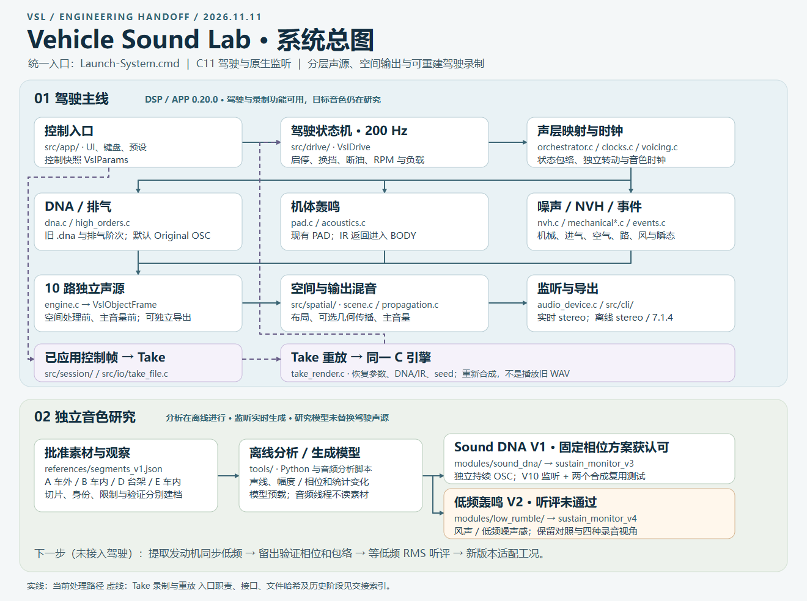

# Vehicle Sound Lab

离线提取新增[零空间残差与三角修正V1](research/零空间残差与三角修正V1.md)：原始零空间仍9/12、三组实际gap失败；四个固定高精度诊断定位小单位块相对误差后，三角计算使同一原12验证全部通过，原目标／频率／节点／容差保持。独立原方程、完整稳定残差、两项gap和全部36行汇总核对通过；直接相减检验仍4/12，差异保留。未读取真实素材或替换C音色。下一步先验证结构化惩罚根与隐式Q的实际内存，再决定完整288实验；多发动机／全驾驶状态／V6五层及独立物理7.1.4继续。

同目标波形空间验证已完成：[波形空间声源提取V1](research/波形空间声源提取V1.md)。两版均保留原方程、频率、节点和容差，原12问题独立资格4/12→9/12，3个完整停止量仍失败；原参数、梯度和两种gap均通过。7显式高精度及4有限DFT控制、24行发布数字和两图已核查。当前稠密存储不能直接扩成完整双声道，下一步先验证零空间残差与结构化存储，不做真实素材或C推广。670C/H、82参数、认可行驶35%、唯一驾驶器／录放／独立空间保持；V6五层、多发动机、全状态和物理7.1.4目标继续。

完整288稳定求解已结束：[稳定残差完整声源求解V1](research/稳定残差完整声源求解V1.md)。整段重建NRMSE降至2.66714e-5，但仍stop7／4000，两种原gap未通过；完整U／V、波形／频带、500检查点／17保真行及两图独立核查完成，全部退步保留。6高精度恒等式与5子空间控制后，独立确认剩余梯度几乎全在当前求解空间之外，不能靠放宽门槛或只看投影梯度推广音色。下一步先验证同目标的精确波形空间表示，仍保留全部分音／节点；670C/H、82参数、认可行驶35%、唯一驾驶器／录放／空间保持。V6五层、多发动机、全状态和物理7.1.4目标继续。

稳定残差控制 V1：同一4个有限矩阵＋8个Hann控制从4/12变为12/12通过，12组拟合参数与上一轮逐位相同；原目标／梯度／两种gap门槛保留。7个高精度反例和RAM／映射后端独立通过，12×18数组逐位一致，24个真实基文件核查完成，两图及全部绘图数字留痕。后续完整288测试已结束，结果见上文，不能从小型通过外推完整资格。见[稳定残差声源提取控制V1](research/稳定残差声源提取控制V1.md)。


求解正交性诊断 V1：同一完整算子128步的左右基最大非对角内积0.783／0.713，全部128次递推已独立核对。新双侧正交QR使12个控制参数误差降至2.74e-14至1.42e-11，但8个Hann直接终止检验仍stop7，资格仅4/12；失败保留，不做完整重拟合或音色替换。部分独立稠密最优解也无法通过直接1e-11终止检验，下一步先验证稳定残差及子空间外梯度，不能放宽门槛。全部进程终止；当前C／参数／认可音色／唯一驾驶／录放／房间保持，多发动机全状态及独立未来7.1.4目标继续。见 [求解正交性与终止诊断 V1](research/求解正交性与终止诊断V1.md)。


等价声源求解 V1：同一目标的平方根形式通过4个有限矩阵及8个原始Hann控制；完整288分音仍stop7／4000、梯度2.45746e-7及两种gap不通过。目标函数降至0.034001，但整段波形和三个分区退步；保留失败，不拟合六源或替换音色。所有进程终止，不重启；两张最终图已逐张检查。下一步按`research/observer_representer_krylov_v1_plan.json`先验证短递推正交性控制，再对同一完整算子做固定128步诊断。保持670 C/H、82参数、3 F2、认可音色、唯一驾驶、录放和房间；V6五层／多发动机／全状态／独立未来7.1.4目标继续。见 [等价声源求解与零方向 V1](research/等价声源求解与零方向V1.md)。


完整窗／前后文提取 V1：八组已知无前后文保真7/8，真实解析前后文使原目标8/8通过，最弱误差2.1308%→0.013147%，但整个扩展记录6.4428%外缘损失保留。完整288分音／双声道／12因子／256节点间距一次4000：频带误差小但stop7、梯度3.18685e-6和gap门槛失败，不做六源新拟合或推广。已知数据零空间至少31870维，65维局部见证独立通过；不代表物理原因。32稠密／8前后文／完整规模／零方向／出版数值均独立核对，两图已检查，失败与源码留痕。下一步按`research/observer_representer_v1_plan.json`先验证同一目标的样本空间等价求解。保持670 C/H、82参数、3 F2、认可声音与唯一驾驶／录放／房间／待听；完整多发动机全状态和未来独立7.1.4继续。见 [完整窗与前后文提取 V1](research/完整窗与前后文提取V1.md)。


加权拟合修正／边界频谱 V1：六份保存解各修正4000次（累计8000），全部仍stop7；梯度均过原门槛，但独立最优性gap门槛0/6通过，不推广声源。波形NRMSE0.000412→0.000392，宽频功率MAE0.379→1.023dB、14–21.6kHz偏差+2.015→−6.072dB，退化完整保留。新增已知控制及全部12重建／5760Gram、36行出版结果独立通过，2图已检查。发现六份完整度量14–21.6kHz能量>99.9995%落在首尾不完整窗，数学floor均未激活；纯低频控制也复现截断高频。下一步先核对“全波形保首尾＋完整窗相对频谱”的单位／已知精确解／条件数，不再盲加迭代。见 [加权拟合修正与边界频谱 V1](research/加权拟合修正与边界频谱V1.md)。保持670 C/H、82参数、3 F2和认可版本／单驾驶器／空间／待听；完整多发动机／状态／7.1.4目标继续进行。


共享频率度量 V1：六份同一 V10／两次升速局部窗口全部完成，30 重建／14400 Gram 及出版数据独立复核通过。波形 NRMSE 0.000412，宽频功率 MAE 0.379 dB；8–14 kHz 损失显著减少，但 14–21.6 kHz 偏差 +2.015 dB，左右平均误差较旧谐波版退化，六份均 stop7／4000 未收敛。新增阶次时间块预条件已知信号和双声道独立通过。下一步固定原目标，从六份保存解各做一次修正；不循环拟合轨迹、不替换持续声源。见 [共享频率度量与弱高频 V1](research/共享频率度量与弱高频V1.md)。670 C/H、82 参数、3 F2、默认／单驾驶器／空间和待听记录保持；完整目标仍进行中。


新增[完整频谱与弱细节诊断V1](research/完整频谱与弱细节诊断V1.md)：完整有限 Hann 覆盖全频率与端点，七组窗控制／四组合成伴随／三组稠密解先行；六份原素材与三旧基线共24结果、11520复Gram及全部退步计数独立核查。新完整目标波形NRMSE约0.00211，但8–10／10–14kHz平均少10.83／17.44dB，左右与CV退步，六解均stop7未收敛，不推广。下一步先用精确已知信号区分未收敛与尺度偏置，再验证共享频率度量。现有C／默认／驾驶录放空间保持，完整目标继续。

新增[同窗前向算子已知控制V1](research/同窗前向算子已知控制V1.md)：复包络节点→OSC→原Hann观察器及实线性伴随已实现，7项已知控制经独立标量OSC／直接DFT／节点梯度复验。明确保留只匹配选定谐波观察量时的反演歧义，尚未反演实际素材或制作新音色。下一步在全部六源上推断时间轨迹并报告正则化、残差和可识别范围，再拟合可持续声源；现有C／认可声音／唯一驾驶器／V6五层与未来独立空间保持，全目标继续。

新增[条件分位面实源对照V1](research/条件分位面实源对照V1.md)：接缝／端点控制先行，六源三原状态三映射生成54新波形，保留原108共162结果，完整独立OSC／104112复矩阵／160704中点矩及所有发布指标通过。新梯度左右误差0.48888→0.13775，仍高于原相对相位0.08589；时间起伏也退步，未推广。全部退步／失败／两图留痕。下一步建立同一有限Hann观察器的生成前向模型，先做已知轨迹与反演歧义控制，再拟合素材时间规律；唯一驾驶器／V6五层／未来独立空间保持，完整目标继续。另更新[ADI算力估算V9](handoff/ADI21569算力估算V9.md)，区分现有C的800MCPS规划与研究单锚点约2100–3900MCPS假设。

新增[条件相位输入路径V1](research/条件相位输入路径V1.md)：六源三路径三映射共54组／216条反事实及104112复数矩阵完整独立核查。P路径带来较大的相位变化和左右退步，U路径也有退步，交互项存在强抵消；不能固定输入或删项作为新音色。另完成[新条件分位面的7项已知控制](research/条件分位面已知控制V1.md)：可降低P变化的放大，但会改变圆周矩，尚未读取实源或替换C。下一步先补圆周接缝控制，再全六源配对；唯一驾驶器／V6分层／未来独立空间保持，完整目标继续。

新增[独立相位流原边际对照V1](research/独立相位流原边际对照V1.md)：八项端点／重复值控制先行，六源三原状态生成18条新对照，全部108方案结果和有符号载频预算独立核查。只换独立流时高频扩散几乎不变，条件相位映射仍产生主要退步；新对照本身也未改善左右，不替换当前声音。下一步分辨条件解码的幅度／相位输入时间路径，继续V6分层、唯一驾驶器与未来独立空间层，完整目标进行中。

新增[冻结声纹连续相位对照V1](research/冻结声纹连续相位对照V1.md)：六源三种子五方案全部应用同一连续相位规则，90对照／173520复数矩阵及独立全样本OSC、原观察器和发布指标核查通过。梯度条件左右误差仅0.48888→0.48703，原相对相位0.08589，包络起伏误差变大，未推广。两张图与全部退步留痕；当前670C/H／82参数及认可声音保持，下一步隔离已有独立相位随机流与条件映射的作用。唯一驾驶器／V6分层和未来独立7.1.4边界保持，完整目标继续。

新增[载频来源与高频扩散V1](research/载频来源与高频扩散V1.md)：同一90条冻结波形按六载频组分轨，保留完整复数左右及有符号交叉项，定位条件相位新增高频主要来自低载频扩散，不能当作补回机械细节。独立173520矩阵／全样本重和／37点分组核查、全部发布指标及两图留痕；[后续半角控制](research/相位半角与连续提升控制V1.md)八项已知控制及独立审计通过，尚未对素材路径验证。当前声音与670C/H／82参数、唯一驾驶器／V6分层保持；下一步原观察器验证时间模型，多发动机／全状态／物理7.1.4目标继续。

新增[条件相位时域复测V1](research/条件相位时域复测V1.md)：六冻结声纹×三种子×五方案共90条归一化坐标波形，经原Hann观察器及独立AR／CDF／OSC／全21930行STFT核查。新条件映射的参数级左右误差虽更低，波形重测却由原相对相位0.0621退步至0.4063；相同行数短段亦退步，未进入实时或新听评。全部分项、退步与两张科学图留痕。下一步做原波形按载频来源的能量及有符号交叉项归账，先修时间生成结构；670C/H与82参数、唯一驾驶器／V6分层和未来独立空间层保持，全目标继续。

新增[条件相位斜率优化V1](research/条件相位斜率优化V1.md)：同一目标和边际下直接优化条件映射，六声纹1728模型／3456LP证书及独立精确有理数核查通过。逆均匀输入斜率中位数229602→33.83，固定无量纲路径最大步进中位数2.506→0.286；极端值及全部退步保留，不代表新音色或时间规律已合格。失败尝试、精度修正与图表留痕，当前C／唯一驾驶器／独立未来空间层保持，下一步经原观察窗检验实际生成时间。

新增[幅度条件相位可实现性V1](research/幅度条件相位可实现性V1.md)：连续幅度权重＋原相位边际的条件模型，经8控制、六声纹1728分音LP与完整独立对偶／幅度／解码核查。训练左右误差0.067913→0.001828，仍有355个模型类目标缺口；稀疏解虽连续但斜率过陡，未制作试听或替换C。下一步在相同目标内求平滑内解，再核对真实时间变化；唯一驾驶器和独立未来空间接口保持。

新增[左右幅相关联与观察窗口V1](research/左右幅相关联与观察窗口V1.md)：五处退步主要落在幅度与相位差的关联项；完整总体分数高斯诊断误差0.067913→0.067725，表明仅增加PCA方向帮助很小。原Hann4096/hop256对无慢调制白噪声亦产生约0.95相邻功率关联，不能直接抬ρ。7控制、六源18组及独立矩／求积／实二次型核查通过。诊断模块分开维护，当前C、默认和上轮试听保持，多发动机／全状态／物理7.1.4继续。

新增[左右相对相位声源V1](research/左右相对相位声源V1.md)：每分音共同／左右差相位替代独立绝对相位，六原观察平均复数左右相干度误差0.16744→0.06791，24/24比旧变化相位改善、19/24比固定相位改善。12条新配对OSC共享幅度，独立AR／逆CDF／标量OSC及实际WAV左右核查通过；[20条单播放器试听](http://127.0.0.1:8789/references/analysis/relative_phase_v1/review1/index.html)待听评。时间结构仍有缺口，670C/H及82参数／默认／唯一驾驶器保持，尚未C移植或完成物理7.1.4。

新增[幅相分离统计声源V1](research/幅相分离统计声源V1.md)：从六个冻结F3声纹构建连续正幅度分位表与独立相位表示，7已知控制／18组联合分布／12新合成独立核查通过；[单播放器试听](http://127.0.0.1:8789/references/analysis/radial_copula_v1/review1/index.html)有原C、新幅度固定相位和变化相位。高频系数功率CV误差下降90.73%，不是音色认可；相位版左右关联18/24坐标变差，保留诊断、待修。当前670C/H和82参数／默认／唯一驾驶器保持。

新增[复数统计与幅度串扰诊断](research/复数统计与幅度串扰诊断V1.md)：四组已知输入经原统计编译器／C，纯相位恒幅亦出现额外调幅；六个F3锚点的完整协方差高斯系数功率CV为观察的1.40–4.46倍（48／48）。原double训练数据转FLOAT精确，全部138240复数DFT及独立矩核查通过；下一步验证正幅度与相位分开表示，保留左右联合关系。当前670C/H、82参数、声音和默认保持，不把诊断当作已改善听感。

新增[变速与统计纹理分离诊断](research/变速与统计纹理分离诊断V1.md)：19已知声源先验证频带边界效应，再用冻结原C作16条固定／扫频、纹理0／1消融；原670C/H和82参数保持。固定音高平均声线高频起伏低于0.001dB，开启统计纹理为约1.1–2.3dB，下一步核查复数统计到幅度的映射。不是新音色或默认迁移。


新增[F3统一驾驶联合细节预算](research/F3统一驾驶联合细节预算V1.md)：同一驾驶器／owned录放新增模块化离线分层导出，分别保留raw DNA、驾驶包络、六干声及最终混音。9条真实配方1233窗／295920DFT独立核查通过；两组三点高频共同变化已存在于DNA内部，不能只靠加独立调制补齐。原667C/H与82参数保持，追加3份离线C/H共670；默认／声音保持。


新增[F3完整频带联合包络](research/F3完整频带联合包络V1.md)：两段已批准原声扩展至各3秒，保留高频升速趋势、频带共同变化与左右差异；独立959窗／46032DFT和全部标量统计核查通过。去趋势协方差第一方向占45%／74%，不能简化为一条共用调制，也未当成随机发动机预设。下一步与现有完整声源联合预算，当前声音／默认保持。


新增[F3原生频谱区域与包络](research/F3原生频谱区域与包络V1.md)：六个原生锚点在指定时钟／Hann窗下，6kHz以上没有干净线间点；这是无法分辨，不能解释为没有噪声。73双声道／718窗独立核查通过，保留完整左右频带与包络观察，下一步扩展原始时间上下文。当前C／声音／默认保持。


新增[F3原生投影与细节交叉项](research/F3原生投影与细节交叉项V1.md)：11组已知混合及60组原生／C输入通过独立数值核查，但投影余项含AM边带、有限噪声及强频带相消，暂不能作为独立细节目标。当前运行C、声音与默认保持；下一步从原生频谱划分谐波邻域、线间和不可分辨区域。

新增[F3原生双声道细节预算](research/F3原生双声道细节预算V1.md)：六个局部锚点回到原始采样比较，3–14kHz约缺2.15–5.29dB，但高频左右差异并非普遍不足。18条原C和54等长片段经独立频谱／交叉谱／DFT核查；下一步建立谐波／线间谱及动态左右能量预算。当前667C/H、82voice、默认与行程保持，没有新听感迁移。

当前统一窗口已加入[F3两组三点局部声纹](research/F3局部声纹接入统一驾驶V1.md)：可由同一驾驶器控制、分层监听并录放完整内嵌参数行程。运行`Launch-Voice-Catalog.cmd`，选择“F3五挡升速一／二 · 三点局部声线”；构建输出为`build-catalog-local-v1`。十二项是十个V10观察／配方情境和两个解析示例，默认保持。68项CTest、619项原生静音检查、旧十项WAV保持及新旧兼容播放器验证完成；局部范围仍约61–68Hz，未获得全转速／负载或物理7.1.4验证。下文为各阶段历史记录，以本段及[当前代码入口](handoff/当前代码阅读入口.md)为准。

新增[带限DNA接入](research/带限DNA接入V1.md)：明确选用的较高根频率加载器复用原OSC／驾驶器，旧接口保护保留。70项测试与十套冻结WAV／新旧自包含录放通过；现有声音与默认不变，高锚点UI／owned录放尚未接入。

当前统一窗口新增第十项[F3升挡前DNA＋叠加细节](research/F3叠加细节接入统一窗口V1.md)：同一驾驶器／分层监听／自包含录放，主DNA零撤出、无独立LF，默认保持。67项CTest、487项原生静音检查、旧九项完整WAV保持及十项重放通过；新增项是一个V10局部观察情境，听评待答，不代表十种发动机或完整加速／换挡标定。入口`Launch-Voice-Catalog.cmd`，构建`Build-Voice-Catalog.ps1`，独立输出`build-catalog-F3-v1`。

新增[F3升挡附近原声观察](research/F3升挡附近瞬态V1.md)：原生频谱、频带包络及左右变化已核查，变化不等同于全频一起切断；所选下降／恢复碰观察边界，暂不导出事件增益。现有声音／默认保持，后续将已有F3配方接入可选统一驾驶入口。

新增[F3原生周期功率检查](research/F3原生周期功率V1.md)：原采样上的残差没有复现先前高频周期判定，强调制对照也有一次漏检，因此暂不编入周期调制。独立复算与完整负面结果已留档；现有声音／默认保持，后续转向换挡附近的短时声学变化。

新增[F3固定变换噪声对照](research/F3固定变换噪声对照V1.md)：四组平稳噪声通过同一分析坐标，未复现原实录高频周期判定；独立重采样与检测核查通过。此结果尚不能证明机械来源，现有音色／默认保持，下一步在原生时间轴核查高频起伏。

新增[F3双声道残差细节V1](research/F3双声道残差细节V1.md)：同一主声线保持，按本段原声与生成声的双声道差额拟合独立残差层；[加层前后／独奏／原声](http://127.0.0.1:8789/references/analysis/F3_detail_v1/review1/index.html)。原C生成三组32秒，统计差额显著缩小，尚待机械质感听评；残差未被当成已分离机械声或完整工况，原生默认保持。

新增[F3升挡前局部主声线](research/F3后加速局部声线V1.md)：三段独立观察仅一段通过，用原Sound DNA持续生成；[原声／参考／三组生成试听](http://127.0.0.1:8789/references/analysis/F3_lift_voice_v1/review1/index.html)。修正旧离线工具把输出选择误当种子的调用错误，新增显式种子导出宿主，保留所有原尝试。现有驾驶窗口／默认音色未改；该候选尚未完成细节层或听评。

代码研究从[当前代码阅读入口](handoff/当前代码阅读入口.md)开始：统一窗口的编译运行、主链示意和C模块阅读顺序均在一页中。当前研究分支为`research/coherent-low-v1`，代码基点`6125782`。最新整体听评为“模拟的很像”；减速电子感、怠速节奏及未完成标定仍独立记录。

统一窗口新增[台架负载控制](research/台架负载原生控制V1.md)：运行`Launch-Voice-Catalog.cmd`，在“转速台架”用原制动轴调整−100%至+100%负载，切回驾驶仍控制制动。RPM与负载可独立比较，原驾驶器／音色／自包含录放沿用；本轮没有新音色拟合。

新增[B换挡原声与声纹支持核查](http://127.0.0.1:8789/references/analysis/B_shift_voice_v1/review1/index.html)：补查发现先升挡、后降挡，固定单路径未通过；不导出新DNA或改默认。[证据和留痕](research/B换挡局部声纹V1.md)。怠速联合起伏仍待原有听评，本次驾驶素材观察不算怠速升级。

新增[D台架火焰附近原声核查](http://127.0.0.1:8789/references/analysis/D_flame_audio_v1/review1/index.html)：固定36–44秒、35张原PTS画面与双声道分析；可见火焰不等于可分离回火。预设瞬态条件未检出候选，未据此改C音色或触发。见[证据和限制](research/D台架火焰与爆音证据V1.md)。

新增[减速双声道配方接入](research/减速双声道配方接入V1.md)：统一窗口追加一个可选E车内候选，沿用原驾驶／分层／录放链。九项为七个V10情境＋两个解析示例，未自动绑定收油状态，默认和已认可行驶35%保持。怠速节奏候选仍在[原版／候选／原声页](http://127.0.0.1:8789/references/analysis/idle_complex75_v1/review1/index.html)待听，未替换C默认。

新增[减速声线与双声道细节试听](http://127.0.0.1:8789/references/analysis/E_decel_source_v1/review2/index.html)：从批准E车内减速语境提取一个56.023Hz声线，以原C核持续生成；同一DNA／35%撤出量下比较原细节和左右联合细节。此配方现已作为统一目录可选项，未自动映射收油状态。[参数、模块和限制](research/E减速声线与双声道细节V1.md)／[归档摘要](research/E_decel_source_v1_summary.json)。最新专项听评为“左右关系有改善，音色仍明显电子”；F2怠速候选继续独立待听，不据频谱／互谱接近宣称音色完成。

新增[驻车声线接入统一窗口](research/驻车声线接入统一窗口V1.md)：运行 `Launch-Voice-Catalog.cmd`，选“V10 · 驻车中间声线＋共振（试验）”，即可用转速台架或模拟驾驶操作原五锚点候选，并分层监听、录制及回放。新项未配置独立低频层，对应滑条禁用；DNA自身低频照常生成。65项CTest、244项原生静音检查通过，原七项输出保持一致；[验证与归档](research/catalog_bridge_v1_summary.json)。音色待听，完整工况与多发动机仍未完成。

新增[驻车中间声线V1](research/驻车中间声线V1.md)：同一A尾排素材三个新窗只采用通过原谱线检查的41.612Hz声线，独立DNA／共振参数；原驾驶器生成新增前后补油／加速换挡对照。两处源窗排除，覆盖仍有空缺；F2怠速、原生默认保持，候选待听。

新增[驻车共振细节与驾驶候选](research/驻车共振细节与驾驶V1.md)：三个A驻车中高段按各自素材重新拟合，已有C持续声源和唯一驾驶器生成固定声线／补油／加速换挡对照，并显示实际RPM与状态。新候选待听评，低转未推广，F2怠速候选与默认保留。

统一入口：运行 `Launch-Voice-Catalog.cmd`，同一C驾驶窗口可选择七个V10观察／配方情境和两个解析合成示例，并复用分层监听与完整行程录放。它们不是九款已拟合实车；[原目录设计](research/统一音色目录V1.md)、[新增驻车项](research/驻车声线接入统一窗口V1.md)与[车内减速项](research/减速双声道配方接入V1.md)分别说明范围。默认仍是既有行驶35%＋细谱怠速候选，待听联合起伏候选未接入。

当前原生入口：运行 `Launch-Layer-Monitor-Study.cmd`，可在完整混音与DNA／低频／细节／辅助／启停事件／其他干声之间切换。切换只影响监听，录制仍保存完整行程，回放时可重新单听；[模块与验证说明](research/驾驶分层监听V1.md)。沿用已有音色，怠速联合起伏候选仍待听评。

当前音色任务：改善怠速“节奏太规整、像持续音符”。[原版／素材驱动候选／F2原声试听](http://127.0.0.1:8789/references/analysis/idle_complex75_v1/review1/index.html)已准备，候选尚未获得听感认可或接入实时C；[当前状态与模块入口](research/怠速优化当前状态.md)说明实现和边界。[保留的系统Demo](http://127.0.0.1:8789/research/current_demo_v1/index.html)继续使用既有声音。下方“最新”字样属于历史阶段记录。

最新[多谱线声学坐标研究](research/多谱线声学坐标V1.md)：15正／3反独立已知信号通过音高／高频功率／左右关系核查；原E低转固定片段的粗轨迹恢复，但相位仍失败，无新怠速DNA。实时540C/H和既有音色保持。当前需诊断完整周期、旁带和录音混合，真实怠速／带载音色仍未完成。

最新[E驻车／起步低转核查](research/E驻车与起步低转核查V1.md)：补两段已批准E的原双声道／42帧上下文。短车外平台有谐波族，但现有粗追踪未通过，无新怠速模型；78秒车内片段有剪辑及蓄转起步，不能整段当怠速。实时540份C/H、原模型与行驶35%保持。下一步独立验证有旁带／缺线时的参数提取，真实怠速及完整带载加速仍未完成。

当前[行驶完整配方统一驾驶](research/行驶完整配方统一驾驶V1.md)：`Launch-Full-Recipe-Drive-Study.cmd`已把保留35%的DNA／独立相干LF／连续细节接同一驾驶器、原生窗口和schema8／29控制的自包含录放；默认停止、未点火、房间0。55项CTest、84旧WAV及实际静音设备台架／踏板／分轨／2-12与自身UI检查通过。540份C/H，所有原音色参数不变；[算法说明](handoff/算法说明.md)与[总图](handoff/系统总图.svg)已更新。真实怠速、完整带载加速和同RPM负载声纹仍待完成；以下保留各阶段历史，不据旧“35%尚未接驾驶”判断当前入口。

新增[B驻车声纹验证](research/B驻车声纹验证V1.md)：已知信号提取与两套新测试参数的实际C连续生成通过，但三段真实B候选的独立留出未通过，未导出怠速音色。另36帧确认模式／视角／中控及停车关闭操作，不能混成一个怠速状态。530C/H及既有模型不改；[怠速／加速补充候选](research/怠速与加速补充素材V2.md)只核对网页，待用户审阅后下载。行驶35%保持，真实怠速及带载加速仍待完成。

最新[B素材状态纠偏](research/B素材状态纠偏V1.md)：已取回批准B的720p视频，五处左右音轨匹配确定本地MP3对应偏移约36.3ms，目视100帧。旧`B_cabin_steady`84–94秒实为车外前备厢操作，已从车内／发动机拟合依据排除；218–230与475–485秒均含换挡及混合动作。另建驻车／起步／停车分段目录。两段既定相位交叉核查拒绝，无新DNA；530C/H和模型保持，未重复53CTest或新增音色认可。行驶35%保持。

最新[双声道细节统一驾驶](research/双声道细节统一驾驶V1.md)：`Launch-Stereo-Drive-Study.cmd`将A启动趋稳车内双声道候选接到同一驾驶器／细节滑条／schema7自包含录放，默认停止、细节0、房间0。53项CTest、84旧WAV及三次实际静音设备录放通过，2／12前L/R与源一致；530份C/H。新车内候选覆盖本次工程怠速，带载加速细节仍无支持，真实热怠速／负载声纹未标定。行驶35%完整配方保持独立监听；以下为历史阶段记录。

最新[低转双声道连续细节](research/低转双声道连续细节V1.md)：新增模块化C双通道VAR／SOS细节核，A启动后车内稳定段有独立候选，保留原DNA并补左右关系。52项CTest、三种子各48秒实际C核查通过；529份C/H，原521份不变。600–850Hz仍有缺口，未获听评／热怠速／带载加速标定，也未接驾驶默认；[同增益试听](http://127.0.0.1:8789/references/analysis/stereo_resonance_v1/review1/index.html)。行驶35%保持，以下保留各阶段记录。

最新[踏板状态与细节覆盖](research/踏板状态与细节覆盖V1.md)：16秒实际静音设备录放走通怠速、加速、收油、换挡切扭／恢复、降挡补油及熄火，行程和2／12源一致。发现低转细节**不覆盖850工程RPM稳定怠速**，加速也仅短暂经过支持区；需要补参数／转速证据，不能据运行通过声称音色完成。521份C/H；声音参数、默认及行驶35%保持。

当前新增[连续共振细节统一驾驶](research/连续共振细节统一驾驶V1.md)：运行`Launch-Drive-Resonance-Study.cmd`，已有A低转补细节候选可在同一个驾驶器／DNA相位／原生窗口／schema6行程中调节，默认停止、未点火、细节0。51项CTest、84旧WAV字节回归及短静音设备录放通过。只接局部附加细节；行驶35%完整配方仍独立监听，怠速及带载加速声纹尚未标定／验收完成。下方“无驾驶／行程”是此前完整固定配方的范围。

当前入口：[完整声源原生监听](research/完整声源原生监听V1.md)，运行`Launch-Resonant-Source.cmd`。低转／行驶五配方、音高及分层量可控，默认停止；50项CTest、四次短静音设备逐样本重现、三配方8秒dry基准一致及自身窗口检查通过。原500份C/H不变，新增11份。**新配方独立监听已接，驾驶／行程仍未接；怠速和带载加速音色尚未标定／验收完成。** 下文保留各阶段范围。

当前补充：[完整共振声源C配方](research/完整共振声源C接入V1.md)已将DNA／相干LF／连续细节接成同一可控声源，三个原配方×三个seed、各8秒完整混音核对及49项CTest通过。500份C/H中原492份不变；2／12前置及分轨一致。没有新调音，仍未接原生监听／驾驶／行程，怠速原听评继续待答。下文“仅细节核”的阶段状态以此段覆盖。

当前进度：[连续共振细节C核](research/连续共振细节C核V1.md)已独立移植，三个现有参数×三个种子的C／Python细节比较及48项CTest通过；原478份C/H不变，新增14份。完整混音、驾驶／原生监听／行程尚未接入，怠速音色仍待原听评。行驶音色按决定保留离线35%，停止继续调同一片段。[Sport素材复核](research/Sport降挡与低转依据V1.md)另识别4→3→2降挡与后续升挡；低转相位交叉核查未通过，没有输出新DNA或修改挡位策略。下文为各阶段当时进展，以本段及[实际完成度](research/怠速与加速完成度V1.md)判断当前范围。

新增[固定挡位加速核查](research/固定挡位加速核查V1.md)：复用现有C／两档E车内DNA生成加速对照，明确同一生成核可控，但现有参数范围窄、低频和高频细节未齐；不是新调音或全状态验收。低转候选仍待原听评，行驶35%保持。

新增[驻车低转声源候选](research/驻车低转声源V1.md)：复核47帧动作／机位，发现缺口已在400Hz–2.8k内；原C DNA加同一连续共振生成核，按低转素材重新拟合九带细节。两个方案各三种子、单播放器待听评；没有确认热怠速／RPM或接入实时C驾驶，行驶35%保持。

最新听评：共振细节**35%保留、70%否决**；[中频保护V2](research/共振细节中频保护V2.md)比较后仍是旧35%更好，V2不采用。用户要求行驶音色暂时到此。该35%为离线固定情境配方，尚未接原生C驾驶；[怠速／加速状态核查](research/怠速与加速完成度V1.md)确认共用同一控制器／OSC核心，但真实怠速、高频与带载加速负载声纹未完成标定。以下较早pending／技术通过记录不覆盖此次结论。

新增[连续激励／共振细节替换试听](research/连续共振细节替换V1.md)：已生成35%／70%两个离线候选，单播放器支持完整／分频对照。素材拟合的八带共振与弱能量包络替换部分规整高频；三种子数值通过，音色待评。参数模型无PCM／时间轴／房间；原478份C/H、驾驶与默认保持。

最新[DNA高频质感诊断与优化方案](research/DNA高频质感诊断与优化V2.md)：用户认为离线／C整体仍不足，原生C未通过。解释共同微扰、直送／房间边界，并量化高频过度周期化；下一版采用素材驱动的高频替换与连续共振细节。本轮仅新诊断／方案，478份C/H和模型未改；下述相对方向偏好不能理解为最终音色验收。

新增[A启动动作与高清仪表依据](research/A启动动作与仪表V2.md)：指示冲转高点约1800–2500RPM，旧演示1150RPM峰值未对齐。提供动作视频、20帧粗读区间与原音频谱；真实快速声学周期仍未连通，未修改C或把视觉读数称为精确转速标定。

最新听评认可**轻量共同微扰更接近机械声**。[C接入与优化思路](research/共同微扰C接入V1.md)将它作为独立模块接入固定情境原生监听；运行`Launch-Shared-Phase.cmd`，一个开关比较原版。47项CTest和短设备／控制回放通过。C随机序列与离线候选不同，原生听感仍待确认；完整驾驶状态／实测抖动标定尚未完成。独立高频云维持否决。

最新[声纹沉淀与控制边界](handoff/声纹沉淀与控制边界.md)：持续DNA为统计OSC生成，不循环原片；全RPM／负载／状态与高频时变细节尚未完整参数化。[原始高频核查](research/原始高频覆盖V1.md)从未归一化录音提取独立补充OSC，仅作离线候选，不替换认可音色。

当前[动作／转速与高频边界](research/动作转速与高频边界V1.md)：接火低频候选收到“差别不明显而且好像没那么好听”，不作为音色改善推广。真实启动RPM尚未标定，低档DNA带宽、残差覆盖与状态谱形仍有缺口；可运行的统计OSC原型不等于完整实车音色模型。

最新[状态覆盖与启动细节原生接入](research/启动细节原生接入V1.md)：非行驶状态参考／试听入口、功能与音色边界汇总。`Launch-Startup-Detail-Study.cmd`将同A启动、接火及可选细节接到一个驾驶器／监听／行程；46项CTest、短时设备和录放通过，完整状态音色仍待逐项验收。

新增[启动车内细节候选](research/启动车内细节V1.md)：同A参考的左右协方差预算、原C持续OSC及统一启停对照。11带补充平均细节，600–850Hz不可独立相加而保留缺口；未更改原生默认，音色待听评。

新增[接火低频统一驾驶](research/接火低频统一驾驶V1.md)：同一A车内DNA、唯一驾驶器CATCH状态、独立固定滤波层已进入可选原生监听与行程。`Launch-Catch-Study.cmd`打开独立构建，默认停止、接火量0%；45项CTest及短设备／录放通过。音色仍待听评，快速接火音高与高频细节继续完善。

当前状态：[启动／低转／补油／减速／换挡参考与运行边界](research/系统运行与状态素材V1.md)。系统短时功能与录放通过，多状态音色仍未完整验收。[可选启动层](research/启动层统一驾驶V1.md)已接同一C驾驶链，`Launch-Startup-Study.cmd`打开独立构建、默认停止；接火与低频建立继续完善。

最新[局部谱线与高频密度C对照](research/局部谱线与高频密度V1.md)以现有C核生成两组独立候选：保留低频／平均相位，调整高频谐波与OSC细节的分配。三种子数值门槛通过，音色仍待听评；独立实验模型不改变驾驶默认。

[简明算法说明](handoff/算法说明.md)按当前统一驾驶链梳理模块、状态触发与认可范围。最新[慢声线与谐波分配复核](research/慢声线与谐波分配V1.md)确认跨窗口慢变化仍存在，但纯净失谐音也会出现低相位占比，不能据此直接补噪声；认可音色保持原值。

最新[离线时钟校验](research/离线时钟校验V1.md)将扫频测量误差与工况声纹分开验证；16组新控制通过，但原反例与实录仍有限制，未推广新音色模型。实时系统继续保留现有基准。

Windows C11 声浪工程。仓库包含驾驶 DSP / App 0.20.0、独立 Sound DNA V1、低频轰鸣 V2 历史对照，以及新 DNA／相干低频联合监听、源码、测试、模型和交接文档。



## 构建和运行

安装 Visual Studio 2022 的「使用 C++ 的桌面开发」工作负载（MSVC x64、Windows SDK）和 CMake 3.21+。从工程根目录的 PowerShell 执行：

```powershell
.\Build-System.ps1
.\Launch-System.cmd rebuilt
```

构建脚本会执行49项CTest，覆盖驾驶、DNA／空间接口、监听混音、多锚点、残差、相干低频分层、新驾驶适配器、辅助声层、启动／接火层、数值作用域、共同微扰、连续共振细节／完整配方与行程回放。运行入口可打开驾驶、DNA监听、低频对照、新声源联合监听与新DNA驾驶监听，无需Python或Max。联合监听可运行 `Launch-New-Monitor.cmd`，新驾驶监听运行 `Launch-DNA-Drive.cmd`；均默认停止。旧驾驶使用 `.vsltake`，新源码为自包含 `.vslrun` schema5／27字段；旧构建与行程用冻结匹配播放器，两者均有离线12通道导出。本轮独立研究构建位于`build-resonant-source-v1`，提供完整配方探针／契约，尚无新原生音色入口；原有构建与窗口保留。

## 完整素材与开发证据

原始录音、清洗音轨、48 个冻结版本和全部渲染见 [完整交接 Release](https://github.com/Kidrage/VehicleSoundLab/releases/tag/handoff-2026-11-11)。[下载、校验和恢复说明](handoff/素材下载与恢复.md)。

## 接手代码

- [算法说明](handoff/算法说明.md)：声纹建模、OSC 合成、工况分层与实时接入的简明说明。
- [C 模块和接口](handoff/C模块与接口.md)：驾驶状态、实时 DSP、宿主和离线工具之间的边界。
- [工况与声层](handoff/工况与声层.md)：怠速、加速、巡航、收油、换挡等八种工况的分层响应。
- [开发留痕](handoff/开发留痕.md)与[阶段索引](handoff/阶段索引.csv)：历次方案、验证和听评。原始录音、冻结快照、旧版二进制和渲染音频由本地交接档案提供；旧试听和历史实验需要恢复相应证据。

驾驶 0.20.0 是功能主线；独立固定相位 DNA 在一个 V10 情境获认可，低频 V2 听评未通过。[研究续接](handoff/研究续接.md)记录了下一步：提取与发动机同步的低频，验证相位和包络，再按同等低频响度对照试听。

后续研究：相干低频 V1 获得“发动机感／厚度改善”的固定情境听评。新 [DNA／低频空间适配器](modules/dna_scene/README.md)已将两者接入同一 C 对象渲染链，保留干声、独立层和十源分轨，支持离线立体声／12通道；空间听评和完整驾驶工况接入尚未完成。新研究不在上面的冻结 Release 中，详见[本轮记录](research/DNA空间接入V1.md)。

新 [联合原生监听](research/联合声源原生监听V1.md)已加入简洁WindowsUI，底层混音见 `modules/scene_monitor`，宿主见 `experiments/scene_monitor_v1`。实际设备静音验证、控制采用帧离线重合成和程序内控件自测通过；用户连续听评、跨RPM／负载及完整驾驶接入仍待完成。

[驾驶素材与DNA锚点](research/驾驶素材与DNA锚点V1.md)新增四份批准素材的六段观察、E五次升挡证据和两档实验车内模型。同一C声源可载入新模型；新分析窗修正了单周期边界引入的高频泄漏，默认认可模型保持原样。

[多锚点驾驶接入](research/多锚点驾驶接入V1.md)新增 `modules/dna_atlas`／`modules/atlas_drive`：共用OSC时钟的锚点过渡、唯一驾驶控制器、工况增益包络、分轨和stereo／12通道导出。当前只有E的两个高转车内锚点，覆盖外明确标记边界变调；完整转速／状态音色、原生UI和听评仍未完成，A的已认可默认监听独立保留。

后续[驻车车外四锚点](research/驻车车外四锚点V1.md)用同一套 C 库加入 A 同一驻车尾部位置的低／中／高转声纹，模型位于 `voices/exterior_anchors_v1`，与 E 车内及已认可 A 移动尾排配方分别保留。四组驾驶导出、旧 E 位级回归和 29 项测试通过；根频率到 RPM 尚未标定，低转带宽／锚点间隔、实时预算与听感仍需完善。

最新[DNA驾驶原生监听](research/DNA驾驶原生监听V1.md)已接入A四档／E两档、踏板、点火、自动／手动挡、台架与空间控件。统计更新仅作保持样本不变的计算优化；短时实际静音设备、控件与30项回归通过。声纹覆盖、完整声层、长期稳定性及新驾驶录制格式仍待完成。

后续[工况声纹分离](research/工况声纹分离V1.md)比较同音高的驻车起落声纹，并用已知OSC／噪声检查分析窗：四周期Hann中心谐波读取保留纯谐波功率，却遗漏约62.5%的理想宽带噪声功率，解释当前模型约4dB的部分高频缺口。诊断模型尚未接入驾驶；后续将工况谱形与谐波间残差分开建模。

后续[谐波间残差 OSC V1](research/谐波间残差OSC_V1.md)将缺口做成独立 `modules/sound_residual`：A驻车车外／E车内分别拟合，512个正弦OSC补充1.2–8kHz能量与左右关系。31项回归及离线统计检查通过；音色待听评，认可DNA／相干低频保持原样。

最新[驾驶细节分层](research/驾驶细节分层V1.md)通过独立 `modules/residual_atlas` 将六档残差接入新驾驶监听，新增“高频细节”旋钮，默认0%。保留DNA、残差及对象分轨，stereo／12通道源一致；33项回归和新设备／UI核查通过。完整工况谱形、低频／进气／机械分层及音色听评继续完善。

后续[换挡时序与声纹](research/换挡时序与声纹V1.md)仅做离线证据：E五次升挡显示低／高频响应不同，排除部分单纯降音高影响；仪表时序不能直接当切扭参数。三窗、反例及全部失败／修订源码已留痕，运行C和认可模型未改。

最新[驾驶低频分层](research/驾驶低频分层V1.md)通过独立 `modules/harmonic_body` 从现有OSC互补拆出LF，使用独立机体包络和BODY空间代理。新驾驶UI增加“低频分层”，默认0%；17条旧音轨逐样本一致，34项回归及短时静音设备／UI检查通过。该层不是新分离出的物理超低频／NVH源，音色仍待听评。

后续[驾驶行程录制](research/驾驶行程录制V1.md)加入独立 `atlas_take`／`atlas_take_io`：内嵌模型、实际采用帧控制、seed、有效相位与重建校验。实际静音设备保存／载入／完整回放及2／12通道源一致通过；新增UI交互／目视检查待完成，音色与长期稳定性仍沿既有限制。

[工况声线诊断V2](research/工况声线诊断V2.md)新增短起落的独立C谐波幅度轴及36项契约。自动扫频控制仍有约1.20dB高频假变化，不映射驾驶状态，音色待听评；原认可模型和19条冻结驾驶分轨保持一致。
