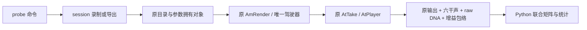

# 同一驾驶链的联合细节导出

这个离线入口通过现有目录、唯一驾驶器和自包含 `.vslrun` 录放，导出最终输出及原六组干声；不另建声音生成器或驾驶状态机。

| 文件 | 职责 |
|---|---|
| `session.h` | 非实时录制／导出接口 |
| `session.c` | 装配原目录、录制工程台架轨迹、校验旧播放器哈希并导出 |
| `probe.c` | 严格整数参数、UTF-8路径、命令分派及防覆盖 |
| `CMakeLists.txt` | 只构建该入口，链接原 `catalog_drive_models`／`atlas_take_io` |



在仓库根目录编译，然后指定尚不存在的输出文件：

```powershell
cmake -S experiments/joint_capture_v1 -B build-joint-capture-v1 -G "Visual Studio 17 2022" -A x64
cmake --build build-joint-capture-v1 --config Release --parallel 2 --target joint_capture
.\build-joint-capture-v1\bin\Release\joint_capture.exe make 10 23117 E:\VehicleSoundLab\performances\joint-example.vslrun
.\build-joint-capture-v1\bin\Release\joint_capture.exe export E:\VehicleSoundLab\performances\joint-example.vslrun E:\VehicleSoundLab\performances\joint-example 512 2
```

`make`只接受目录5／6解析示例、9独立升挡前情境、10／11两组三点局部库，种子为非零uint64。总5秒：原启动／趋稳2秒，然后3秒最低至最高声学根频率目标；单锚点保持原频率。原RPM／声音跟随器继续运行。BENCH实际operating为`FREE_REV`，即使命令gear为5，也不能称为实车负载五挡复刻。load0.8只是工程输入；关闭自动换挡、回火和房间，master／detail／width为1。

`export`支持1–512帧块及2／12输出通道。协议`vsl.joint-capture/2`生成：

- `_out.wav`：原播放器最终输出，校验音频／声源哈希。
- `_layers.wav`：固定12通道＝DNA／LOW／DETAIL／AUX／EVENT／OTHER各左右一对。
- `_raw.wav`：驾驶包络前原DNA。
- `_envelope.f64`：逐采样原double包络，IEEE754小端64位。
- `.csv`：每240帧及末帧的RPM／根频率／锚点／包络／状态等遥测。
- `.json`：帧数、布局、严格render ID和哈希校验结果。

导出器在原事件／停止边界拆请求，使`AtPlayer.raw`缓冲覆盖整个返回块。所有原六干声、输出及遥测与协议1逐字节相同。float干声独立舍入，不能要求其求和与最终float输出逐比特相同；保留两者及误差。出错留下部分文件供排查，已有目标一律拒绝覆盖。

测量、审计、绘图、冻结分别由`tools/{measure,audit,review,package}_F3_driver_joint_v1.py`负责，频谱内核在`tools/driver_joint_v1/budget.py`。结论及范围见[研究说明](../../research/F3统一驾驶联合细节预算V1.md)。这里的12路只是布局／源不变检查，未验证物理7.1.4回放。
