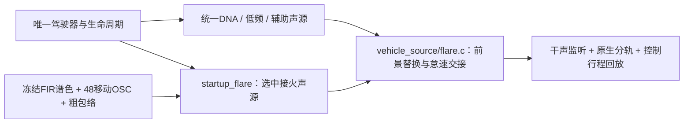

# App V17：选定变调接火接入正常启动

2026-11-17。用户选中 `startup_rotation_v1/listen2/Candidate.wav` 约2–4秒的变调段，明确暂时移除前段拖转，并要求简化主App、去掉A/B模块。这是对接火声线的选择，不是对96OSC拖转模型的认可。

## 当前行为

默认V10点击“启动”，50ms静默状态准备后，直接合成选中接火段（原1.91–4.01秒，共2.10秒），末0.70秒等功率交接到同一引擎持续生成的DNA怠速。前置动作、旧事件起动机、两种拖转均不参与。启动电平默认100%，仍随总输出电平变化。点击“完整流程”使用相同模块。

驾驶页只显示一个启动电平。删除活跃A/B按钮、7秒独立试听Host及不可保存的特殊流程；研究Host移到 `tools/startup_character_v1/archived_audition.py`。主构建不再调用 `Build-Startup-Audition.ps1`，只构建一个正式声源DLL。历史源、原试听与冻结库保留供追溯。

## C模块与控制

| 路径 | 职责 |
|---|---|
| `modules/startup_flare/model.c` | 编译参数与非实时构造；无PCM。3组Mid/Side谱色FIR、48组移动分音、9点包络 |
| `modules/startup_flare/voice.c` | 生命周期边沿触发、连续相位变调、时长、音量平滑、取消／重触发、交接权重 |
| `modules/startup_character/voice.c`、`ridge.c` | 复用既有程序纹理与移动OSC核；新增无分配rearm，保留随机谱色状态 |
| `modules/vehicle_source/flare.c` | 同一引擎采样时钟上的适配与所有分轨／监听统一混合；持续DNA始终推进 |
| `experiments/vehicle_source_v1/bridge.c` | 仅默认V10显式开启；其他目录和自定义DNA不继承 |
| `tools/compile_startup_flare.py` | 校验冻结输入SHA，确定性生成model.c，不重新分析或拟合素材 |

公开控制结构、ABI12、preset9、take10和16原生分轨不变；新增可选启动能力位128。`startup_gain`用于该能力的接火电平，旧`catch_gain`和`legacy_event_gain`须为0。旧啮合／拖转／接火／脱开事件类型在该引擎中不可重复叠加；其余事件框架保留。接火声进现有`startup`立体声分轨。

启动响应的上升＋回落时长控制整个接火声的时间展开，固定声学音高曲线0.82→1.22→1.09→1.00。2150 RPM是唯一驾驶器的工程冲转目标，**不是从录音测得的RPM，也不是48个分音的直接轴速标定**。参数中没有房间模型。FIR用于声源谱色，不是空间混响。

新库：`build-vehicle-source-v15/bin/Release/vsl_source_bridge.dll`，SHA256 `b1a541e47568fe29cdb141027da839695d8cac7d5b6922a89cf5736a8a9ad5fd`。编译参数由DLL身份绑定到配方／行程；旧v14、v13库不覆盖，原行程继续使用其原库，不放松身份检查。

## 验证与边界

最终技术证据：`E:/VehicleSoundLab/references/analysis/startup_flare_v1/verification3/verification.json`。执行工具 `tools/verify_startup_flare_v1.py --output <新目录> --ui`。

- 7项C回归通过；默认主启动实际调用新核。
- 原选段前1.4秒与主启动差异最大1.1642e−10 FS；完整接火分轨与冻结catch分轨差异最大1.4902e−8 FS，来自浮点输出及主增益位置。
- 480／217采样分块PCM及全部分轨逐样本相同；分轨重组误差最大8.7312e−9 FS；静默准备段为0；峰值0.18510 FS。
- 相同控制和启动响应下，接火结束后的原DNA、低频、纹理、全部分轨与v14逐样本一致。其余11目录默认控制／能力一致，并完成短时输出一致检查。
- 中途熄火、同实例再次启动、无效控制拒绝、配方存取、控制行程精确回放、36秒完整驾驶到熄火通过。
- 真实Tk App正常启动、保存行程、回放到相同记录帧数、完整流程按钮、停止通过；设备静音，正常及回放均0供声中断；没有调用独立试听Host。截图已检查。

verification1保留：验证脚本误调用不存在的`recipe.read`而中止；修正为现有`recipe.validate`后，verification2重新完成全部检查。再修正初始启动电平0的平滑残留、预留底部提示空间，verification3检查最终版本。没有重新拟合或改变选中声线。

技术核对不等于本次App人工听评完成。加速约20km/h机械厚重感淡出仍未修复；本轮不改其配方，不做板载MCPS或空间渲染承诺。
