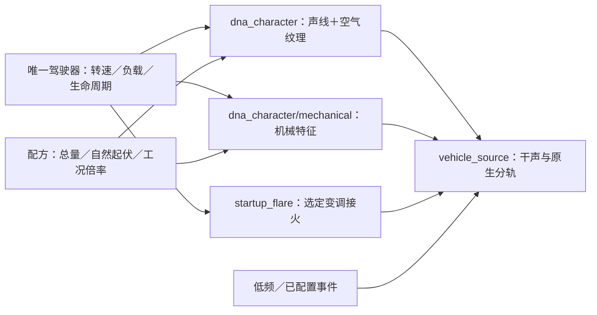

# App V18：参数扩展与机械特征归入 DNA

2026-11-17。按用户确认：启动电平0.5保持V17默认听感音量，扩大可调范围；旧辅助模板只保留机械特征，机械进入主DNA配方。

## 使用

启动 `Launch-Vehicle-Sound.cmd`。默认V10驾驶页的启动电平为 **0.50**，范围 **0–2.60**。0为关闭接火前景，0.5为原默认，1为原默认振幅的2倍，2.6为5.2倍；主输出电平仍独立相乘。范围按原UI上限1翻倍至2，再留30%而来。默认声音未额外增亮、换声源或归一化。

在 **DNA 配方** 页调整声线、空气纹理与机械特征。机械0–130%，默认0，保留原机械声源和18ms平滑。声线及空气纹理各有六组工况响应；机械使用既有发动机运动／燃油／模式包络，不新增六个机械状态倍率。“恢复DNA配方”恢复声线／纹理参数并将机械量归零。

旧进气、排气空气、道路和风声模板从当前App及统一DNA生成路径退出。独奏通过显式原生分轨索引选择，删去旧选项不会导致错轨。工作台整车配方页同步移除这些模板、将机械列入DNA；旧配方的退休字段若全为0可以读取，非零明确拒绝，避免悄悄改变原声音。

## 参数合同

| 类型 | 原上限 | V18上限 |
|---|---:|---:|
| 选中V10启动电平 | UI 1 | 2.6；基准改为0.5 |
| 输出、幅度细节、互补低频、相干低频、共振／残差纹理、机械 | 1 | 1.3 |
| DNA声线／空气总量、六组工况倍率 | 2 | 2.6 |
| DNA自然起伏、细谱参与、高转保留、随速程度 | 1 | 1.3 |
| 事件电平、音高、纹理、分类型电平 | 2 | 2.6 |
| 事件时长／衰减 | 4 | 5.2 |
| 启停响应的9个时间／RPM上限 | 各自原值 | 原值×1.3 |
| 事件延迟、间隔、冷却、连发强度 | 各自原值 | 原值×1.3 |
| 导入DNA包的细节／状态过渡时间 | 1／2秒 | 1.3／2.6秒 |
| 油门、刹车、打滑、概率 | 1 | 1 |
| 挡位、事件次数、锚点数、相位对齐阶数、种子 | 离散／数据边界 | 保持 |

最小值及相互约束保留，例如燃烧建立时长不能超过接火上升＋回落总时长。RPM、速度、负载等驾驶输入保留物理控制边界；声音配方的冲转RPM上限单独扩展。未配置的声音槽仍禁用，扩大范围不会补出缺失音色。工作台原来比原生C更窄的事件电平1扩大至1.3，其余事件宏同表。

范围同时落实在C校验、子声源和UI，超界拒绝；未使用滑条放宽但底层截断的做法。DNA细谱参与量超过1时，基底替换权重最低为0，超量继续增强指纹，避免负基底反相。概率及状态插值权重仍为0–1。扩展区会增加输出电平，C保持线性输出；需要时用主输出电平留余量。

## C模块

`modules/dna_character/mechanical.c`推进原发动机轴相位／燃油时钟并提取既有机械特征；`modules/vehicle_source/mechanical.c`应用机械量平滑并写机械分轨。统一路径不再调用旧`vsl_nvh_tick`。历史核心仍保留供非统一接口和冻结回放使用；共享的旧机械核心内部算出的进气信号被丢弃，不进入任何输出。

`startup_flare/voice.c`使用2×参数值映射原启动振幅。`atlas_drive`、`dna_character`、`modal_texture`、`drive_recipe`、`drive_resonance`、`event_control`等同步扩展实际可调范围。机械控制复用原`mechanical_gain`字段；公开结构及ABI12、preset9、take10、16分轨／23通道不变。新增能力位256（扩展范围）和512（机械DNA路径）。自定义单状态／多状态DNA也声明这些能力，但不继承V10启动或细谱资产。

新库为 `build-vehicle-source-v16/bin/Release/vsl_source_bridge.dll`。旧v15及更早DLL不覆盖，配方与行程仍严格绑定DLL哈希；V18不会按新0.5语义解释旧行程中的1.0。选择旧DLL启动时保留其原启动量程。

当前DLL SHA256：`7d22c302389c34168dfa19a78f810f597178c1891286d3e2b09111c1a9e3efea`。

## 验证记录

复现：`tools/verify_app_headroom_v18.py --output <新目录> --ui`。最终结果和截图见 `research/app_headroom_v18_delivery.json` 指向的本地证据。验证包括新0.5与冻结V17默认逐样本对照、机械声及所有分轨对照、217／480分块、启动增益比例、各扩展上限真实C执行与越界拒绝、扩展参数存取和精确回放、36秒完整流程、真实Tk／WinMM静音录放及界面布局。

最终verification2全部通过：默认及机械对照的混音／分轨误差均为0；分轨重组最大误差8.7312e−9 FS；启动2.6对应比例误差1.1921e−7 FS（浮点量化），峰值0.96252 FS。7项C回归通过；真实App录制与回放均0供声中断，截图已检查。supplement1验证单／多状态自定义DNA的detail1.3、transition2.6、两项能力位与机械量；工作台退休字段兼容／拒绝规则和DNA恢复按钮通过。

verification1保留：默认、机械、启动比例和扩展DNA检查已通过；验证脚本错误假定存在换挡／停机音色而中止。实际编译事件库只有旧启动类候选，因此后续只用历史目录核验事件核扩展范围，不在主V10恢复已移除的启动叠加。

本次没有重新拟合音色、恢复前置拖转、增加房间模型或处理加速约20km/h的机械厚度淡出问题。
