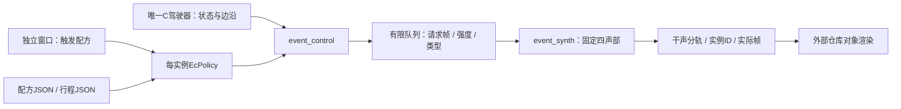

# 事件触发配方与控制台 V7

2026-11-16。本轮把写死在C中的事件时序变成每实例的可保存配方，接通独立操控窗口、工作台启动入口、完整驾驶、行程回放和分轨导出。保留认可的持续DNA、相干低频、35%共振细节及正式事件库。未做DSP优化、ADI移植或空间渲染。

## 使用

1. `Build-Vehicle-Source.ps1`构建`build-vehicle-source-v7`；旧V6和更早二进制保留。
2. 独立窗口入口仍是`Launch-Vehicle-Controller.cmd`。更新后的音色工作台“打开驾驶试听”也指向V7独立窗口；当前旧常驻服务没有重启。
3. 停止监听，在“独立事件”页打开“触发配方…”。先配置声音参数或导入事件JSON，再配置触发行为。没有音色参数的事件仍不发声，不能用增加次数补上缺失音色。
4. “保存参数”保存声音、事件覆盖、启动响应和触发配方。“完整流程”采用这些设置。“保存本次行程”记录采用的配置、控制及实际事件帧；回放和分轨导出使用同一配置。

| 参数 | 范围／默认 | 含义 |
|---|---|---|
| 回火最少／最多次数 | 1–4／1、3 | 每个获准收油组的随机次数，最少不得超过最多 |
| 收油后延迟 | 0–0.5 s／0.018 | 从驾驶器确认收油资格的帧开始计算 |
| 连发最短／最长间隔 | 0.02–0.5 s／0.095、0.16 | 同一组相邻请求间隔，最短不得超过最长 |
| 每次连发强度倍率 | 0–1／0.72 | 后续请求的强度递减；另受事件总电平和类型电平控制 |
| 合格收油的触发概率 | 0–1／1 | 每次资格边沿判断一次，不按音频采样重复判断 |
| 两组回火冷却 | 0–5 s／0 | 从上次获准且有音色参数的资格帧计算；被跳过的组不续冷却 |
| 换挡短声延迟 | 0–0.25 s／0.010 | 从既有驾驶器换挡边沿开始计算；缺少换挡音色仍禁用 |
| 拖转纹理延迟 | 0–0.1 s／0.008 | 从进入CRANK开始计算，不改变车辆拖转时长 |

例如三连发：次数3／3、延迟0.04、间隔0.12／0.12、强度倍率0.5、概率1、冷却2。生成请求间隔为5760帧，强度依次为首声的1／0.5／0.25。四声部池包含尾音；有音色且允许调度不等于一定成功启动，容量拒绝和替换另计。

手动单次试听绕过自动概率与冷却；不绕过音色可用性和声部容量。C仍负责收油资格、生命周期、停止取消与唯一音频时钟。阈值／虚拟动力映射不由UI另建一套。

## 模块与接口

| 位置 | 职责 |
|---|---|
| `modules/event_control/configuration.c`、`api.h` | 10项配方、默认值、有限范围校验、资格／尝试／缺音色／概率跳过／冷却跳过计数 |
| `modules/event_control/policy.c` | 采用配方，保留原状态资格、随机流、手动与停止策略 |
| `modules/vehicle_source/event_policy.c` | 首帧前复制／读回配方；已有帧、排队事件或观察状态后拒绝修改；读取统计 |
| `experiments/vehicle_source_v1/bridge.*` | ABI7；Policy72字节、Stats20字节；旧Control336／Telemetry152／Notice40／Startup72不变 |
| `tools/vehicle_controller/event_policy.py`、`event_policy_panel.py` | 参数合同、输入校验、独立编辑窗口；不做驾驶积分或事件调度 |
| `native.py`、`host.py` | 原生API绑定、实例配置、音频线程统计快照；原`Engine.state()`结构不变 |
| `recipe.py`、`take.py`、`startup.py` | 配方schema5／行程schema6；完整声源身份包含触发策略，篡改／缺失拒绝 |
| `vehicle_scenarios`、`render.py` | 完整流程、变块回放和干声导出采用同一配方 |

V5／V6二进制可通过显式路径继续使用对应旧schema；拒绝自定义新策略和隐式迁移。旧配方／行程应使用原冻结引擎。本轮不改变89个voice文件或事件音色设计器DLL。

## 验证与留痕

证据目录：`E:/VehicleSoundLab/references/analysis/event_policy_v1`。

- `source-build2.log`四项CTest通过：配方、干声／空间旁路、外部输入、事件时钟／分轨。`core-tests2.log`另外两项通过：事件池生命周期／身份、语义控制／调度。
- `verification1`：12预设×事件开／关、3启动中断和一次双收油，共28组与原V6二进制逐样本对照；混音、23通道分轨、状态、事件通知完全一致。新增自定义策略、36项原生非法输入、实例复制／锁定、概率0与手动试听、冷却、缺音色、身份篡改、变块回放及实际导出通过。连续19通道与默认完全一致。
- `ui2`：真实自有Tk／WinMM静音窗口，10字段编辑／非法值保留／默认与取消／配方保存载入，完整32秒流程及从文件载入的另一轮32秒回放，均0中断；通知／最终状态与独立离线回放一致。窗口已关闭，截图已检查。
- 初始默认延迟浮点截断导致回火提前1帧，已修复为固定延迟取最近帧；随机间隔沿用原向下量化，保住默认随机流。原失败见`research/event_policy_v1_initial_delay_failure.json`。
- `ui1`功能测试通过，但一个子窗口截图抓错原生句柄；保留原记录，改用校验标题的顶层HWND，正式截图以`ui2`为准。`core-tests1.log`过滤名错误，没有执行测试，不能计为通过。

三连发测试使用已批准E素材的1.2–14kHz局部短声候选，只为工程槽验证；它并非确认的真实全频回火，未晋升正式事件库。A启动候选也仍待听评；其余缺失事件不以通用爆音替代。完整目标未完成。

当前常驻旧窗口／工作台服务未替换。此前自动审批拒绝持久启动／重启，仅返回`blocked by policy`；本轮未重试或绕过，只使用并关闭了自有有界静音测试窗口。未新增下载、提交或推送；G1／G2／G3审阅和启动听评仍待原请求回复，不重复询问。

冻结包及校验清单由`tools/finalize_event_policy_v1.py`生成；完整后续任务仍包括真实全频回火、其他事件音色及全状态听感验收。
