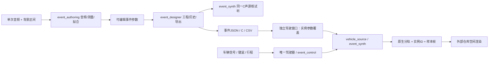

# 独立事件设计与驾驶配方 V1

2026-11-16。本轮完成事件音色的工具链和驾驶接入；不改变认可的持续DNA、低频、细节参数，不做算力优化。新启动候选仍待听评，真实回火及其他机械短声尚缺可用参数，完整目标未完成。

## 使用

1. 运行 `Build-Event-Designer.ps1` 与 `Build-Vehicle-Source.ps1` 构建两个C入口。前者生成事件试听DLL及构建来源清单；后者现在构建独立的 `build-vehicle-source-v3`，保留旧V1/V2二进制。
2. 更新后的音色工作台首页点击“独立事件设计”，进入 `/events.html`。保留“打开驾驶试听”按钮和独立Tk窗口。
3. 导入含一次事件及附近背景的0.12–60秒音频，选择互不重叠的事件与背景区间。事件0.06–5秒，背景至少0.06秒。没有背景的纯参数设计可直接载入已有候选或参数JSON。
4. 选择动作、视角、备注和门控方式，提取参数。事件／背景低于3 dB时只保留分析及原声，不覆盖既有音色；旧音色与新参考不一致时明确提示。
5. 调节模态、共振频带、包络和触发宏；按“生成C试听”。导入片段、事件参考、A/B共用一个播放器，固定0.25监听增益，无自动归一化、限幅或房间处理。峰值显示使用原电平。
6. 导出 `parameters.json`，在独立驾驶窗口V3的“独立事件”页按“导入事件JSON”。先停止监听，参数在下次监听前载入。导入不会改写全局事件库；窗口的音高、衰减、纹理与各类电平继续生效，导出包内的离线试听宏不自动覆盖驾驶控制。
7. 手动试听或启用事件后启动驾驶；启动、接火等由原唯一驾驶器状态自动调度。回火／换挡自动资格也沿用同一控制器。缺失类型默认禁用，导入有效自定义参数后才开放。
8. “保存参数”生成完整控制／自定义事件配方；“保存本次行程”记录实际控制及事件帧。参数JSON不需要原录音即可复现合成。

当前常驻旧服务没有重启，新版本未常驻打开。此前自动审批两次拒绝重启／新端口启动，仅返回 `blocked by policy`；未改用其他方式绕过。本轮仅启动并关闭自有短时测试服务和静音验证窗口。该状态不影响已完成的代码、导出及验证。

已准备两个可编辑A素材实例，位于 `E:/VehicleSoundLab/designs/events`；清单见 `E:/VehicleSoundLab/renders/event_designer_v1/examples1/examples.json`。完整启动试听配方为同目录的 `vehicle_startup.recipe.json`，在独立窗口“载入参数”中打开。配方初始熄火、不自动播放；两种启动层仍是待听评候选。

## 模块与数据流

| 文件／模块 | 职责 |
|---|---|
| `tools/event_authoring/contract.py` | Python标准库参数合同与C结构；驾驶端无需安装NumPy/SciPy |
| `tools/event_authoring/{audio,measure,fit,model,export}.py` | 原声读取、声学峰／频带包络、模式拟合、独立数值模型和C参数导出 |
| `tools/event_authoring/native.py` | 同一事件C核的非实时试听桥接；核对ABI、DLL及构建来源 |
| `experiments/event_synth_v1/author_bridge.c` | 将任意合法参数交给真实4声部事件池，生成单次离线试听 |
| `tools/event_designer/{media,workspace,package}.py` | 显式48k解码、事件工程、历史、提参编排、实际C试听及JSON/C/CSV/ZIP |
| `tools/sound_designer/web/events.*` | 独立事件页面；持续DNA页面保持独立 |
| `modules/vehicle_source/events.c` | `vs_engine_event_profile`在第一帧前复制参数、更新本实例可用类型；已运行或已有排队事件时拒绝替换 |
| `modules/event_control/{policy,scheduler}.c` | 状态资格、有限队列与帧级调度；手动请求带来源标记，自动资格取消不误取消手动试听 |
| `modules/event_synth` | OSC模态＋程序噪声SOS＋包络，最多4声部、每声部12模态／4频带；无PCM、房间或分配 |
| `tools/vehicle_controller/{event_profiles,recipe,take}.py` | 自定义参数验证／身份、整车控制配方、带覆盖参数的确定性行程 |

驱动接口保持原16类／23原生通道，事件槽复用仍配合实例ID与半开区间 `[start,end)`。新参数接入不添加第二个驾驶器、音频时钟或空间渲染器。

## 参数含义

| 参数 | 调整结果 |
|---|---|
| 模态 Hz／终点Hz／扫频时间 | 单次机械声的共振音高与升降调；并非自动识别的发动机RPM |
| 模态幅度／相位／衰减 | 峰强度、起始波形关系和尾音；正弦模态，不是锯齿波 |
| 噪声 Hz／Q／幅度／起音／衰减 | 各共振频带的粗糙度、宽窄与短时包络 |
| 总起音／释放／最长发声／电平 | 事件外包络、结束方式与输出大小 |
| 门控＋保持时间 | 启动拖转等持续声；门控关闭时成分自然衰减；驾驶中释放由状态控制 |
| 音高／衰减／纹理／强度／种子 | 离线单次触发宏。驾驶中音高／衰减／纹理用于下一次触发；电平可实时改变 |

同声部各噪声频带共享程序激励，事件之间使用独立种子。事件总体±0.2%频率偏移为工程规则，不是从素材测得的微扰。拟合用背景功率差、最多12个峰及四频带包络；35%峰功率分配和衰减回退均留痕。这仍是紧凑声学近似，不能声称物理声源分离或完整波形还原。

## 身份与兼容

- 车载桥接 ABI4；控制／遥测／事件通知仍为336／152／40字节，新增事件参数结构尺寸核对。新DLL在 `build-vehicle-source-v3`，旧V2及冻结交付保留。
- 参数工程 `vsl.event-designer-project/1`；导出 `vsl.event-design/1`，内部 `vsl.event-profile/1`。
- 驾驶配方 `vsl.source-controller-preset/3`：控制、目录、所有自定义事件参数及引擎／原参数库／有效事件库身份。旧预设1/2可迁移，新的事件覆盖默认为空。
- 行程 `vsl.source-controller-take/4`：嵌入自定义事件参数并绑定有效事件库哈希；离线和实时回放均先创建同一覆盖实例。旧行程使用对应冻结播放器，不宣称跨DLL兼容。
- 导出 `profile.h` 包含 `EsProfile` 与单次试听 `EsRequest`；参数CSV涵盖全部模态、频带、外包络及宏。`synthesis.wav`保留原电平，`preview.wav`为固定0.25试听版本，均不是运行时素材。

## 验证与剩余工作

验证目录：`E:/VehicleSoundLab/renders/event_designer_v1/`。已覆盖实C与独立模型、门控扫频／释放、声纹提取、低对比度拒绝、JSON无原声重建、历史恢复、CSV、生成C头编译及逐值核对、HTTP浏览器交互、桌面／窄屏。驾驶端另验证实例隔离、运行中替换拒绝、自动启动／接火、非200Hz网格手动帧、23通道、4声部容量、完整配方／行程重放及篡改拒绝。

`verification1`的浏览器文件哈希失败源于FLOAT WAV的PEAK时间戳；实际PCM完全一致。`verification2`改为比较data块。`flow1`误将缺失事件的控制拒绝预期为声部通知，测试预期已修正；接入时另修复了自动回火取消误伤手动试听的问题。失败输出及各次Python验证入口保留，最终交付冻结完整源码；最初浏览器校验脚本未单独冻结，不宣称该次所有执行源码均已保存。

启动两种参数仍来自A车内混合录音，未经音色验收；工程启动RPM／时序不等于原录音实测转速轨迹。真实回火、啮合、脱开、换挡和停机声源参数仍需合适素材与试听；验证中的合成回火类型只是已知测试夹具，不编入正式音色库。G1/G2/G3素材审阅仍待用户答复，未下载。完整启停／驾驶听感、长时运行与参数化设计的其他车型覆盖仍需继续，未做ADI算力达标承诺。
