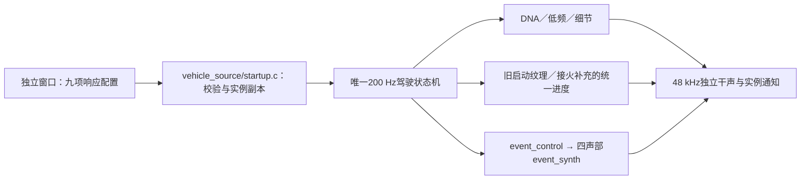

# 启动响应配置与控制台 V4

2026-11-16。把原先固定的启动／停机工程响应变成每引擎独立配置，接入独立控制窗口、配方、行程及干声导出。未改变认可声纹或正式事件库，没有做算力优化、ADI移植或空间功能。

在驾驶页点“启动与停机响应…”；停止监听后编辑、应用，再点“启动”或“完整流程”。主界面仍为四页，新参数放在单独小窗口。直接入口是仓库的 `Launch-Vehicle-Controller.cmd`，工作台 `/api/driver` 的启动适配已指向 V4；常驻旧服务／窗口本轮未重启。

## 参数与作用

| 参数 | 原默认 | 作用 |
|---|---:|---|
| crank_seconds | 0.28 s | 拖转持续时间，之后进入接火 |
| crank_rpm | 220 RPM | 拖转指数响应的目标转速 |
| crank_tau | 0.07 s | 拖转接近目标的时间常数 |
| catch_rise_seconds | 0.20 s | 接火到冲转峰值的上升时间 |
| catch_settle_seconds | 0.45 s | 峰值平滑回落到当前音色怠速的时间 |
| flare_rpm | 1150 RPM | 工程冲转峰值，实际至少为该音色怠速转速 |
| combustion_seconds | 0.06 s | 接火时燃烧许可的平滑建立时间 |
| stopping_seconds | 0.55 s | 停机阶段持续时间 |
| stopping_tau | 0.12 s | 停机指数衰减时间常数 |

配置由 C 再校验，只能在处理第一个采样之前、事件队列为空时设置，按实例复制，不修改全局默认。输入 NaN、无穷、越界或燃烧建立时间超过接火总时长会拒绝。运行中不允许修改。

“A：2000 RPM 对照”只改峰值，不自动改其余时长。A 仪表粗读高点约1800–2500 RPM，2000是工程候选，**并非实测转速轨迹、音画对齐或燃烧阶次标定**。原1150默认保留。极端短停机／慢衰减组合可能在阶段末产生更明显的截断，界面范围不代表各组合都已完成听评。

## 模块与数据流

- `src/profiles/lifecycle.{h,c}`：原默认与有效范围。
- `src/drive/types.h`、`src/drive/lifecycle.{h,c}`：每实例响应与原有转速响应计算。
- `modules/vehicle_source/startup.c`：非实时配置接口；`modules/atlas_drive/render.c`按同一响应推进旧纹理时间。
- `tools/vehicle_controller/startup.py`：上位参数合同与完整声源身份；`startup_panel.py`仅负责编辑，不计算转速。
- `native.py`、`host.py`、`recipe.py`、`take.py`、`render.py`与`tools/vehicle_scenarios`：载入、持有、保存和重放同一配置。

九项响应不会自动改写独立事件的模态、噪声、扫频和衰减参数。拖转事件随实际CRANK进入／退出触发与释放；接火事件随CATCH进入触发，其自身尾音仍由事件参数控制。事件编辑继续在音色工作台完成。

## 版本与回放

新构建目录 `build-vehicle-source-v4`，桥ABI5，启动结构72字节，原控制／遥测／通知仍为336／152／40字节。配方schema4、行程schema5增加 `startup_response` 和 `source_effective_sha256`，与DLL、89个声源文件及有效事件覆盖一起绑定。被修改的配置会使身份校验失败。

旧V3 DLL、配方、行程和冻结交付保留；旧行程使用对应冻结版本，不冒充可以跨DLL无损回放。新的离线导出和32秒完整流程均消费保存的启动配置。

## 核查与试听

- `renders/startup_response_v1/verification2`：12预设各153600帧，与**原V3 DLL**的混音、23通道分轨、遥测、实例通知逐项精确一致；37组原生／Python拒绝、实例隔离、复制语义、播放前锁定、取消与重启、2000 RPM峰值、完整停机、变块回放及导出通过。
- `renders/startup_response_v1/ui2`：自有Tk窗口及静音WinMM，编辑／恢复默认／配方往返／播放期间锁定／实际保存行程／32秒完整流程通过，供声中断0，实际事件与最终C状态回放一致。截图已查看；不代表音色获认可或设备长时间压力测试。
- 原三个source/input/event CTest通过。以上验证捕获精确源码及参数绑定，并在结束时复查没有漂移。
- [启动响应试听页](http://127.0.0.1:8789/references/analysis/startup_response_v1/review1/index.html)：同一C声源1150／2000 RPM对照、原A短参考和实际转速曲线。统一0.25增益，无房间、压缩或逐版归一化；原声与C不逐时刻对齐。浏览器单播放器、拖动／切换、静音播放、桌面／手机显示已验证。

## 素材与未完成项

复核本地已批准B的15–25秒，证据在 `references/analysis/event_sources_v1/timelines3/B_catch`。强低频出现时画面中另有车辆，目前无法确定声音归属或精确启动动作，未拟合／推广B启动音色。

正式事件库仍只有未经认可的A混合座舱拖转／接火候选，回火、换挡和其他机械短事件仍有素材／音色缺口。新尾排指定频带候选仍只作局部声学增量，不认定完整回火。本轮没有下载新素材，也未把G1／G2／G3待审批候选当作已获批准。

本轮补齐的是动作可编辑和可重复执行，尚未证明全状态声纹覆盖或启动音质完成；完整目标保持进行中。常驻服务／新窗口的启动和重启此前被自动审批以 `blocked by policy` 拒绝，本轮仅运行并关闭有限时长的自有测试窗口，没有绕过该拒绝。
