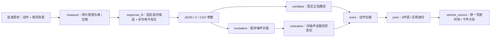

# 启动音色校准与控制台 V6

2026-11-16。本轮把批准 A 素材的启动早期纹理、接火补充做成可重复提参、可编辑、可导入完整驾驶系统的候选。**听感尚待确认；没有替换认可行驶音色或正式事件库。** 空间渲染、MCPS优化及ADI移植不在本轮范围。

## 方法与 C 模块

旧候选主要按总能量定标，频带分布偏离录音；只拟合模态和噪声电平仍无法兼顾中高频与14 kHz以上的衰减。失败的纯电平拟合保留在 `references/analysis/startup_timbre_v1/response1`。

| 路径 | 职责 |
|---|---|
| `modules/event_synth/coloration.c` | 两节 biquad 构成四阶 Butterworth 高切，只处理程序噪声；正弦模态不经过它。每声部独立状态，无内存分配。 |
| `event_synth/{api,internal}.h`、`{profile,voice}.c` | 可选 `noise_lowpass_hz`：0旁通，或300–18000 Hz。随事件音高变化，运行截止最高21 kHz。0旁通保留旧运算顺序。 |
| `tools/event_authoring/response_fit.py` | 六个固定候选0/4/6/8/10/14 kHz，按实际有限波形的交叉功率联合拟合最多12模态＋4噪声频带的幅度；每候选最多240次目标函数评估。频率、相位和包络不在本轮搜索内。 |
| `tools/event_designer/workspace.py` | 保留源选区、背景、校准方式、编辑与历史；无法匹配时保留旧模型并输出拒绝结果。 |
| 工作台 `web/events.*` | “校准频谱响应”开关和“噪声高切”参数；适用于全频片段，指定频带分析时禁用校准开关。 |
| `tools/vehicle_controller/events.py` | 导入新JSON，显示噪声高切；仍由唯一C驾驶器触发，同一事件池输出。 |

六个检验频带为0–60、60–300、300–1200、1200–4500、4500–14000、14000–24000 Hz。显著频带采用±3 dB门槛；极弱频带检查绝对能量上限。目标是原录音与背景的正功率谱增量，**不能当作物理声源分离、RPM识别或机械自然度证明**，也不保证频带内的细谱和瞬态已经还原。

## 候选、动作与使用

仅用已批准 A 原录音：早期纹理36.65–37.12秒，接火补充37.22–38.02秒；共同背景35.0–36.2秒。保留35–40.5秒原电平上下文，两份校准候选都选择10 kHz噪声高切。仍是混合车内观察，不宣称已分离启动机、燃烧或座舱。

- 工作台工程：早期纹理 `773ad53ffd964fa18a7abfaf4aa2821b`，接火 `462af3cefda441aba34886ecfc96dbae`，位于 `E:/VehicleSoundLab/designs/events`。
- [试听页](http://127.0.0.1:8789/references/analysis/startup_timbre_v1/review1/index.html)：11条试听共用一个播放器，含原／新完整32秒干声、事件独奏、原录音与单独事件。
- 完整候选配方 `renders/startup_timbre_v1/delivery1/startup-candidate.recipe.json`；单事件JSON/C/CSV/ZIP在对应 `projects/{crank,catch}`。路径均相对数据根 `E:/VehicleSoundLab`。
- 调节时先保持音高／衰减1×，比较噪声高切和纹理比例，再调各模态／噪声频带的电平。高切只控制噪声支路，0恢复旁通；高切降低可能损失空气感，不能作为所有发动机的统一设置。

完整演示0.35秒请求启动，拖转时长0.28秒、目标220 RPM；接火0.2秒上升至1150 RPM，再0.45秒回落；怠速850 RPM。2.5秒起步，15.5秒收油，18秒制动，27秒停车怠速，29.5秒熄火。实际事件早期纹理0.358–0.648秒、接火0.630–1.430秒，保留调度相位及淡出；这些是工程控制，未与A原车测量对齐。

两版保持相同连续DNA、相干低频、35%共振细节、怠速、转速轨迹、增益0.25和E局部收油短声。前19个连续通道逐样本相同，3秒后全部23通道相同；没有房间、限幅或逐条响度补偿。E仍只表示1.2–14 kHz声学补充，尚未确认为完整回火音色。

## 版本与验证

新的事件提参桥ABI2，车载声源桥ABI6；`EsProfile`由696增为704字节。控制／遥测／事件通知仍为336／152／40字节，启动响应72字节；配方4、行程5保持原结构，严格绑定新DLL身份，旧行程使用冻结播放器。新构建目录分别为 `build-event-synth-v2`、`build-vehicle-source-v6`，旧DLL保留。

- 2项事件＋3项声源C核查通过；27组V6与实际V5对照覆盖12预设、事件开关和3个启动中断，混音／原生分轨／状态／通知完全一致。
- 独立SciPy与C：8个已知滤波／门控案例、8个原候选复现、两素材×4种子的新候选通过；最大素材采样误差小于1e-7 FS，四种子六频带检查通过，不能推广为任意种子或听感认证。
- 两套32秒实际C驾驶捕获与变块回放通过；声源隔离、同一事件时间表、最终状态和峰值检查通过。
- 真实Chrome提参→编辑→重载→历史恢复→C生成，以及JSON/C/CSV/ZIP导出通过；导出C头实际编译并逐参数复核。不可达拟合保留旧音色和拒绝记录。
- 真实独立V6窗口导入两份新事件、配方保存／载入、32秒静音WinMM回放、行程再生成，以及两次取消／排队重启通过，音频欠载0。

失败留痕：`workbench1`检查早于重载完成；`workbench2`错误比较整个WAV而把PEAK头时间戳当成音频差异，实际PCM一致，`workbench3`改为比较data块后通过。一次不带筛选的CTest额外发现68个未构建历史目标，3个已构建声源检查仍通过；日志 `ctest-unbuilt-targets.log`保留，不把未执行目标写成通过。前述5项对应构建脚本的明确范围。

## 当前交付边界

源代码、候选参数和试听页已经更新；常驻工作台／旧独立窗口未重启。此前自动审批对常驻启动／重启返回 **“blocked by policy”**，本轮未重试或绕过，仅运行并关闭自己的限时测试服务和窗口。没有新下载、提交或推送。

完整目标继续：新启动候选需听评；完整实车回火、其他机械事件及全状态声纹质量仍需完善。G1/G2/G3素材审批继续等待，不重复申请或推断批准；不恢复旧数值求解研究。留痕总入口 `research/startup_timbre_v1_verification.json`，冻结目录 `E:/VehicleSoundLab/baselines/startup_timbre_v1/delivery1`（生成后以清单和独立审计为准）。
