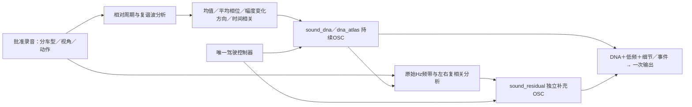

# 声纹沉淀与控制边界

最新补充：用户认为离线轻量和C仍有合成器／锯齿质感，C未通过。已完成[周期重复／包络诊断与方案](../research/DNA高频质感诊断与优化V2.md)：共同微扰只是小修饰，不能替代高频表示；参考6–8kHz波形远低于C的周期重复程度。下一版先干声分频定位，再做素材驱动的替换／连续共振细节，避免叠加更多固定载波。房间可剥离，但素材传递仍嵌入模型。本轮无新音色或实时改动。

后续进展：用户认可[轻量共同微扰](../research/共同微扰C接入V1.md)更像机械声。这是在原谐波内加入共享的有界相位坐标，已接可选C监听；它没有恢复原录音的完整高频时间细节。C新随机序列、完整工况与实测抖动仍需分别验证。

后续听评：用户明确否决本页末尾的原始Hz高频补充对照，认为有劣质合成器音色。它不作为改善方案推广；见[新反馈与共同微扰试验](../research/主声线共同微扰V1.md)。以下模块能力／局限描述保留，不能将均值拟合结果理解成听感通过。

当前系统已经把部分录音声纹变成了持续、可调的 OSC 声源；**还没有把整台发动机在各转速、负载和动作下的细节完整参数化**。高频确有遗漏，不能用功能测试通过或平均频谱接近来代替音色验收。

## 录音怎样变成模型

模型保存声纹的统计参数，运行时由新随机状态产生幅度变化，再叠加正弦；不读取原片 PCM，也不沿录音时间轴重播。`sound_dna/oscillator.c`固定平均相位，避免之前高细节量下的明显颤动；`texture.c`负责变化。

历史上的“64 OSC／细节保留”短片重建工具沿录音轨迹还原片段，属于分析参考。**持续 Sound DNA 与新驾驶声源已改为统计生成**。即使没有采样循环，统计模型仍可能只适合一个窄情境；“不是播放录音”不能证明“已掌握整台发动机”。

## 高频由哪些模块负责

| 内容 | C模块 | 实际覆盖与问题 |
|---|---|---|
| 随音高移动的谐波亮度、尖锐声线 | `sound_dna`、`dna_atlas` | 已有；谐波数有限。驻车低音高模型最高线约2.88kHz，启动趋稳约8.92kHz |
| 谐波间的宽频细节与左右相关 | `sound_residual`、`residual_atlas` | 已有独立OSC层及量控制；旧模型多止于8kHz、默认0。尚不是已识别的燃烧／排气物理声源 |
| 更密的细节谱线／变化 | `residual_dense`、`residual_motion` | 独立实验；密度会影响拍频，额外AM未证明改善。不能作为已认可默认 |
| 进气、机械、排气空气、回火等 | `drive_aux`、旧事件核 | 工程声层和触发已有，尚未完成对应录音的音色与时序标定 |

所以答案是：**有高频生成模块，但还没有一个已经验证、覆盖所有状态的“真实高频细节模块”。** 高频也不只指8kHz以上；2–8kHz的谐波密度、边带与快速包络同样影响质感。把高架滤波器调亮不能补回遗漏结构。

## 哪些细节现在能控制

| 轴 | 已能做什么 | 尚缺什么 |
|---|---|---|
| 音高／声线 | 持续声独立变调；驾驶中选取、插值声学锚点 | 全RPM区间和声学周期到曲轴RPM的可靠标定 |
| 细节 | DNA幅度变化总量、独立补充层音量、随机种子 | 逐带变化深度／速率及与负载、燃烧事件的耦合 |
| 层次 | 独听／混合DNA、低频、补充、辅助与事件层 | 真实声源分离及各层跨状态的统一音色标定 |
| 驾驶动作 | 状态机触发点火、切扭、收油、补油、回火；独立增益包络 | 同RPM下带载／收油／换挡的实测谱形与频带时序；新DNA尚未消费旧DNA的完整工况谱形参数 |
| 空间 | 保留模型L/R，可选声床或对象输出 | 从双声道推导真实多声源位置／7.1.4内容 |

“细节”滑条目前主要调量，不能把它说成可编辑所有发动机微观细节。底层接口已有部分谱形控制，尚未全部进入原生UI与状态标定。

## 本轮可复核的进展

对批准的A原始双声道重新测量，分别检查车内启动趋稳与车外驻车低音高，避免先周期归一化再丢掉高频。原启动C声源在3–8kHz低约4dB；驻车低模型在3kHz以上基本缺少表示。原片仍有这些频带。

本轮用**不改DNA的独立OSC补充**做两个诊断：启动8–16kHz、驻车低音高3–16kHz。六次既有C核生成与直接正弦和相符；三个种子的频带平均功率最大误差分别0.064／0.097dB。**这只证明能补回均值，未证明补回原始音色、瞬态或自然度**。启动短段前后半的高频功率仍相差最多2.09dB，静态模型没有保留这类变化。

诊断页：[原始频带与OSC补充](http://127.0.0.1:8789/references/analysis/hf_bandwidth_v1/render1/index.html)。它是离线对照，非新的实时UI；当前原生参数与认可模型未替换。

下一步以原录音为目标，分别沉淀**谐波声线、非谐波细节、频带时间变化、状态条件**，再映射为可操作参数。先做同一情境的频带／包络／左右关系核查与听评，再扩状态、扩车型；不再把单一触发器或一次平均谱拟合作为整套音色完成的证据。
