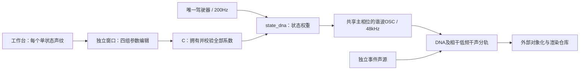

# 多状态 DNA 与独立控制台 V9

2026-11-17。把默认、怠速、给油、收油的独立声纹参数接入同一 C 驾驶器。它解决“所有驾驶状态只能用同一条声纹变调”的工具缺口；不是新的兰博基尼全状态音色标定，也没有增加空间渲染或进行算力优化。

## 使用

1. 运行 `Build-Vehicle-Source.ps1`，从工作台“驾驶试听”或 `Launch-Vehicle-Controller.cmd` 打开独立 V9 窗口。
2. 停止监听，打开“音色与分层 → 导入／编辑工作台DNA”。先导入默认声纹，再用“当前编辑”选择怠速、给油、收油，分别导入工作台导出的单状态 DNA 包或模型。每组最多 8 个锚点。
3. 四组必须保留相同分音数；不同组的基频位置和统计维度可以不同。不会截断高频或补造分音来勉强兼容。录音视角、声学阶次及工程 RPM 映射仍须确认，不能直接把车内、车外和其他车辆混成一套实测表。
4. 设定默认首锚点参考 RPM 和状态过渡时间，应用。四组共用一个 RPM→声学基频映射。过渡时间是达到约 63% 的时间，3 倍时约达到 95%；默认 0.12 秒。
5. 使用踏板、固定转速、外部信号占位或完整流程。音色页显示实际状态权重；当前组超出参考基频范围时提示“外推”。缺失状态使用默认声纹。
6. “保存参数”与“保存本次行程”内嵌所有组的系数；回放、离线混音及原生干声分轨使用相同 C 系统。多状态包导入会整体替换；单状态包导入当前编辑组。

自定义 DNA 仍默认关闭目录低频、共振、怠速附加层和事件。启动、接火等独立事件要明确导入／启用，避免把兰博基尼专用声层自动混入其他设计音色。恢复目录声源可回到原认可配方。

## 状态与算法

| 驾驶器状态 | 主 DNA 组 |
|---|---|
| 启动前、拖转、接火、停机、巡航 | 默认；启动／接火短声由独立事件模块补充 |
| 运行中的怠速 | 怠速 |
| 给油加速、空挡补油、换挡恢复、降挡补油 | 给油 |
| 收油、换挡切断 | 收油 |

状态来自原有驾驶器，不在 Python 中重复判断。这个分类不是连续的 RPM×负载完整物理声纹图。

同一谐波只用一条主相位／转速时钟；各组提供幅度、统计变化和左右相对相位。切换平滑插值正幅度及预对齐的相位差，不把四个不同周期的 WAV 交叉淡化。组间相位对齐在非实时载入时完成，仅消除任意录音周期起点差，不等于测得真实缸列点火时序。各组统计状态持续推进，不在切换时重置随机序列。

## 模块

| 文件 | 职责 |
|---|---|
| `modules/state_dna/{bank,lookup,voice}.c` | 非实时组间相位准备；锚点查询；实时权重与共享时钟合成 |
| `modules/vehicle_source/state_dna.c`、`state_assets.h` | 参数所有权、原驾驶状态映射、独立混合遥测 |
| `modules/atlas_drive/source_process.h`、`render.c` | 在唯一声源时钟上调用主 DNA 钩子；空间旁路保留 |
| `experiments/vehicle_source_v1/bridge.*` | ABI9，载入纯参数四组并复制，读回权重与各组参考覆盖 |
| `tools/vehicle_controller/dna_bank.py` | schema2 多状态包、严格维度／SHA／版本校验；schema1 单状态仍支持 |
| `dna_panel.py`、`dna_states.py` | 停止时编辑／导入／导出；显示 C 的实际混合，不执行 DSP |
| `native.py`、`host.py`、`recipe.py`、`take.py` | C 调用、唯一音频线程、完整配方和行程身份 |

构建目录 `build-vehicle-source-v9`；V8 二进制保留。配方 schema7、行程 schema8，旧文件使用原冻结引擎，不隐式迁移。控制／驾驶遥测／事件通知的原布局保持，DNA 混合使用独立结构查询。

## 验证与边界

本轮证据在 `E:/VehicleSoundLab/references/analysis/state_dna_controller_v1/`，最终汇总以 `research/state_dna_controller_v1_verification.json` 为准。核查涉及解析幅相和权重、主时钟、参数所有权、空间状态不推进、旧 V8 逐样本对照、固定 RPM 不同状态、缺省回退、原 288 分音和不同锚点网格、完整 32 秒流程、变块回放、干声导出及独立静音窗口录放。示例使用同一 V10 声纹的人工谱形编辑，仅演示工具能力，不是新的实车测量或听感认可。

保留首轮无符号负数测试公式错误、取消的原生指针夹具、启动怠速尾部导致的错误全程回退断言，以及窗口漏收新配方版本的问题。不能把它们改写成首次即通过。

最终功能证据为verification3及ui3：27组原V8目录／中断对照逐样本一致；四组状态、缺失回退、不同锚点网格、32秒完整流程及变块回放／23通道干声导出通过。ui3使用实际自有静音窗口，完整流程和保存行程回放各32秒，观测到四组状态，欠载计数0，窗口已关闭；最小尺寸下独奏和静音控件均可见。六项不同C检查分别在build1的原五项和state-check2修正后新增项通过。verification3之后只有ui.py的排版变化，最终ui3绑定当前源代码和同一V9二进制；没有把静音功能测试称为音色听评。

生成与空间边界见[声源生成边界与算力V2](声源生成边界与算力V2.md)。本仓库不推进空间状态，不计另一个仓库的IR／HRTF／扬声器渲染成本。395＋50＝445 MCPS是完整目标的设计额度；新四状态执行尚未建立独立ADI周期估计，不能把旧V14估算当作V9达标证明。所有组的统计准备及状态交接成本仍须计入生成器。

完整目标仍包括真实启动／全频回火和其他事件的音色质量、实测 RPM／负载／状态声纹覆盖。G1／G2／G3 素材审阅仍待原请求回复；本轮不新增下载。此前常驻启动／重启被自动审批拒绝，本轮只运行并关闭自有有界测试窗口，不宣称旧常驻工作台已更新。
