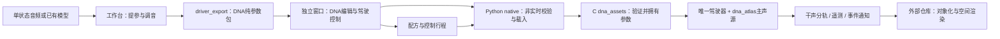

# 工作台 DNA 驾驶接入与控制台 V8

2026-11-17。补齐“工作台提取／编辑声纹 → 独立驾驶控制 → 保存／回放／分轨导出”的参数链。运行时不播放录音；既有认可行驶配方保留。空间渲染仍属于另一仓库，当前未做 ADI 移植或算力优化。

## 使用

1. 在音色工作台提取或打开一个 DNA，编辑分音、EQ、左右关系和统计起伏。
2. 展开“用于驾驶控制”，填写该声纹的参考 RPM，点击“导出驾驶 DNA 包”。这是人工工程映射，不是声学算法测得的真实 ECU 转速。
3. 在独立窗口 V8 的“音色与分层 → 导入／编辑工作台 DNA”载入 `.dnabank.json`；也可以逐份加入 `voice.model`，最多 8 锚点。锚点须基频递增且分音数相同，不自动删减高频来兼容。
4. 应用后使用踏板、固定转速、外部信号占位或“完整流程”。RPM、挡位和生命周期继续由唯一 C 驾驶器处理。
5. 保存参数／行程时自动内嵌 DNA 数值；原音频及原模型路径不参与回放。恢复目录声源可回到原配方。

单锚点只描述一个状态；范围外为变调外推。多锚点目前沿声学基频轴插值，尚不是 RPM×负载×工况的完整声纹表。界面显示参考范围，运行遥测继续报告 coverage。不能把可驱动、可回放当作已完成所有状态的音色标定。

## 模块

| 入口 | 职责 |
|---|---|
| `modules/vehicle_source/dna_assets.{h,c}` | 非实时复制 1–8 个 `SdProfile`，构造自拥有 `SaBank`；拒绝非法参数和不兼容锚点。 |
| `experiments/vehicle_source_v1/bridge.{h,c}` | ABI 8 新增 `vsl_source_open_dna`；目录选择只提供车辆控制默认值，不复制该车的其他音色资产。 |
| `tools/vehicle_controller/dna_bank.py` | 无 NumPy 的参数包合同、完整维度／范围／SHA 校验及参考范围。 |
| `tools/vehicle_controller/dna_panel.py` | 停止监听时导入、排序、删除、编辑参考 RPM／种子／细节／对齐阶数、导出和应用。 |
| `tools/sound_designer/driver_export.py` | 将实际编辑后的模型打包，另存来源和映射说明。 |
| `native.py` / `host.py` | 非实时临时文件交给 C 后即删除；音频线程只使用 C 拥有的数值状态。 |
| `recipe.py` / `take.py` / `render.py` / `vehicle_scenarios` | 采用同一个 DNA 包，绑定完整声源身份并支持变块回放、分轨导出。 |

## 音色隔离和参数语义

- 自定义 DNA 默认关闭目录低频、共振／残差细节、怠速、启动／接火纹理、历史事件及连续辅助声。缺失模型的旋钮禁用。独立事件也默认关闭，可以明确导入事件参数后启用。
- 主 DNA 与其他层仍独立维护。本轮没有把兰博基尼专用低频或怠速自动混进任意新音色。
- 工作台 gain_db、EQ、width、shared、local 已写入模型数值；detail 随参数包传递。控制器的输出电平是另一个主增益。
- 工作台 preview pitch 只影响试听，不写入驾驶模型；驾驶音高遵循 `root_hz = RPM × root_per_rpm`。导出页面及来源文件明确记录这个区别。
- 驾驶器使用现有 `dna_atlas/SaVoice`；工作台预览和它不是逐样本相同的执行器，不宣称二者 PCM 等价。
- “干声”表示未增加本系统空间效果；参数仍可能保留原录音麦克风及环境的影响，不声称物理去混响或左右尾排分离。

## 版本和验证

构建目录为 `build-vehicle-source-v8`，保留 V7 DLL。ABI 8 的 Control／Telemetry／Notice／Startup 布局不变。配方 schema 6、行程 schema 7 显式保存 `dna_bank`，普通目录配方保存 null；完整声源 SHA 同时绑定 DNA、启动响应、事件参数和触发策略。旧文档只由其对应原引擎读回，不隐式迁移。

核查入口：`tools/verify_dna_controller_v1.py`、`verify_dna_controller_ui_v1.py`、`verify_dna_controller_web_v1.py`。实际证据见 `E:/VehicleSoundLab/references/analysis/dna_controller_v1/`，最终汇总见 `research/dna_controller_v1_verification.json`。

核查包含：实际 V7／V8 的 12 预设×事件开关及中断／收油共 28 组逐样本对照；工作台三种声纹的实际编辑数值、纯参数 C 载入和无无关分轨；非法合同及 C 构造、双锚点范围；32 秒 C 流程、变块回放、参数篡改拒绝和导出；实际浏览器下载及独立静音窗口录放。通过项以最终汇总为准，不以本段列举代替检查结果。

保留失败：首次新增 C 测试沿用了目录可选层电平而被自定义资产正确拒绝，夹具关闭这些层后通过；首轮声源测试在 1.2 秒启动响应尚未稳定时断言固定目标转速，改为等待 4 秒再核对；首轮网页核查没有等待异步工程列表恢复，误读空工程 ID，补上等待后通过。失败日志和执行版本保留。

常驻旧工作台／窗口未重启：此前持久进程启动被自动审批以“blocked by policy”拒绝，本轮没有重试或绕过，只运行并关闭自身限时服务／静音窗口。因此代码和构建已更新，不宣称当前旧常驻页面自动获得 V8。

## 仍需完成

启动候选听评、真实全频回火及其他独立事件音色、怠速／负载／状态覆盖仍未完成。现有 E 短声只作局部候选，物理回火身份未确认。G1／G2／G3 素材审批沿用原待确认状态，没有新增下载或重新发起审批。本轮没有新音色认可，不将功能回归通过作为音色验收；完整系统目标继续。
