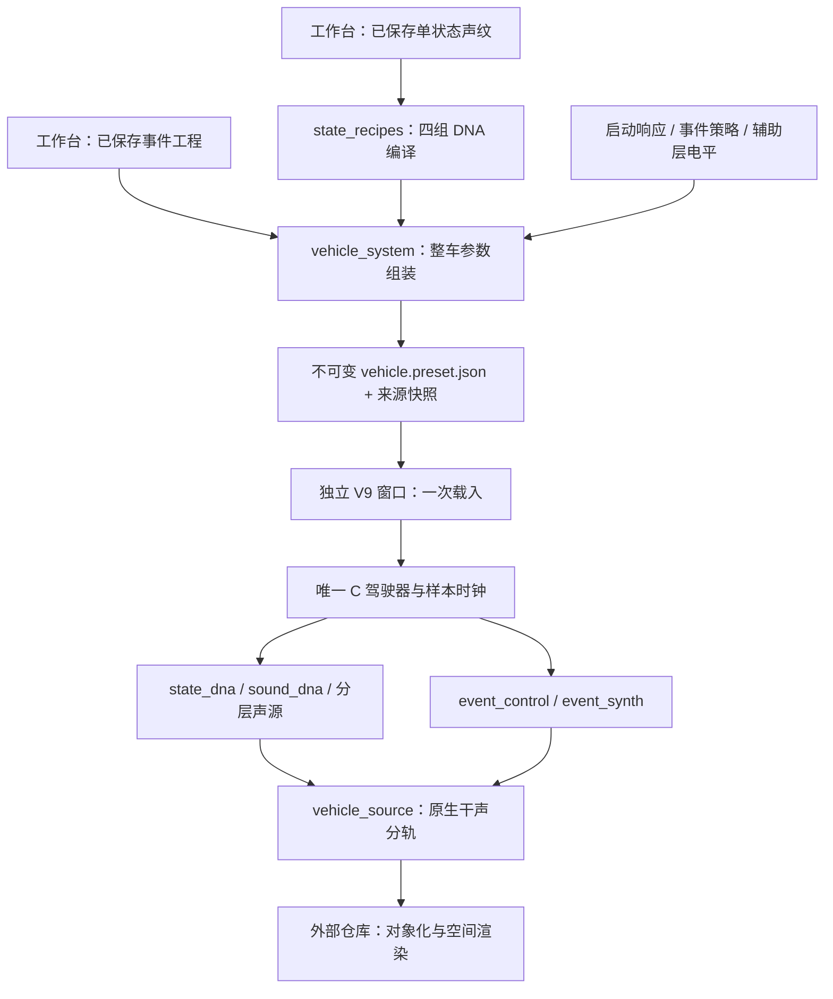

# 工作台整车参数 V2

2026-11-17。在“车辆 DNA”配方页，把多状态主声纹、启动响应、七类独立事件、触发策略和连续辅助层合并为一个可下载的整车文件。独立 V9 驾驶窗口保留，用“载入参数”一次恢复。底层 C、音色库及引擎二进制沿用 V9，本轮完善作者工具和操作链，没有 DSP 优化或空间渲染集成。

## 操作

1. 先在“声纹设计”保存各状态，在“独立事件”保存短声音色。这里读取已保存的参数，不采用其他页面尚未保存的旋钮。
2. 在“车辆 DNA”选择默认、怠速、给油、收油组，设置共同 RPM 映射、细节、种子和过渡时间。各组要求仍见[车辆 DNA 配方 V1](工作台车辆DNA配方V1.md)。
3. 勾选“一并保存整车参数”，按需展开启动响应、独立事件、事件时序与概率、连续辅助层。为每类事件选择工程和电平；空位置静音。再打开“自动触发所选事件”。
4. 编译保存，下载“整车参数”。独立 V9 窗口停止监听后，用顶部“载入参数”打开这个 JSON。可以踏板驾驶、固定转速、外部信号占位，或播放 32 秒完整流程，再保存行程及分轨。
5. 不勾选整车参数时，继续导出原 DNA 包；旧配方、旧版本保留。整车 JSON 与 DNA 包是两个入口：前者用“载入参数”，后者用“导入／编辑工作台 DNA”。

可设 9 项启动响应、10 项事件时序／概率、7 类事件选择与各类电平、4 项事件宏，以及进气／机械／排气空气／道路／风 5 项电平。事件工程的模态／共振／程序噪声系数采用保存值；该工程的试听音高、时长、纹理和增益只存入来源记录，不重复烘焙。实际驾驶采用本页的统一事件宏。

启动啮合、拖转、接火、收油回火、换挡短声、起动机脱开、停机末响复用同一个 C 事件调度和四声部合成器，但参数分别保存。选择了未确认类型或限频带候选时，页面保留提示。选择事件位置不等于证明录音中的物理动作，也不等于音色验收。

自定义主 DNA 不会继承目录里兰博基尼专用低频、残差、共振、怠速或启动附加资产。当前本页只设置五项通用连续辅助声层；专用资产还不是可任意搭配的整车资产编辑器。主 DNA、完整事件音色和真实 RPM／负载覆盖仍须逐项校准。

## 模块与边界

| 模块 | 职责 |
|---|---|
| `sound_designer/vehicle_system.py` | 字段与工程类型校验、事件来源绑定、完整配方组装、非实时 C 采用检查 |
| `sound_designer/state_recipes.py` | 原四组编译及不可变版本；可选整车文件和哈希 |
| `web/vehicle_system.js` | 折叠参数控件、载入和序列化，不判断驾驶状态 |
| `web/vehicles.js`、`server.py` | 原页面／串行后台任务，增加完整文件下载及来源变更提示 |
| `vehicle_controller/recipe.py`、`ui.py` | 沿用 V9 合同和独立窗口；实际采用配方／行程 |
| `modules/state_dna`、`event_control`、`event_synth`、`vehicle_source` | 沿用现有 C，负责生成、状态、事件、分轨；本轮未改 |

新增 `GET /api/state-recipes/system` 提供实际 V9 默认值、控件范围和已保存事件列表；保存仍走原串行 `POST /api/state-recipes/save`。旧配置可无 `system` 字段，旧快照保持可读。完整文件采用现有 `vsl.source-controller-preset/7`，没有新 ABI。独立窗口顶部显示实际工作台 DNA 名称，避免载入自定义声纹后仍显示原目录音色；切回目录恢复目录名称。

每个版本新增可选 `vehicle.preset.json` 及其 SHA，`provenance.json` 记录事件工程／文档 SHA、试听宏、完整声源身份及候选提示。事件来源后来被编辑或删除时，旧文件保持不变；重新编译才采用新参数。校验／编译失败不写新版本，不覆盖当前配方。完整配方内嵌系数，播放不依赖原音频。

声源输出仍是 16 类／23 原生通道及事件实例通知；观察双声道不冒称独立物理尾排。这里不做声像、房间、IR、扬声器路由，也不计渲染预算。

## 验证与限制

证据在 `E:/VehicleSoundLab/references/analysis/vehicle_system_workbench_v1/`：

- `verification1`：实际 C 运行 32 秒完整驾驶，七类事件均触发、回火按策略触发 3 次、最多 4 声部、最终 OFF；变块回放 PCM／事件／状态一致。5 类错误保留快照，来源变更不改发布文件，空选择不泄漏编译库事件，身份篡改拒绝。
- `web1`：真实 Chrome 编辑、HTTP 下载、重开、历史切换、来源变更提示、无效策略拒绝、DNA 单独配方和整车配方切换；桌面／手机截图已检查。实际下载的完整文件被 C 采用。
- `ui2`：最终源码独立 V9 窗口一次载入下载文件，恢复全部设置及实际 DNA 名称，保存往返、错误文件保留状态；静音运行完整流程及保存行程回放，两次 32 秒，缺流为 0，事件／最终状态一致。`ui1` 保留名称修正前的通过记录与截图。
- `dna-only-regression1`、`single-state-regression1`：旧四组 DNA 作者流程及原 V10／合成器单状态导出回归。

七类事件功能核查用的是明确标为“非实车标定”的人工模态夹具，只证明控制／参数／回放链，不能据此说七类实车音色已完成。原有声音与底层 C 需由最终归档核查确认保持。

批准 D 的 36–46 秒另保留原声上下文和逐帧尾焰证据；全片扫描的 55.445 秒候选处于片尾标识，不可作为发动机事件。可见尾焰不保证同时的声音可独立提取，也不提供精确燃烧／ECU 时序。听音确认问题继续等待原回复，本轮没有把它自动拟合成回火，也没有新下载。

真实启动听评、可确认的全频回火、其他事件音色及整车 RPM／负载音色覆盖继续进行。自有测试服务、浏览器和静音窗口会在测试后关闭；既有常驻服务／窗口不由本轮重启或替换。没有上传、DSP 优化或 ADI 算力达标声明。
