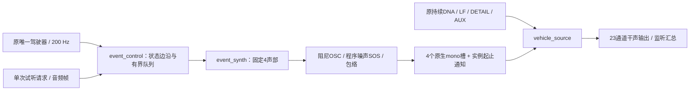

# 独立事件声源与提参 V1

同日后续：[事件音色工作台与配方V1](事件音色工作台与配方V1.md)已增加事件设计页、实际C参数试听和每实例覆盖。当前独立窗口V3／ABI4，旧V2／ABI3保留。下文为本事件声源初版记录。

2026-11-16。新增纯合成事件系统已接入声源控制台 V2。认可的持续 DNA 配方不变；新事件默认关闭，是待听评的素材驱动候选，不代表启动、回火及全生命周期音色已经完成。

## 当前能体验什么

运行 `Build-Vehicle-Source.ps1`，再运行 `Launch-Vehicle-Controller.cmd`。窗口标题带 V2；原 V1 窗口及冻结交付保留。工作台的驾驶按钮继续打开独立窗口，服务更新后需重新启动工作台服务以采用新版启动器。

“独立事件”页提供：事件总电平、分类型电平、音高、时长/衰减、程序纹理占比和单次试听。电平实时生效；其他宏参数在下一次触发采用。单次试听不自动启动发动机。开启事件候选后，正常启动按钮会按原驾驶器的拖转→接火→运行状态触发事件，并与持续 DNA 交接；旧回火/起动机及旧启动附加层在该模式下关闭，避免叠加两套事件。关闭候选模式后采用原声源链。

“音色与分层”页可分别独奏四个事件槽；四槽是复用的音频通道，不等于四个永久声音对象。保存行程及离线导出会保留事件实例身份和帧时间。

当前参数库只有两种可用候选：

| 类型 | 原素材及范围 | 已知边界 |
|---|---|---|
| 启动早期纹理 | 获批 A，36.65–37.12 s；背景35.0–36.2 s | 车内混合录音，不能称为物理隔离的起动机。自动随拖转状态运行；单次试听约0.8 s后释放。 |
| 接火补充 | 获批 A，37.22–38.02 s；同背景 | 含连续发动机能量，非独立点火脉冲；应保守叠加，未建立实测物理RPM轨迹。 |

啮合、收油回火、换挡、脱开、停机末响已有类型与触发接口，但没有合格参数时保持禁用。A尾排短片段及F3换挡语境未通过本版背景对比检查，保存为仅分析结果，没有降低门槛或生成通用爆音代替。D36–44 s保留原“固定条件下无独立候选”结论。

## C模块



| 文件 | 职责 |
|---|---|
| `modules/event_synth/profile.c` | 参数合法性与资源上限检查 |
| `oscillator.c` | 最多12个正弦模态；每模态频率、固定起始相位、衰减及可选频移 |
| `excitation.c` | 每声部独立随机流，最多4个短SOS噪声滤波带 |
| `envelope.c`、`voice.c` | 起音、自然终止、受控释放；每次触发复制参数，后续编辑不改变已经起音的声部 |
| `pool.c` | 4声部容量、优先级、3 ms抢占淡出、开始/结束/拒绝通知；不额外开第5个尾音声部 |
| `modules/event_control/policy.c` | 观察原驾驶器状态和已有收油/换挡计数，不重复车辆积分或回火武装判断 |
| `scheduler.c` | 16项固定队列，按绝对音频帧调度，未来连发的取消及溢出计数 |
| `modules/vehicle_source/events.c` | 连接两模块、实时分类型增益、逐样本同钟输出 |
| `tools/vehicle_controller/events.py` | UI控件；不实现DSP或另一个驾驶器 |

启动、接火、收油、换挡的延迟和连发策略属于工程控制设定，非从视频反推出的ECU时序。自动回火沿用原驾驶器的资格判断，增加18 ms起始延迟及1–3个有界事件；换挡短声延迟10 ms。无素材类型不会产生事件。

运行时无PCM读取/回放、文件I/O、分配或房间处理。原声源适配器仍含历史空间存储/链接依赖，处理入口继续绕过空间计算。尚未做算力优化或ADI板测。

## 可复用提参流程

输入一个48 kHz已解码主文件，指定事件区间、同文件背景区间、事件类型、录音视角/语境。示例位于 `examples/event_authoring`。

```powershell
python tools/author_event.py examples/event_authoring/A_crank.job.json --output <新目录> --dependencies E:/VehicleSoundLab/tools/python_deps
python tools/compile_event_bank.py --profile <crank/profile.json> --profile <catch/profile.json> --output voices/events_v1
./Build-Vehicle-Source.ps1
```

Python需安装NumPy、SciPy、SoundFile；本机启动器采用已配置的Python运行时，分析依赖目前在上述本地目录。每次作者工具输出到新目录，保存输入任务、主文件哈希/区间、背景、测量、参数、原声、合成预览及执行源。事件/背景总功率对比不足3 dB时仅输出分析，退出码3，不编译参数。这是V1的保守适用条件，可能拒绝低频背景很强而高频明显的事件；不等于判定录音无回火。

测量：通道功率平均、统计背景功率扣除、最多12个谱峰、选定单声道观测的复投影相位、四个频带的起音与衰减。拟合：阻尼模态加程序噪声频带，以一个总电平匹配统计超出背景的能量。PSD扣除不构成真实声源分离；35%的峰值分配、拟合范围、无可拟合衰减时的回退值及触发共同±0.2%频率偏差均在输出中明确标为工程选择。

`profile.json`中的`parameters`可编辑每个模态的Hz、幅度、相位、衰减和末端Hz，以及每个噪声带的中心频率、Q、幅度、起音和衰减。重新编译事件库后才进入C；当前UI宏参数不会反向改写材料测量。没有追加房间IR，也没有从原素材物理去混响。

## 接口与回放

桥接ABI3：`VsControl`336字节、`VsTelemetry`152字节、`EsNotice`40字节。运行库位于 `build-vehicle-source-v2/bin/Release`；旧V1构建和冻结行程播放器独立保留。

16类分轨、23个原生通道：原19通道加4个事件mono槽。监听居中权重是电气汇总，不是空间渲染。通知包含类型、实例ID、槽、实际帧、请求帧、动作和原因；生命周期用`[开始帧,结束帧)`表达。抢占延迟在通知中可见。实例ID仅在一次引擎生命周期内唯一，外部需结合流身份使用。

新行程格式 `vsl.source-controller-take/3` 绑定DLL、完整voices库、编译事件库哈希及stream_id。离线命令：

```powershell
python tools/render_vehicle_take.py <take.vsltake.json> --output <绝对输出前缀>
```

导出完整混音、各原生分轨和`_events.json`。事件库JSON与DLL中的编译身份不一致时拒绝启动；旧行程不强行用新版回放。

## 验证与未完成工作

独立核检查：确定性、解析正弦对照、4声部上限、优先级淡出、实例切换、释放和缺失参数。策略检查：状态边沿不重触发、精确帧调度、手动序号、取消及队列上限。源联调检查：第137帧触发、不同分块的声音/身份一致、启动唯一触发、23通道重建和无重复旧事件。

这些检查不证明音色自然或完整实车可用。仍需：补充可辨识的回火/短机械事件素材、听评并完善启动候选、验证全生命周期听感、事件作者工具的工作台页面与车辆配方打包、长时间驾驶/并发压力验收，以及后续目标板移植。完整目标继续进行。
