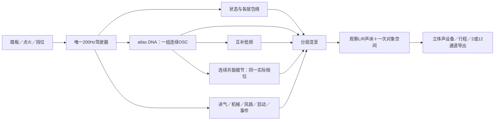

# Vehicle Sound Lab 算法说明

面向工程接手 · 2026-11-12。当前529份C/H、52项CTest；完整实验历史见[开发留痕](开发留痕.md)及各研究快照。

## 当前系统



驾驶层每240个音频样本更新一次，即48kHz下200Hz；声源逐样本持续生成。RPM、挡位、车辆速度、喷油资格和状态只由`src/drive`维护。宿主负责输入及设备，不自行再算一套转速。

| 模块 | 责任与入口 |
|---|---|
| `src/drive/`、`src/core/orchestrator.c` | 车辆与启停／换挡状态；各声层独立包络、切扭与恢复 |
| `modules/sound_dna/` | 模型校验、相关随机幅度、固定平均相位谐波叠加及参数平滑 |
| `modules/dna_atlas/` | 一个相位跨多档参数，按声学根音插值幅度／平均相位；记录范围内外状态 |
| `modules/harmonic_body/` | 从同一OSC样本提取互补低频，交给机体包络；不新增总能量 |
| `modules/residual_atlas/` | 旧可选512正弦细节层，插值谱协方差，默认0 |
| `modules/resonant_detail/` | 连续随机激励、AR／SOS共振器、弱周期能量形状；参数IO独立 |
| `modules/drive_resonance/` | 将上述共振核接到实际DNA相位；逐锚点参数／缺项／局部范围、独立量 |
| `modules/drive_aux/`、`src/core/events.c` | 进气／机械／空气／道路／风的工程层，以及换挡／回火等程序瞬态 |
| `modules/start_texture/`、`modules/catch_bloom/` | 可选CRANK启动OSC谱形；由完整DNA派生的CATCH低频增量 |
| `modules/atlas_drive/`、`stereo_bed/`、`src/spatial/` | 统一调度、分轨、一次声床／对象路由与空间输出 |
| `atlas_monitor/`、`win_output/`、`atlas_take/`、`atlas_take_io/` | 启停淡变、设备、拥有模型的行程重合成及非实时文件操作 |

旧`src/core/dna.c`和`.dna`属于历史驾驶声源。新atlas链使用`.model`统计参数，复用原驾驶控制器；其音色状态与固定情境研究监听分别记录。

## Sound DNA保存什么

离线按车型、录音视角和声学根音取段，提取左右复谐波均值、共同变化方向、残差协方差及时间相关性。运行生成新的相关随机变化，沿固定平均相位叠加：

```text
z[k,c] = mean[k,c] + detail × variation[k,c]
y[c]   = Σ |z[k,c]| × cos(k × phase + mean_phase[k,c])
```

参数中没有PCM循环和原录音的系数时间轴。持续生成长度与音高独立。固定相位用于减轻此前高细节量下的颤动；平均频谱和统计变化沉淀下来，原素材全部瞬态并未因此还原。

驾驶atlas按`RPM × root_per_rpm`得到声学根音。当前映射包含工程假设，**负载主要作用于包络，尚无完整“同RPM、不同负载”的实测声纹轴**。A车外、E车内以及不同动作的锚点保持各自语境；不能把驻车降转当成带载升转。

## 连续共振细节与低频

新增可选`stereo_resonance`双通道VAR／SOS连续细节核，另由`stereo_resonance_io`非实时事务加载；保留跨声道时间关系，未接驾驶默认。A启动后车内稳定段已有8带候选，600–850Hz不可加预算留空；没有新房间处理或热怠速标定。原521份C/H保持，52项CTest和3×48秒C生成核对通过，音色待听评。见[低转双声道细节](../research/低转双声道连续细节V1.md)。

新细节核用素材拟合的固定Hz共振器和连续激励重建部分不规则细节。`drive_resonance`保存主DNA采样前的实际相位，结合采样后根音／锚点权重；预热与运行均采用相同周期原点。静音和范围外仍推进RNG／滤波状态，回到范围时不重启。

当前驾驶研究只接A驻车低转`idle_add`候选。0.96–1.04倍根音保留，向0.90／1.10平滑淡出；缺参数档位不填充。该掩码是工程约束，不能代替实测RPM／负载覆盖。细节量乘原DNA驾驶包络，再进入统一混音／空间。它是附加层，尚未把行驶35%谐波替换移进驾驶atlas。

踏板行程实测暴露了范围缺口：控制器850工程RPM怠速映射约7.083Hz，低于10.006Hz低转细节参数的启用区，故稳定怠速的新细节输出为0。16秒行程中加速仅经过该范围约0.0334秒；需补对应参数及映射依据，不能据“接入成功”认定状态音色完成。

低频有两条不同路径：驾驶`harmonic_body`对原DNA做互补分层；固定情境研究的相干LF使用独立Sound DNA参数。后者曾获厚度／发动机感认可，前者不能继承这一听评。接火低频候选的改善未获认可。

## 状态与触发

| 状态 | 触发与声音调度 |
|---|---|
| OFF／READY／STOPPING | 点火输入与生命周期；燃烧、旋转机械和传输停止分别管理 |
| CRANK／CATCH | 启动资格触发拖转、接火进度；可选启动OSC／接火低频按各自进度和包络运行 |
| IDLE／FREE_REV | 运行后低转／空挡升转；同一DNA时钟，工况调整各层包络 |
| PULL／CRUISE／OVERRUN | 挡位、节气门、加速度和负载共同判断；RPM驱动锚点，负载／断油影响声层权限 |
| SHIFT_CUT／RECOVER／REV_MATCH | 挡位变化触发切扭、恢复与补油；各层保持不同响应速度 |
| 回火 | 开关启用后，由符合转速／负载／释放条件的事件触发，带冷却限制 |
| 道路／风 | 随车辆运动变化，熄火滑行时也可继续 |

自动挡沿用运动策略：松油保挡，制动时安全降挡。状态控制可运行；各状态实车音色和时序仍须分别校准。事件激励、滤波噪声和连续共振已获算法边界授权，系统各层并非严格纯正弦OSC。

## 空间、录放与实时边界

观察L/R保留录音视角的声道关系。声床模式将其一次映射至FL/FR；辅助／事件进入既有对象空间路径。当前12通道声床的其余10通道为0，没有凭空增加实测空间信息；对象路径也只是工程投影。房间、宽度、视角与传播与声源分开，可关闭。

正式行程为`.vslrun` **schema6／28控制字段**，拥有模型、随机种子、映射和实际采用控制帧。新细节库及源哈希已纳入，保存后可清空外部模型再重放。旧格式使用各自冻结播放器，新旧格式与渲染身份严格区分。

声源处理不分配内存、不读文件、不操作UI。模型加载／验证、滤波预热、行程文件IO在非音频线程。设备当前为stereo；2／12导出通过公共渲染边界。

## 已认可与待完成

| 范围 | 当前结论 |
|---|---|
| A固定行驶情境 | 持续DNA自然质感、相干LF及后续共振替换35%获得阶段性偏好；按用户决定保留35%，停止该片段调音 |
| 被否决方向 | 独立高频OSC云、原生共同微扰的整体音色、70%强替换及中频保护V2不采用 |
| 新低转细节 | 已接统一驾驶／原生／行程，原听评仍待；踏板核查确认850工程RPM稳定怠速不在其支持区，完整怠速声纹未完成 |
| 带载加速 | 控制／多锚点可运行；低中转、同RPM负载差异及升转高频细节尚缺完整标定 |
| 多种音色 | 共用参数结构；实际获批A／B／D／E四份录音，主要是Performante／Tecnica家族V10。尚无多发动机还原验收 |
| 工程验证 | 当前52项CTest；此前84旧WAV及3条CSV一致、768123帧静音踏板录放／分轨／自包含2／12通过；新双声道细节另有3×48秒离线核查 |
| 后续验收 | 新层真实踏板状态、长期设备、人工鼠标和物理7.1.4；功能／数值通过不代替音色听评 |

`Build-System.ps1`构建与测试。`Launch-Drive-Resonance-Study.cmd`打开统一驾驶低转细节研究，默认停止／未点火／细节0。`Launch-Resonant-Source.cmd`保留独立固定配方监听，含行驶35%及低转候选。

当前接口见[C模块与接口](C模块与接口.md)，最新验证见[连续细节驾驶接入](../research/连续共振细节统一驾驶V1.md)，续接步骤见[研究续接](研究续接.md)。
