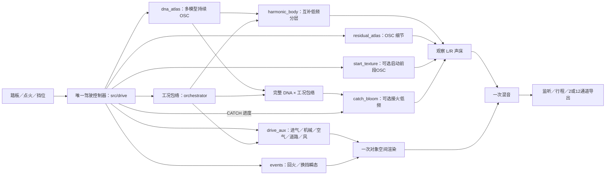

# Vehicle Sound Lab 算法说明

面向工程接手 · 2026-11-12 · 当前源码；历史实验与失败版本见[开发留痕](开发留痕.md)。

最新[边界核查与听评](../research/动作转速与高频边界V1.md)：接火低频未获改善认可；启动RPM／时间是工程设定。启动与低档DNA最高保留谐波约8.92kHz／2.88kHz，残差主要补至8kHz且旧页未接入；完整RPM×负载×状态声线、时变细节与对应设计控件尚缺。当前持续声由静态统计模型生成新OSC，不循环原片，但不能把有限情境拟合和功能测试当作完整音色还原。

最新[启动细节原生接入](../research/启动细节原生接入V1.md)将已冻结同A细节模型装入统一驾驶宿主，独立细节量与启动／接火层共用一个控制器，沿用schema5行程。实时库不改；46项CTest、原生控件消息自检、短设备及自包含录放通过。文中汇总各状态参考／对照，完整状态音色与长期运行仍待验收。

系统分为**驾驶控制、Sound DNA、低频、细节／事件、空间、宿主**。新 DNA 已接入统一驾驶系统；音色听评与工程接入分别记录。

最新[启动车内细节](../research/启动车内细节V1.md)复用当前C库，在同A趋稳DNA上增加独立平均协方差OSC候选。11带可加，600–850Hz不满足独立叠加条件而保持0；当前仅独立离线宿主，未接原生默认或获听评。469份C/H中原468份字节及职责不变，45项既有测试未重复。

当前[接火层统一驾驶](../research/接火低频统一驾驶V1.md)将同A趋稳车内DNA、启动前段OSC及接火低频接入同一C控制／监听／行程；入口`Launch-Catch-Study.cmd`，默认停止、接火量0%。启动前段由CRANK进度选谱矩，接火低频由CATCH进度控制固定滤波附加量。快速接火音高、高频及完整启动仍未还原，新音色待听评。

可选[立体声声床](../research/立体声声床接入V1.md)保留DNA／低频／细节观察L/R，辅助与事件进入一次对象空间渲染。已有[六类状态参考](../research/系统运行与状态素材V1.md)及[驻车局部C对照](../research/驻车状态局部对照V1.md)；系统短时功能通过，换挡、收油等状态音色未完成同动作验收。新谐波幅度50%／100%收到“原版更好”反馈，未晋级实时C。

## 系统与 C 模块



| 模块 | 工程责任 |
|---|---|
| `src/drive/`、`src/core/orchestrator.c` | 200 Hz 更新车辆、RPM／负载、启停、换挡、喷油资格和各层包络 |
| `modules/sound_dna/` | `profile`校验模型；`texture`生成统计变化；`oscillator`叠加固定平均相位谐波；`voice`平滑音高／细节／增益 |
| `modules/dna_atlas/` | 多档模型由一组 OSC 连续插值；按明确的声学根音／RPM 映射选锚点 |
| `modules/harmonic_body/` | 从同一谐波输出取低频，互补分给 DNA／机体包络；并非独立测得的车体声源 |
| `modules/residual_atlas/` | 在驾驶锚点间插值谱协方差；持续的512条正弦补充谐波间细节，默认量0 |
| `modules/drive_aux/` | 复用机械模态／NVH，分出五路辅助层，量分别默认0；不运行第二套驾驶控制器 |
| `src/core/events.c` | 程序振荡、噪声与衰减包络生成瞬态；不播放原片段 |
| `modules/start_texture/` | 兼容单／双谱矩模型；持续OSC谱形插值、独立量与CRANK门控，不替代运行DNA |
| `modules/catch_bloom/` | 同一完整包络后DNA经固定带通与CATCH包络产生独立低频附加量，已可选接入监听／行程；不重新合成整套DNA |
| `modules/atlas_drive/`、`src/spatial/` | 统一调度、独立捕获、十对象汇总与一次空间渲染 |
| `modules/stereo_bed/` | 可选观察声床一次宽度／布局；2／12通道只占FL/FR，不当作物理缸列，不与对象重复 |
| `atlas_monitor`、`win_output`、`atlas_take`、`atlas_take_io` | 传输／设备、成功提交帧上的控制录制、非实时文件保存与重合成 |

旧 `src/core/dna.c` 仍属于冻结的旧驾驶声源；新驾驶链复用其控制系统，**不叠加旧 DNA 声源**。旧 `.dna` 与新 `.model` 是不同模型契约。

## Sound DNA 如何生成

离线按车型、视角、声学根音取段，对齐周期，提取左右复谐波系数，保存均值、共同统计变化方向、残差协方差和时间相关性。模型不保存 PCM 循环或系数时间轴。稳定单音入口为 `tools/compile_sound_dna.py`；移动素材另需声线跟踪／周期校准。

运行时生成新的相关随机幅度，沿已认可的固定平均相位叠加：

```text
z[k,c] = mean[k,c] + detail × variation[k,c]
y[c]   = Σ |z[k,c]| × cos(k × phase + arg(mean[k,c]))
```

固定相位用于减轻高细节量下的颤动。持续生成的长度独立于音高；独立监听契约为48 kHz、0.90–1.10倍音高，驾驶适配器另有锚点范围。录音 L/R 是观察声道，不直接对应左右缸组。

## 工况与触发

| 状态／输入 | 声音行为 |
|---|---|
| 点火／启动 | 生命周期区分拖转、接火和运行；旋转机械与燃烧资格分别门控 |
| 带载加速／巡航／空挡补油 | RPM改变音高／锚点；负载和节气门改变各层独立包络 |
| 收油／断油 | 保留机械拖转；燃烧与排气空气按喷油资格释放，不把全部声层同时静音 |
| 换挡 | 挡位控制触发切扭／恢复；各层采用独立包络。运动自动挡松油保挡、制动时安全降挡 |
| 降挡补油 | 控制器决定离合与短时补油，随后恢复正常工况 |
| 回火 | 开启回火后，由收油事件或符合条件的升挡事件触发；有负载／RPM等限制，并非每次松油必响 |
| 道路／风 | 按车速变化，熄火滑行时仍可继续 |

这些层已集成在同一系统；其频率、声级与工况谱形仍主要是工程配方。回火等瞬态采用事件激励，NVH包含滤波噪声；整套系统并非每一层都只用纯正弦。

## 哪些音色得到认可

- **固定情境**：A移动尾排的持续 Sound DNA，以及后续“实测相位”相干低频，获得自然质感／发动机感／厚度认可。通过 `dna_scene` 独立联合监听；该低频仍使用 Sound DNA 模型契约。
- **驾驶实验**：A驻车车外四锚点、E车内两锚点已接入新驾驶链，尚未获得完整音色听评；驾驶低频互补分层不能继承固定情境的低频验收。
- **通用性**：实际取得四份录音 A／B／D／E，覆盖 Performante／Tecnica 两车型，主要仍是同一家族 V10。共用算法可换模型；尚未证明 V8／V12／911或任意复音合成器音色的还原能力。
- **高频／空间**：高频幅度候选未获认可，独立密度候选仍待听评，[residual_dense](../research/可变载波密度V1.md)尚未接驾驶默认。[左右声纹复核](../research/左右声纹与叠加预算V1.md)只找到D台架两带的稳定局部传递，B／E车内未形成合格通用候选；A近双mono。新可选声床已保留生成模型的L/R并进入12通道FL/FR，未新增空间信息；真实位置、多声道监听与音色仍待验收。房间／视角／传播在声床模式只作用于工程对象。

C声源处理不分配内存、不读文件、不操作UI。模型载入／校验与 `.vslrun` schema5保存均在非音频线程；行程保存模型、seed、声床模式和27字段控制，再经相同算法重合成。旧schema4／3／2／1使用对应冻结播放器。当前索引469份C/H，统一接火构建的45项CTest通过；四种48kHz／512帧短时静音设备场景均无断流或块超时，144123帧行程录放及2／12离线源一致通过。当前设备为stereo；5ms离线场景曾超时，完整状态标定、长期性能和实际7.1.4仍需验证。

完整接口见[C模块与接口](C模块与接口.md)；当前接入证据见[接火低频统一驾驶](../research/接火低频统一驾驶V1.md)，续接路线见[研究续接](研究续接.md)。
