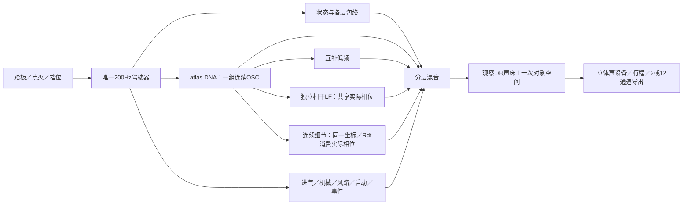

# Vehicle Sound Lab 算法说明

最新离线提取核查：[实测声线结构V1](../research/实测声线结构V1.md)取消实际声线列表输入，仍声明五分之一候选格点。17例通过16例，密集36声线的共同相位仍偏，续算300次未修复；因此没有新怠速／加速参数。小频谱残差不能证明相位正确，下一步检查实慢幅度表示与共同相位耦合。实时C、既有参数及行驶35%保持。

面向工程接手 · 2026-11-13。当前540份C/H、55项CTest；完整实验历史见[开发留痕](开发留痕.md)及各研究快照。

最新[少数声线独立相位](../research/少数声线独立相位V1.md)从观测残差自动选择最多2条有界实相位变化，其余声线继续约束共同坐标。12例中10正例过原误差门槛、2反例由支持判据拒绝；原5阶失败误差下降约12.7倍。仍是已知声线低带宽离线研究，求解到120次上限；尚须未知结构、原33例和逐条14kHz验证，无实录／实时音色更新。

最新[有限窗共同相位](../research/有限窗共同相位V1.md)将声线系数、正慢变幅度和共同相位通过真实有限窗联合拟合；投影／导数独立核查通过，5／6正例通过误差门槛，单线反例正确拒绝。局部独立相位仍污染共同坐标，继续300次未解决；这是离线原理研究，未获原33例／14kHz完整资格，无实录或实时音色更新。

最新[共同支持与瞬时相位](../research/共同支持与瞬时相位V1.md)将连续根音投回原3峰支持区域，23项边界控制通过，快速1001帧粗路径恢复；完整33例仍32通过。低到高参考候选在第一轮低阶也失败，未采用；下一步拟合有限窗前向响应及相位曲率。29例高频证据经精确坐标／造波代码核对后复用，无实录或C音色更换。

最新[实测根音与高频保留](../research/实测根音与高频保留V1.md)确认时间坐标误差可带走谐波细节；新的实测峰加权中位数候选将两组干扰的格点误差由0.55／1.88降至0.055／0.096dB，逐条高频检查也通过。33项通过32项，急升转仍拒绝，无新实录／C音色；下一步修连续提案的共同支持约束与有限窗瞬时相位。

最新[分数谱线提取](../research/分数谱线与相位提取V1.md)扩为2048点／主周期、14kHz源带宽，并补完整与相干功率双检查。最终29项通过26项，7／15阶遮蔽及急升转仍失败，整体未取得资格；没有实录新拟合、DNA或C试听。完整频带总量接近不能替代谐波细节保留验证。

最新[低转周期与带宽诊断](../research/低转周期结构与带宽V1.md)：E原低转候选存在五分之一谱线间隔；已知信号确认短窗串扰可能造成相位不一致，尚无完整周期／新DNA认定。若需五倍长周期，现320谐波／1024点会将覆盖降至约2.1／2.45kHz，必须同时设计高频表示，不能只改根音。C、模型、行驶35%保持；真实怠速及完整带载加速仍未完成。

当前[行驶完整配方统一驾驶](../research/行驶完整配方统一驾驶V1.md)已将保留35%的DNA替换、独立相干LF与连续细节接到同一驾驶／原生／schema8行程。未改原模型或继续调行驶音色；真实怠速及带载加速参数仍缺。

补充[E驻车／起步核查](../research/E驻车与起步低转核查V1.md)：车外短平台有谐波族，但现有80ms粗追踪中断，尚无新DNA；车内78秒附近为剪辑后约1秒低转再蓄转起步，不能整段标为怠速。需先独立验证有缺测／旁带的追踪方法，不把参数提取失败等同于原录音没有声纹。实时540C/H与音色模型未改。

后续[多谱线离线提取](../research/多谱线声学坐标V1.md)通过15正／3反已知信号的音高、高频功率和左右关系验证，并恢复原E固定片段的粗轨迹；实录仍未通过相位一致性，未导出新DNA。当前应诊断周期格点／旁带与录音混合，不将约33Hz谱线间隔直接当怠速周期或继续裁窗找通过。实时模块和模型保持。

新增[B驻车提取核查](../research/B驻车声纹验证V1.md)：独立已知信号与新合成测试参数的实际C持续生成通过；三段真实B候选未过留出条件，无真实新DNA或实时改动。只读取了[补充候选](../research/怠速与加速补充素材V2.md)的网页信息，待用户审阅；不能将测试参数加载成功写成怠速音色完成。

素材纠偏：[B视频复核](../research/B素材状态纠偏V1.md)已确认旧`B_cabin_steady`84–94秒为车外前备厢开合，排除其车内／发动机标定用途。B行驶片段也含换挡／转弯，现有标签不能代表单一负载。已补音轨约36.3ms关系与驻车／起步候选目录；无新音色、C或模型变更，以下53项为既有验证而非本轮重跑。

## 当前系统



驾驶层每240个音频样本更新一次，即48kHz下200Hz；声源逐样本持续生成。RPM、挡位、车辆速度、喷油资格和状态只由`src/drive`维护。宿主负责输入及设备，不自行再算一套转速。

| 模块 | 责任与入口 |
|---|---|
| `src/drive/`、`src/core/orchestrator.c` | 车辆与启停／换挡状态；各声层独立包络、切扭与恢复 |
| `modules/sound_dna/` | 模型校验、相关随机幅度、固定平均相位谐波叠加及参数平滑 |
| `modules/dna_atlas/` | 一个相位跨多档参数，按声学根音插值幅度／平均相位；记录范围内外状态 |
| `modules/harmonic_body/` | 从同一OSC样本提取互补低频，交给机体包络；不新增总能量 |
| `modules/drive_recipe/` | 拥有独立LF模型／功率mask，替换量随细节支持退出；LF复用主DNA相位、独立量与包络 |
| `modules/residual_atlas/` | 旧可选512正弦细节层，插值谱协方差，默认0 |
| `modules/resonant_detail/` | 连续随机激励、AR／SOS共振器、弱周期能量形状；参数IO独立 |
| `modules/stereo_resonance/` | 双通道VAR／独立随机激励／SOS细节；稳定证书非实时校验，无周期或RPM时钟 |
| `modules/drive_resonance/` | 同一DNA坐标下逐锚点选择Rdt／Rvs；拥有参数／缺项／局部范围、独立量 |
| `modules/drive_aux/`、`src/core/events.c` | 进气／机械／空气／道路／风的工程层，以及换挡／回火等程序瞬态 |
| `modules/start_texture/`、`modules/catch_bloom/` | 可选CRANK启动OSC谱形；由完整DNA派生的CATCH低频增量 |
| `modules/atlas_drive/`、`stereo_bed/`、`src/spatial/` | 统一调度、分轨、一次声床／对象路由与空间输出 |
| `atlas_monitor/`、`win_output/`、`atlas_take/`、`atlas_take_io/` | 启停淡变、设备、拥有模型的行程重合成及非实时文件操作 |

旧`src/core/dna.c`和`.dna`属于历史驾驶声源。新atlas链使用`.model`统计参数，复用原驾驶控制器；其音色状态与固定情境研究监听分别记录。

## Sound DNA保存什么

离线按车型、录音视角和声学根音取段，提取左右复谐波均值、共同变化方向、残差协方差及时间相关性。运行生成新的相关随机变化，沿固定平均相位叠加：

```text
z[k,c] = mean[k,c] + detail × variation[k,c]
y[c]   = Σ |z[k,c]| × cos(k × phase + mean_phase[k,c])
```

参数中没有PCM循环和原录音的系数时间轴。持续生成长度与音高独立。固定相位用于减轻此前高细节量下的颤动；平均频谱和统计变化沉淀下来，原素材全部瞬态并未因此还原。

驾驶atlas按`RPM × root_per_rpm`得到声学根音。当前映射包含工程假设，**负载主要作用于包络，尚无完整“同RPM、不同负载”的实测声纹轴**。A车外、E车内以及不同动作的锚点保持各自语境；不能把驻车降转当成带载升转。

## 连续共振细节与低频

可选`stereo_resonance`双通道VAR／SOS细节由独立IO加载，已通过既有`drive_resonance`接同一驾驶／原生／拥有行程，默认量0。A启动后车内稳定段拟合8带，600–850Hz不可加预算留空；无新增房间或热怠速标定。见[统一接入与限制](../research/双声道细节统一驾驶V1.md)。

新细节核用素材拟合的固定Hz共振器和连续激励重建部分不规则细节。`drive_resonance`保存主DNA采样前的实际相位，结合采样后根音／锚点权重；预热与运行均采用相同周期原点。静音和范围外仍推进RNG／滤波状态，回到范围时不重启。

研究入口分别使用A驻车车外`idle_add`、A启动趋稳车内Rvs、A行驶35%完整配方，不混机位。0.96–1.04倍根音保留，向0.90／1.10平滑淡出；缺参数档位不填充。掩码是工程约束，不代替实测RPM／负载覆盖。细节量乘原DNA驾驶包络再统一混音／空间；行驶35%由`drive_recipe`动态撤去对应谐波功率，细节关闭／越界则恢复原DNA。

踏板行程实测暴露了范围缺口：控制器850工程RPM怠速映射约7.083Hz，低于10.006Hz低转细节参数的启用区，故稳定怠速的新细节输出为0。16秒行程中加速仅经过该范围约0.0334秒；需补对应参数及映射依据，不能据“接入成功”认定状态音色完成。

上述是车外研究；车内研究沿用已有`base_hz/850`工程映射，本次IDLE32160帧有支持、PULL224880帧细节为0。它不代表车外缺口已解决，亦不是实测热怠速或带载加速标定。

低频有两条不同路径：`harmonic_body`对原DNA做互补分层；相干LF使用独立Sound DNA参数，现通过`drive_recipe`接驾驶器并拥有独立滑条／机体包络。后者曾获固定情境厚度／发动机感认可，前者不能继承这一听评。接火低频候选的改善未获认可。

## 状态与触发

| 状态 | 触发与声音调度 |
|---|---|
| OFF／READY／STOPPING | 点火输入与生命周期；燃烧、旋转机械和传输停止分别管理 |
| CRANK／CATCH | 启动资格触发拖转、接火进度；可选启动OSC／接火低频按各自进度和包络运行 |
| IDLE／FREE_REV | 运行后低转／空挡升转；同一DNA时钟，工况调整各层包络 |
| PULL／CRUISE／OVERRUN | 挡位、节气门、加速度和负载共同判断；RPM驱动锚点，负载／断油影响声层权限 |
| SHIFT_CUT／RECOVER／REV_MATCH | 挡位变化触发切扭、恢复与补油；各层保持不同响应速度 |
| 回火 | 开关启用后，由符合转速／负载／释放条件的事件触发，带冷却限制 |
| 道路／风 | 随车辆运动变化，熄火滑行时也可继续 |

自动挡沿用运动策略：松油保挡，制动时安全降挡。状态控制可运行；各状态实车音色和时序仍须分别校准。事件激励、滤波噪声和连续共振已获算法边界授权，系统各层并非严格纯正弦OSC。

## 空间、录放与实时边界

观察L/R保留录音视角的声道关系。声床模式将其一次映射至FL/FR；辅助／事件进入既有对象空间路径。当前12通道声床的其余10通道为0，没有凭空增加实测空间信息；对象路径也只是工程投影。房间、宽度、视角与传播与声源分开，可关闭。

正式行程为`.vslrun` **schema8／29控制字段**，拥有模型、随机种子、映射和实际采用控制帧。双核类型／稳定证书、独立LF模型／校准量／功率mask及源哈希纳入，保存后可清空外部模型再重放。旧schema7等使用各自冻结播放器，格式与渲染身份严格区分。

声源处理不分配内存、不读文件、不操作UI。模型加载／验证、滤波预热、行程文件IO在非音频线程。设备当前为stereo；2／12导出通过公共渲染边界。

## 已认可与待完成

| 范围 | 当前结论 |
|---|---|
| A固定行驶情境 | 持续DNA自然质感、相干LF及后续共振替换35%获得阶段性偏好；按用户决定保留35%，停止该片段调音 |
| 被否决方向 | 独立高频OSC云、原生共同微扰的整体音色、70%强替换及中频保护V2不采用 |
| 新低转细节 | Rdt／Rvs均接统一驾驶／原生／行程；车内研究在工程怠速处有支持，车外映射仍缺；完整真实怠速声纹未完成 |
| 带载加速 | 控制／多锚点可运行；低中转、同RPM负载差异及升转高频细节尚缺完整标定 |
| 多种音色 | 共用参数结构；实际获批A／B／D／E四份录音，主要是Performante／Tecnica家族V10。尚无多发动机还原验收 |
| 工程验证 | 当前55项CTest；84旧WAV及3条CSV一致、完整配方台架／踏板和旧车内台架实际静音设备录放、分轨／自包含2／12及自身窗口检查通过 |
| 后续验收 | 明确怠速／中低转带载／同RPM负载参数、长期设备、人工鼠标和物理7.1.4；功能／数值通过不代替音色听评 |

`Build-System.ps1`构建与测试。`Launch-Full-Recipe-Drive-Study.cmd`打开同一驾驶窗口的行驶35%配方，默认停止／未点火／房间0，连续细节和相干LF各100%。`Launch-Drive-Resonance-Study.cmd`／`Launch-Stereo-Drive-Study.cmd`保留车外／车内细节研究，默认细节0；`Launch-Resonant-Source.cmd`保留独立固定配方监听。

当前接口见[C模块与接口](C模块与接口.md)，最新验证见[完整配方驾驶接入](../research/行驶完整配方统一驾驶V1.md)，续接步骤见[研究续接](研究续接.md)。
