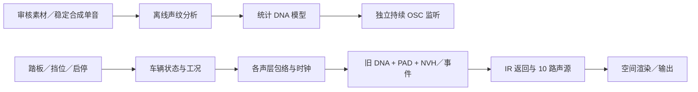

# Vehicle Sound Lab 算法说明

新驾驶链现有自包含行程：`atlas_take`保存实际采用帧上的25字段控制、完整模型／相位和seed，`AtPlayer`按原控制器重新合成；`atlas_take_io`在非音频线程保存 `.vslrun` schema2。录制不保存输出PCM，2／12通道共用声源；旧 `.vsltake`保持独立。schema1用冻结播放器。见[最新模块图与边界](../research/驾驶辅助声层V1.md)。

当前统一驾驶链：新DNA＋互补低频＋可选残差／事件＋五路辅助层 → 一次空间渲染 → 监听／行程。`drive_aux/motion.*`负责曲轴／喷油适配，`voice.*`复用机械模态与NVH，五个量独立且默认0；进气／机械／空气按工况，路／风噪按车速变化。这是工程映射，尚未从素材中完成物理声源分离；固定情境获认可的DNA／相干低频模型保留。

面向工程接手 · 2026-11-11 · 驾驶 DSP 0.20.0 / Sound DNA / 相干低频／多锚点驾驶实验

项目采用“工况控制 + 分层声源 + 声学传递”的结构。声音主体由 OSC 叠加和调制生成，按 **Sound DNA、低频轰鸣、噪音／机械细节** 分层；事件激励用于补充瞬态。

新分析结论：同音高的驻车起落声纹存在总音量之外的谱形变化；四周期Hann仅读中心谐波会遗漏大量谐波间能量，不能通过整体抬高DNA补偿。工况谱形与独立残差需分开建立；见[工况与能量预算](../research/工况声纹分离V1.md)。后续已新增独立C残差模块，已有宿主及认可音色保持原样。

**旧驾驶系统使用旧DNA／PAD／NVH；新Sound DNA保留独立监听，并通过多锚点适配器接入驾驶控制和独立Windows监听。** 新链完整工况音色及产品录制格式待完成；低频V2听评未通过。

后续进展：相干低频 V1 已获得一个固定 V10 情境的发动机感／厚度认可。`modules/dna_scene` 将新 DNA 与该低频接入同一空间渲染链，保留原始观察、独立层、干声及十源分轨，支持离线2／12通道；空间听评和宽RPM／负载驾驶接入尚未完成。见[本轮记录](../research/DNA空间接入V1.md)。

## 1. 算法总览



离线分析负责提取模型；C 运行时负责持续生成。原录音、分析脚本和 UI 均不进入逐样本合成核。

## 2. Sound DNA：从声纹到持续 OSC

### 离线建模

1. **选取与校准**：按车型、录音视角和工况分别取段。通用编译器接受稳定单音／准周期素材，显式指定声学根音 `root_hz`；移动录音需另行跟踪声线、对齐周期。
2. **提取复系数**：共同重采样到每周期 1024 点的分析坐标，以 256 点步长做 FFT，校正窗口起点相位，保留每条谐波的左右声道复系数。
3. **拟合变化**：计算复系数均值；用 PCA 提取跨谐波、跨声道的共同变化，再保存逐谐波残差协方差和一阶时间相关性。
4. **导出模型**：`.model` 保存根音、谐波数、均值、共同变化方向、相关系数和残差矩阵；不保存 PCM 或录音播放时间轴。入口为 [`tools/compile_sound_dna.py`](../tools/compile_sound_dna.py)。

1024 点是分析坐标；模型根音可独立设置，不能由此推断真实缸数或 RPM。当前 V10 模型使用 300 条谐波；两种合成测试音验证了同一算法对其他根音和谱形的适用性。

### 实时生成

对谐波 `k`、声道 `c`，简化表达为：

```text
z[k,c](t) = mean[k,c] + detail × variation[k,c](t)
y[c](t)   = gain × Σ |z[k,c](t)| × cos(k × phase(t) + arg(mean[k,c]))
phase[n+1] = phase[n] + 2π × root_hz × relative_pitch[n] / sample_rate
```

`variation` 由相关随机过程重新生成：共同主成分负责协同起伏，逐谐波残差补足细节，系数更新之间线性插值。**固定平均相位，只改变幅度**，用于减轻原幅相调制在高细节量下的颤动；均值相位未定义时使用零相位。

这能保留谱形和受控变化，连续生成任意帧数，音高调整不改变播放时长。当前接口限定 **48 kHz、音高 0.90–1.10×、细节／增益 0–1**；参数约 18 ms 平滑。载入时要求最高谐波在 1.10× 下不超过 `0.45 × sample_rate`。

## 3. 驾驶链：工况如何改变声音

驾驶模式下，约 **200 Hz** 更新发动机扭矩、离合耦合、车辆阻力、车速、RPM 和负载；台架模式可直接给定 RPM／负载。车辆参数属于工程配方，尚未逐车实测标定。

控制器分别维护启停生命周期和运行工况。后者包括怠速、空挡补油、带载加速、巡航、收油、换挡切扭、换挡恢复、降挡补油。各层使用独立增益包络，工况另调排气谱倾斜与截止频率：带载增强进气和高阶；收油保留机体／机械、压低进气和高阶；换挡按层切扭和恢复。自动挡采用松油保挡、制动时安全降挡。

旧发动机声源以四冲程周期 `f_cycle = RPM / 120` 积分相位，结合点火几何、缸组延迟和排气谱包络计算谐波系数，再叠加高阶 OSC。自定义旧 `.dna` 使用独立音高时钟。点火压力与转动机械分别判定，因此断油时仍可保留机械拖转声。

| 算法模块 | 当前实现与作用 | C 入口 |
|---|---|---|
| 车辆／工况 | 动力学、启停、换挡、喷油资格 | `src/drive/` |
| 声层调度 | 工况映射、独立起落包络与切扭深度 | `src/core/orchestrator.c`、`src/profiles/voicing.c` |
| 新 Sound DNA | 模型载入 → 统计变化 → 固定相位 OSC → 控制平滑 | `modules/sound_dna/{profile,texture,oscillator,voice}.*` |
| 驾驶旧 DNA | 点火几何、排气谱包络、128 阶主声源与高阶延伸 | `src/core/{dna,exhaust_spectrum,high_orders,clocks}.c` |
| 低频轰鸣 | 驾驶 PAD 为转速关联三音；独立 V2 为密集随机 OSC | `src/core/pad.c`、`modules/low_rumble/` |
| 噪音／机械 | 分频随机声、周期调制、机械模态、回火等瞬态；路／风噪随车速变化 | `src/core/{nvh,mechanical,excitation,events}.c` 等 |
| 声学／空间 | IR 返回并入机体源，10 路声源送立体声或离线 7.1.4 | `src/core/acoustics.c`、`src/spatial/` |

10 路声源为排气左右、进气、机体、机械、气流左右、事件、道路、风。分轨取在空间渲染和主音量之前；录音 L/R 是观察声道，不能直接当作发动机左右缸组。

## 4. C 接入与实时约束

| 链路 | 初始化／控制／处理 |
|---|---|
| 新 DNA | `sd_profile_load` → `sd_voice_init` → `sd_voice_set` → `sd_voice_process`；输出交错双声道 `double` |
| 多锚点驾驶实验 | `sa_bank_init` → `ad_render_init` → `ad_render_set` → `ad_render_process`；唯一驾驶控制器，输出 2／12 通道 `float` 与可选分轨／遥测；音高范围依该适配器定义 |
| 独立低频 | `lr_voice_init` → `lr_voice_set` → `lr_voice_process`；输出单声源 `double` |
| 驾驶总引擎 | `vsl_init` → `vsl_set_params` → `vsl_process_layout`；输出 2／12 通道 `float`，可附带 10 源分轨 |

模型在非实时线程载入并检查返回值；运行期间保持模型存活且不可变。每个 voice 独立拥有相位、随机数和滤波状态；控制通过宿主快照交给音频线程，逐样本处理不分配内存、不读文件、不操作 UI。

当前宿主使用 48 kHz／512 帧，每块预算约 10.67 ms。驾驶 DNA／高阶目标系数每 128 帧更新，主要控制约 18 ms 跟随。驾驶 take 记录控制事件、有效旧 DNA／IR、seed 与 DSP 版本，再调用同一引擎重合成；相同二进制与输入可复现，跨编译器不保证位级一致。

## 5. 已验证范围与后续路线

- **DNA**：固定相位 V10 在一个监听情境获认可；宽 RPM、不同负载和其他实车仍需独立模型与听评。单个统计快照不能覆盖整台发动机，任意复音／失谐合成器音色也未验证。
- **低频**：V2 的密集随机 OSC 听评偏风噪、缺少发动机感；后续相干低频 V1 在同低频 RMS 对照中获得“实测相位更像发动机，厚度也改善”的反馈。该层使用原 Sound DNA 契约保留平均相位，仅在 A 移动尾排固定情境获认可，尚非完整转速／负载模型。
- **工程接入**：`modules/dna_atlas/{bank,voice}.*` 用一组 OSC 插值多档幅度与确定性平均相位；`modules/atlas_drive/{control,render}.*` 复用唯一驾驶控制器、工况增益和空间 API，不渲染旧 DNA。已有 E 车内两档与 A 驻车车外四档独立实验库，均待听评；A 的 RPM 映射未标定，低转带宽、素材间隔和实时性能仍有缺口。独立低频／进气／噪音未接入该驾驶链。参见[四锚点算法与模块图](../research/驻车车外四锚点V1.md)。

完整接口见 [C 模块与接口](C模块与接口.md)，低频验证步骤见 [研究续接](研究续接.md)，历史证据见 [开发留痕](开发留痕.md)。

后续`modules/residual_atlas`将A4／E2六档残差接入新驾驶链：一组持续OSC插值谱协方差，根音只选谱形、不重启或整体变调载波。UI新增细节量，默认0；原DNA、残差及对象可分别捕获。零量返回冻结旧15分轨，33项回归和新设备／UI检查通过；完整工况及自然度仍待验证。见[模块图与限制](../research/驾驶细节分层V1.md)。

新增 `modules/sound_residual/{profile,oscillator,voice}.*`：分别管理残差模型、密集正弦声源和控制时钟。离线将录音与DNA的八带功率／交叉谱差额编译为模型，C用512条OSC持续合成1.2–8kHz补充层。A／E分别拟合，训练频带能量补偿有效；E声道关系和时间包络仍不完整。它不替代低频或独立物理噪音源，尚未接入驾驶，音色待听评；见[简明记录](../research/谐波间残差OSC_V1.md)。
