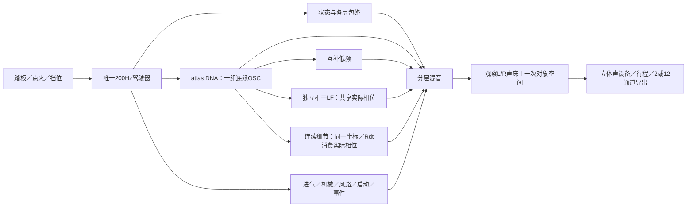

# Vehicle Sound Lab 算法说明

新增[相位与包络分块更新V1](../research/相位与包络分块更新V1.md)：离线受限QP、解析控制与有限预算调度分模块，每步冻结一个参数块，只有受限子问题得到证书。20步完整数值复核通过，快速控制相位恢复仍失败，不能用于新怠速／加速DNA。运行时540C/H和行驶35%保持；下一步研究固定角度／幅度更新的预测失配。

新增[残差尺度与相位起步V1](../research/残差尺度与相位起步V1.md)：离线观测尺度／控制／求解分模块，20总步内保留原固定目标下降条件。损失改善但相位与支持仍失败，没有新DNA或实时变更。20QP及80个固定变量块对照独立重建，下一步检查相位／慢包络的更新分工，不能把单块对照当成已求得的新解。540C/H与行驶35%保持。

新增[正交频带与快速初值V1](../research/正交频带与快速初值V1.md)：离线正交观察／独立声源／检查分模块，保留原频带和白噪声行单位。新旧观察在相同新零相位起点的快速14线控制均失败，40个局部QP与全轨迹独立重建；内部数值通过和高能量保留不能替代相位恢复。尚未进入原36或真实素材提取，下一步先解决观测初始化。实时分层系统、行驶35%和540C/H保持。

新增[观测初值与重叠证据V1](../research/观测初值与重叠证据V1.md)：离线`pullback`／`measure`／`checks`分模块计算同一原始噪声经重叠窗进入目标梯度的完整协方差。9份报告与保存数组回查确认当前是旧观测迁移初值，四组独立源域重建完成；不把窗数当独立支持，也不把梯度协方差当最终相位置信度。近零梯度的原相对审计失败单独保留，前向误差界另核查。没有新的怠速／加速DNA、实时C或音色验收，行驶35%保持。

新增[观测弱方向有限补偿V1](../research/观测弱方向有限补偿V1.md)：独立方向／可行射线模块保留原相位边界和单调性，复用原648变量有界联合补偿，不接入运行时。一次固定正负方向仍可被原观察区分，40个子问题与全轨迹独立重建；小奇异值不能直接代替有边界的有限检验或说明高频丢失。未新增怠速／加速DNA，540C/H及行驶35%保持。

新增[相位归因与数值秩V1](../research/相位归因与数值秩V1.md)：相位响应诊断与秩检查分模块，完整无约束声线逆的前提在数值上失败，不用于生成音色。五阶段检查表明弱方向已存在于原始时域；条件相位84不等于联合相位资格，原约束不能丢。独立审计完成，没有新怠速／加速DNA或实时C更改。

新增[复数径向损失V1](../research/复数径向损失V1.md)：离线提取目标改为复数模长soft-L1，loss／QP适配／拟合／已知控制／独立审计分文件；完整二维Hessian负责相位坐标一致性。已知导数与20个局部求解通过，但密集共同相位p95=0.000264967仍未达0.0001，不能作为新怠速／加速DNA依据。这项修改没有接入实时C，现有540C/H、voices和行驶35%保持。

最新[F2共同变化投影V1](../research/F2共同变化投影V1.md)用两个固定比例描述原局部模型的频率差；六组双声道更符合2／3／5倍频缩放，提示应优先改善连续共同相位提取。它不验证物理阶次，也不输出生成时钟，不能把模型差g(T)当FM／抖动接入。原共同相位资格仍失败，尚无新怠速DNA或C改动；同一驾驶器和分层生成核保持。

最新[F2重叠相位与局部精度V1](../research/F2重叠相位与局部精度V1.md)新增离线重叠观察和单次有界精度修正模块。局部声线放回绝对采样时刻比较，不做相位对齐。已知合法范围端点的数值误差已修正，但原九窗在共享样本上的相位／频率仍不一致，不能据“主线不触边”生成连续怠速DNA。原C分层、唯一驾驶器和行驶35%保持，无新增音色验收。

最新[F2相对变化率V1](../research/F2相对变化率V1.md)只修正离线局部分析：声线越高，同样的转动变化对应越大的Hz/s，因此界限按观测频率相对参考线缩放，独立声线参数和原拟合预算保持。已知例子修复旧高阶截断；实录主线不触边窗增至9/9，但其他线仍失配、残差未解。**这不是共同发动机时钟或新的怠速音色**，尚未进入实时C；唯一驾驶器、DNA／低频／噪音分层及行驶35%保持。

最新[F2边带与相位坐标V1](../research/F2边带与相位坐标V1.md)建立条件复边带／同参数A-Q观察模块。原九怠速窗Q项较音量项更贴近残差，但错相位坐标可产生同类残差、独立双声线可完全等于AM，故不作机械源分类或新DNA。下一步核查原升频率界限的坐标截断；现有C层次、行驶35%及未完成的真实怠速／带载加速保持。

最新[F2局部幅度包络V1](../research/F2局部幅度包络V1.md)仅为离线局部诊断：新增每声线一个实数音量斜率，模型内已知例子可恢复包络，实录九窗误差仅降不足0.4%、主线触边不解且一窗耗尽预算。**不接入实时、不增加怠速完成度**。下一步检查复残差／边带并区分AM／FM／独立邻线，原C分层核和行驶35%保持。

最新[F2谱峰身份V1](../research/F2谱峰身份V1.md)将谱峰身份与强度排名分开：37Hz未消失，45Hz只是暂时更强。新增离散对应／歧义保留模块和独立审计；一次补峰仅降低总拟合误差3.93%，主线仍触边，尚无可靠新怠速DNA。局部峰编号不代表共同相位或真实RPM，现有C生成系统和行驶35%保持。

怠速与带载加速共用同一驾驶器／Sound DNA核，音色参数仍未完成。[最新F2分析](../research/F2局部联合频率V1.md)已修正已知邻线串扰，但实录有局部升频率触边与37→45Hz谱峰身份切换；局部独立幅相拟合不等于共同相位或真实RPM。未生成新DNA或修改C，行驶35%保持。

## 当前系统



驾驶层每240个音频样本更新一次，即48kHz下200Hz；声源逐样本持续生成。RPM、挡位、车辆速度、喷油资格和状态只由`src/drive`维护。宿主负责输入及设备，不自行再算一套转速。

| 模块 | 责任与入口 |
|---|---|
| `src/drive/`、`src/core/orchestrator.c` | 车辆与启停／换挡状态；各声层独立包络、切扭与恢复 |
| `modules/sound_dna/` | 模型校验、相关随机幅度、固定平均相位谐波叠加及参数平滑 |
| `modules/dna_atlas/` | 一个相位跨多档参数，按声学根音插值幅度／平均相位；记录范围内外状态 |
| `modules/harmonic_body/` | 从同一OSC样本提取互补低频，交给机体包络；不新增总能量 |
| `modules/drive_recipe/` | 拥有独立LF模型／功率mask，替换量随细节支持退出；LF复用主DNA相位、独立量与包络 |
| `modules/residual_atlas/` | 旧可选512正弦细节层，插值谱协方差，默认0 |
| `modules/resonant_detail/` | 连续随机激励、AR／SOS共振器、弱周期能量形状；参数IO独立 |
| `modules/stereo_resonance/` | 双通道VAR／独立随机激励／SOS细节；稳定证书非实时校验，无周期或RPM时钟 |
| `modules/drive_resonance/` | 同一DNA坐标下逐锚点选择Rdt／Rvs；拥有参数／缺项／局部范围、独立量 |
| `modules/drive_aux/`、`src/core/events.c` | 进气／机械／空气／道路／风的工程层，以及换挡／回火等程序瞬态 |
| `modules/start_texture/`、`modules/catch_bloom/` | 可选CRANK启动OSC谱形；由完整DNA派生的CATCH低频增量 |
| `modules/atlas_drive/`、`stereo_bed/`、`src/spatial/` | 统一调度、分轨、一次声床／对象路由与空间输出 |
| `atlas_monitor/`、`win_output/`、`atlas_take/`、`atlas_take_io/` | 启停淡变、设备、拥有模型的行程重合成及非实时文件操作 |

旧`src/core/dna.c`和`.dna`属于历史驾驶声源。新atlas链使用`.model`统计参数，复用原驾驶控制器；其音色状态与固定情境研究监听分别记录。

## Sound DNA保存什么

离线按车型、录音视角和声学根音取段，提取左右复谐波均值、共同变化方向、残差协方差及时间相关性。运行生成新的相关随机变化，沿固定平均相位叠加：

```text
z[k,c] = mean[k,c] + detail × variation[k,c]
y[c]   = Σ |z[k,c]| × cos(k × phase + mean_phase[k,c])
```

参数中没有PCM循环和原录音的系数时间轴。持续生成长度与音高独立。固定相位用于减轻此前高细节量下的颤动；平均频谱和统计变化沉淀下来，原素材全部瞬态并未因此还原。

驾驶atlas按`RPM × root_per_rpm`得到声学根音。当前映射包含工程假设，**负载主要作用于包络，尚无完整“同RPM、不同负载”的实测声纹轴**。A车外、E车内以及不同动作的锚点保持各自语境；不能把驻车降转当成带载升转。

## 连续共振细节与低频

可选`stereo_resonance`双通道VAR／SOS细节由独立IO加载，已通过既有`drive_resonance`接同一驾驶／原生／拥有行程，默认量0。A启动后车内稳定段拟合8带，600–850Hz不可加预算留空；无新增房间或热怠速标定。见[统一接入与限制](../research/双声道细节统一驾驶V1.md)。

新细节核用素材拟合的固定Hz共振器和连续激励重建部分不规则细节。`drive_resonance`保存主DNA采样前的实际相位，结合采样后根音／锚点权重；预热与运行均采用相同周期原点。静音和范围外仍推进RNG／滤波状态，回到范围时不重启。

研究入口分别使用A驻车车外`idle_add`、A启动趋稳车内Rvs、A行驶35%完整配方，不混机位。0.96–1.04倍根音保留，向0.90／1.10平滑淡出；缺参数档位不填充。掩码是工程约束，不代替实测RPM／负载覆盖。细节量乘原DNA驾驶包络再统一混音／空间；行驶35%由`drive_recipe`动态撤去对应谐波功率，细节关闭／越界则恢复原DNA。

踏板行程实测暴露了范围缺口：控制器850工程RPM怠速映射约7.083Hz，低于10.006Hz低转细节参数的启用区，故稳定怠速的新细节输出为0。16秒行程中加速仅经过该范围约0.0334秒；需补对应参数及映射依据，不能据“接入成功”认定状态音色完成。

上述是车外研究；车内研究沿用已有`base_hz/850`工程映射，本次IDLE32160帧有支持、PULL224880帧细节为0。它不代表车外缺口已解决，亦不是实测热怠速或带载加速标定。

低频有两条不同路径：`harmonic_body`对原DNA做互补分层；相干LF使用独立Sound DNA参数，现通过`drive_recipe`接驾驶器并拥有独立滑条／机体包络。后者曾获固定情境厚度／发动机感认可，前者不能继承这一听评。接火低频候选的改善未获认可。

## 状态与触发

| 状态 | 触发与声音调度 |
|---|---|
| OFF／READY／STOPPING | 点火输入与生命周期；燃烧、旋转机械和传输停止分别管理 |
| CRANK／CATCH | 启动资格触发拖转、接火进度；可选启动OSC／接火低频按各自进度和包络运行 |
| IDLE／FREE_REV | 运行后低转／空挡升转；同一DNA时钟，工况调整各层包络 |
| PULL／CRUISE／OVERRUN | 挡位、节气门、加速度和负载共同判断；RPM驱动锚点，负载／断油影响声层权限 |
| SHIFT_CUT／RECOVER／REV_MATCH | 挡位变化触发切扭、恢复与补油；各层保持不同响应速度 |
| 回火 | 开关启用后，由符合转速／负载／释放条件的事件触发，带冷却限制 |
| 道路／风 | 随车辆运动变化，熄火滑行时也可继续 |

自动挡沿用运动策略：松油保挡，制动时安全降挡。状态控制可运行；各状态实车音色和时序仍须分别校准。事件激励、滤波噪声和连续共振已获算法边界授权，系统各层并非严格纯正弦OSC。

## 空间、录放与实时边界

观察L/R保留录音视角的声道关系。声床模式将其一次映射至FL/FR；辅助／事件进入既有对象空间路径。当前12通道声床的其余10通道为0，没有凭空增加实测空间信息；对象路径也只是工程投影。房间、宽度、视角与传播与声源分开，可关闭。

正式行程为`.vslrun` **schema8／29控制字段**，拥有模型、随机种子、映射和实际采用控制帧。双核类型／稳定证书、独立LF模型／校准量／功率mask及源哈希纳入，保存后可清空外部模型再重放。旧schema7等使用各自冻结播放器，格式与渲染身份严格区分。

声源处理不分配内存、不读文件、不操作UI。模型加载／验证、滤波预热、行程文件IO在非音频线程。设备当前为stereo；2／12导出通过公共渲染边界。

## 已认可与待完成

| 范围 | 当前结论 |
|---|---|
| A固定行驶情境 | 持续DNA自然质感、相干LF及后续共振替换35%获得阶段性偏好；按用户决定保留35%，停止该片段调音 |
| 被否决方向 | 独立高频OSC云、原生共同微扰的整体音色、70%强替换及中频保护V2不采用 |
| 新低转细节 | Rdt／Rvs均接统一驾驶／原生／行程；车内研究在工程怠速处有支持，车外映射仍缺；完整真实怠速声纹未完成 |
| 带载加速 | 控制／多锚点可运行；低中转、同RPM负载差异及升转高频细节尚缺完整标定 |
| 多种音色 | 共用参数结构；实际获批A／B／D／E四份录音，主要是Performante／Tecnica家族V10。尚无多发动机还原验收 |
| 工程验证 | 当前55项CTest；84旧WAV及3条CSV一致、完整配方台架／踏板和旧车内台架实际静音设备录放、分轨／自包含2／12及自身窗口检查通过 |
| 后续验收 | 明确怠速／中低转带载／同RPM负载参数、长期设备、人工鼠标和物理7.1.4；功能／数值通过不代替音色听评 |

`Build-System.ps1`构建与测试。`Launch-Full-Recipe-Drive-Study.cmd`打开同一驾驶窗口的行驶35%配方，默认停止／未点火／房间0，连续细节和相干LF各100%。`Launch-Drive-Resonance-Study.cmd`／`Launch-Stereo-Drive-Study.cmd`保留车外／车内细节研究，默认细节0；`Launch-Resonant-Source.cmd`保留独立固定配方监听。

当前接口见[C模块与接口](C模块与接口.md)，最新验证见[完整配方驾驶接入](../research/行驶完整配方统一驾驶V1.md)，续接步骤见[研究续接](研究续接.md)。
