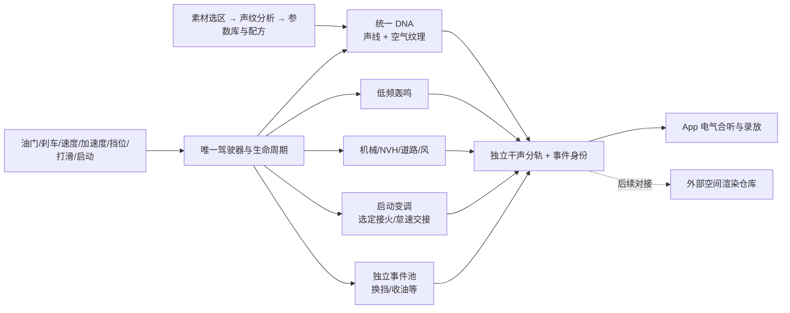

# Vehicle Sound Lab：统一系统报告

更新：2026-11-17。当前入口：`Launch-Vehicle-Sound.cmd`，App V18，声源桥 ABI 12。

V18收敛：DNA为声线＋空气纹理＋机械特征。机械控制并入DNA配方页、仍输出独立干声；旧进气／空气／道路／风模板退出当前生成路径和界面。启动电平0–2.6、默认0.5保持V17默认音量；声音强度、工况倍率和时间参数增加30%扩展区，踏板／概率／离散边界不变。当前库为v16；v15保留原启动电平语义和旧行程。细节、范围表及验证见[App V18参数扩展与机械DNA](AppV18参数扩展与机械DNA.md)。

启动沿用用户选择：Candidate.wav约2–4秒的变调接火 → 同一DNA怠速，前置动作／拖转暂时移除。V17已将其接入普通“启动”和“完整流程”、录制／回放／分轨；驾驶页一个电平，A/B模块退出主App。V17使用v15主声源库，旧v14/v13冻结库保留；7项C回归、原选段波形核对、交接后怠速逐样本一致与真实App录放通过。见[App V17主启动接入](AppV17主启动接入.md)。集成后音色仍由用户听评；加速厚重感淡出尚未处理。

以下V16与更早候选为历史记录，不能理解成当前App仍保留A/B或使用前置拖转。V16曾在驾驶页增加7秒“新启动试听／旧 V3 对照”，见[历史接线](AppV16启动试听接线.md)。

最新交付：[性能优化与持续拖转升级结果V1](性能优化与持续拖转升级结果V1.md)。公共内核五项优化后，PC三场景C处理时间降低9.65–10.25%，12目录及主场景全部分轨最大差3.73e−9FS；新会话使用v14，旧v13及严格回放入口保留。新96组持续OSC拖转已生成独立直接试听，接火／怠速未变，尚待听评及App接入；其单事件计算成本上升单列，不冒充整套系统进一步降算力。以下V1–V3记录为保留的历史过程。

V3听评：用户认为“有优化”，但开头拖转仍不像真车。[拖转原因分析](拖转不像真车原因分析V1.md)已核查时间展开／音高脱耦、独立分音相位关系变化、随机纹理占比与RPM未接入声学驱动；本轮仅诊断，无新候选或DSP／App替换。未宣称其余启动阶段已通过。

最新启动听评认为V2拖转与冲起仍保守、层次少、时长短。已生成[启动表现力候选V3](启动表现力候选V3.md)：回查完整原声、补前置动作、重新提取接火移动分音与残余谱色，动作展开为3.56秒，交接回同一主C怠速；尚待听评，未替换App。V1“风噪感”和V2“表达保守”的反馈均保留。

此前[拖转移动声线V2](启动拖转移动声线V2.md)以40组短时移动OSC补声线，随机纹理只承担剩余谱；该次接火与怠速DNA保持同次输出不变。其技术检查不等于音色认可。

启动优化后续已产出[重建候选V1](启动声重建候选V1.md)：新程序拖转纹理接同一主DNA，关闭候选中的旧接火事件。已导出直接试听音频和可编辑参数；尚待听评，未替换App默认。加速质感淡出的修正仍待完成。

最新听评：用户认可怠速机械厚重感，但认为加速约20km/h后这股质感淡出、声音单薄；刚启用的旧启动候选已被否决。已确认DNA转速混合规则存在音色承接不足，启动候选也未采用已认可的持续DNA生成核。此次仅核查与留痕，未改DSP或默认值。后续先保住怠速身份，完善加速承接和启动建模；详见[启动与加速音色问题诊断](启动与加速音色问题诊断.md)。下文的触发、电平与回放验证均不等于这些音色已获认可。

## 1. 收敛后的主线

**DNA = 进气感声线 + 排气空气感纹理。** 两者共同决定发动机身份，随同一个驾驶器从接火、怠速进入加速、巡航、收油和高转速。低频轰鸣、辅助噪音、独立事件另设分轨。

这次按用户在 App 中的听评修正层次：原“怠速声线”归入进气感声线，原“细谱怠速纹理”归入排气空气感纹理。这里描述**听觉设计角色**；原录音是混合声，尚未实现真实进气／尾排的物理分离。旧独立进气、排气空气模板保留为默认关闭的辅助实验项。



图形文件：[SVG](统一系统主线.svg) / [PNG](统一系统主线.png)。本仓库当前生产入口不计算房间、扬声器分配、传播或空间渲染。

## 2. 每层代表什么

| 层 | 听觉作用 | 当前生成方式与边界 |
|---|---|---|
| DNA · 声线 | 有音高的主体、进气感、转速感和发动机身份 | 主转速时钟驱动的分音 OSC／状态锚点；低转可融入 F2 独立频率声线。原“声线”已从怠速专用控制中移出 |
| DNA · 空气纹理 | 排气空气感、连续细碎感与高频质地 | F2 实测细谱滤波参数＋新生成激励，以及已配置的共振／残差细节。不是独立高频 OSC 云，也不是原录音循环 |
| 低频轰鸣 | 厚度、燃烧／排气的低频相干感 | 保留已认可的实测相位低频路线，独立电平；互补低频分轨与新增相干低频是两个不同控制 |
| 辅助噪音 | 机械、NVH、道路、风及其他环境成分 | 程序模板，默认关闭。旧进气／排气空气模板不再承担 DNA 的核心身份 |
| 启动变调 | 接火冲起、回落与怠速交接 | 默认V10的48组移动OSC＋程序细谱；原前置动作／拖转停用，独立startup分轨 |
| 独立事件 | 回火、换挡、停机末响及历史候选 | 程序激励、OSC／模态共振与包络，4个并发声部；当前V10不叠加旧啮合／拖转／接火／脱开 |

“纯合成”指运行时根据参数生成，**不读取／循环播放录音 PCM**。纹理包含程序随机激励和滤波，因此不能把整套系统称为仅由正弦 OSC 构成。录音机位的谱形仍可能沉淀在参数里；没有附加房间模型不等于已经去除原录音环境。

## 3. 本次实际改动

新增 `modules/dna_character`，把声线、空气纹理及其六组工况倍率放到一个可保存的 DNA 控制契约中。`vehicle_source/character.c`从唯一驾驶器读取状态，处理两条 DNA 干声总线；低频、事件和辅助层不经过这两个总增益。

旧 F2 路径只在 `RUNNING + IDLE` 替换整套声音。新主线去掉这道怠速门控，保留连续的 OSC、滤波器与随机流；回到怠速也不会重启纹理。F2 资产在初始化时复制／编译／预热，处理回调不分配内存、不读文件。

全工况采用明确、可调的工程延伸：

- 声线：低转融入细谱指纹，转速升高后平滑回到主转速 OSC；不把一段怠速声直接拉升十倍。
- 纹理：低转保留完整指纹，高转仍保留指定比例的同一细谱特征；默认 **35%**。这里的 35% 是“高转纹理保留”，与此前获认可的“行驶共振替换 35%”不是同一个参数。
- 指纹声线仅有限跟随转速；细谱滤波器本身保持固定谱形，不声称已测得高转尾排响应。
- 各工况改变两条总线的目标倍率，约 80ms 时间常数平滑；播放中调参不重置声源。首个采样前直接采用初始配方。

具体混合规则：设 `x=clamp((RPM/怠速RPM−1)/3,0,1)`，`n=1−smoothstep(x)`，指纹参与量为 `B`，高转纹理保留为 `C`：

```text
w = B × n                         // 指纹声线权重
a = B × [n + (1−n) × C]           // 指纹空气纹理权重
声线 = 平滑(总量 × 工况倍率) × [(1−w) × 主声线 + w × 指纹声线]
纹理 = 平滑(总量 × 工况倍率) × [(1−w) × 已配置细节 + a × 指纹纹理]
```

这是设计配方，**不是全 RPM／负载实车标定**。默认主线还混合了 A 行驶声纹与 F2 LP-610 怠速特征，不能标成同一台 Performante 的全状态实测模型。

## 4. App 里怎样塑造音色

主窗口固定为“驾驶 / DNA 配方 / 低频与辅助层 / 独立事件 / 信号与回放”。原始素材编辑、车辆配方、独立事件编辑归入同一个工作区；不再新增平行试听 demo。

| DNA 参数 | 听感与使用建议 |
|---|---|
| 进气感声线，0–200% | 主体与有音高的发动机声；先用 100% 为基准 |
| 排气空气感纹理，0–200% | 空气感与细碎质地；先在 70–120% 小范围比较，过高可能盖住声线 |
| 声线自然起伏，0–100% | F2 声线的相关幅度变化，不是新增周期性颤音；未配置指纹时此项无声源可调 |
| 细谱指纹参与量，0–100% | 低转声线／纹理指纹的总体参与程度；0 表示只保留原主声线和已配置细节 |
| 高转纹理保留，0–100% | 离开低转区后还保留多少指纹空气纹理；不能凭此补出不存在的实车高转证据 |
| 指纹声线随转速，0–100% | 指纹声线的有限音高跟随；主发动机声线始终跟随原主时钟 |
| 六组声线／纹理倍率，0–2 | 启动接火、怠速、加速补油、巡航、收油断火、高转区分别可调 |

建议顺序：

1. 输出电平保持一致，先把机械特征和独立事件关掉。用“独奏监听”分别听 DNA 声线和空气纹理，确认每层的作用。
2. 两条 DNA 总量从 100% 起调；先确定声线，再小幅加入纹理，最后调自然起伏。
3. 用“完整流程”检查接火→怠速→加速→收油→停车。用各工况倍率改强弱，不用旧进气／空气模板补主身份。
4. 再加入相干低频，最后加机械和独立事件，避免用厚度掩盖 DNA 的毛刺。
5. “保存参数”保存完整配方；“保存本次行程”保存实际采用的控制动作、参数与精确引擎身份。

高转区指发动机转速达到配置上限的 95%，**不等于车辆最高速度**。车辆高速但转速较低时仍遵循对应的加速／巡航配方；道路和风独立处理。

导入自定义 DNA 不会偷偷继承 F2 纹理。没有配置独立细谱／细节资产时，纹理槽保持静音，App 会提示；两条通用增益仍存在。单状态提取工具目前不能自动为任意新录音生成这一整套独立空气纹理与全工况标定，这是下一项明确的工具能力缺口。

## 5. C 模块与数据边界

| 模块 | 职责 |
|---|---|
| `vehicle_input` + `vehicle_source/driver.c` | 采用控制信号、超时处理；调用唯一驾驶器 |
| `src/drive` | 生命周期、虚拟 RPM／负载、运动自动挡和车辆代理模型 |
| `sound_dna` + `dna_atlas` + `state_dna` | 参数化分音／统计变化、转速锚点、共享时钟的状态声纹 |
| **`dna_character/control.*`** | 两种 DNA 特征、六组倍率的范围和默认值 |
| **`dna_character/voice.*`** | 指纹声线／纹理持续生成、连续混合和平滑，不计算车辆状态 |
| **`vehicle_source/character.c`** | 驾驶状态→DNA 响应行；主线干声接入 |
| `drive_recipe` + `drive_resonance` | 原认可行驶配方、相干低频与共振细节的耦合 |
| `modal_texture` + `spectral_texture` | F2 的独立频率 OSC／相关起伏与细谱随机纹理；由 DNA 模块复用 |
| `dna_character/mechanical.*` + `vehicle_source/mechanical.c` | 同一发动机运动时钟上的机械特征，保留独立分轨；原机械量复用 |
| `drive_aux` | 历史模板适配保留；统一DNA路径已由机械回调取代 |
| `event_control` + `event_synth` | 事件策略、队列、4声部生成和实例通知 |
| `vehicle_source/stems.c` | 输出声线、纹理、低频、辅助和事件分轨；电气合听 |
| `vehicle_controller` / `sound_designer` | UI、离线分析、配方／录放与设备 IO；不放进实时算法 |

当前 ABI 保留 `dna` 与 `detail` 两个干声分轨 ID，在 App 中分别显示为“DNA · 进气感声线”和“DNA · 空气纹理”。二者合起来才是新层次中的完整 DNA。保留两个通道便于以后对象化，**不是从左右录音自动恢复真实进排气对象位置**。

`VsControl.dna` 保存新配方；`dna_unified=1` 选择本轮主线。旧 `idle_mix / idle_motion / idle_detail` 字段为历史路径兼容而保留，新主线不再采用它们。

## 6. 尝试工作的取舍与待完成项

已批准的素材组为 A、B、D、E、F1、F2、F3，共7份，按车型／机位分别建档；没有把它们当作同一台发动机的可互换分轨。

| 素材 | 在主线中的位置 |
|---|---|
| A · Performante | 车外行驶声线、共振细节和相干低频的主要参考；也保留启停证据 |
| F2 · LP-610 | 低转独立频率声线、相关起伏及细谱空气纹理指纹；与A混合是设计选择 |
| B / D | 车内、驾驶／台架状态等证据；不直接当作默认车外纹理叠入 |
| E / F3 | 减速／车内／升速等独立目录候选与状态研究，仍各自保留机位和适用范围 |
| F1 | 多车与机位变化，保留场景参考，不当作固定单车怠速模型 |

| 路线 | 当前处置 |
|---|---|
| 旧64 OSC | 保留为历史听评基准；存在用户指出的低质／压缩感，不恢复为生产主线 |
| 细节保留→持续统计 DNA | 保留已认可自然质感的方向；无原片段循环 |
| 固定相位、实测相位低频 | 保留；各有固定录音场景的听评依据，不能外推成所有工况认可 |
| 独立高频 OSC 云、加重的共同微扰 | 不作为默认补高频办法；此前电子感问题保留在档案 |
| 行驶共振细节替换35% | 保留原配方；70%和中频保护替代未取代它 |
| F2 细谱声线／纹理 | 按本次用户听评成为 DNA 的两种特征；新全工况混合本身尚待听评 |
| 旧低频噪声／风感铺底 | 不作为认可轰鸣方案；研究方向保留相干低频 |
| 启动和短声的多轮投影／拟合 | 保留证据，不把失败或局部解释率当作合格音色；集中在事件模块继续 |
| 被否决的 E 14.315–14.415 秒回火参考 | 继续禁止用于新回火预设；相关历史结果留档 |

事件触发机制已存在：启动边沿与生命周期触发啮合／拖转／接火／脱开；收油和换挡策略触发相应短声；停机触发末响，也能手动单次试听。**“能触发”不等于“音色已定稿”**。V15 修正主 V10 默认配方关闭启动声的问题，默认仅启用现有拖转／接火程序候选，驾驶页可分别调电平；它们仍待听评，回火仍缺合适的已确认参考。拖转阶段由独立拖转声承担，接火时再建立同一 DNA 身份。旧配方明确关闭事件时保持关闭，不自动覆盖用户保存值；其他目录／自定义 DNA 不继承这组启动候选。

后续只沿主线补三件事：先听评这次跨工况 DNA；再把空气纹理提取做成可复用的配方资产；随后完善合格的独立启动／回火等事件。V8、V10、Flat6、科幻声线可共用框架，但当前不能声称已完成多个真实发动机的全工况标定。

## 7. 验证与交接

- 原6项 C 回归通过；新增检查通过六组倍率、首尾生命周期／高转、分块一致和空间存储不变。
- 两条 DNA 总量分别为0时对应分轨为0，另一条及低频／事件／辅助分轨逐样本不变。
- 36秒完整流程含 DNA 参数自动化；480帧和217帧分块回放 **PCM逐字节一致**。合听与分轨重组最大误差约 `1.49e−8 FS`。
- App 实际控件保存／载入、六组响应、窗口布局、静音设备启动／停止通过；截图已检查。未声称人工鼠标拖动、长时间硬实时或新音色听评通过。
- 未进行 ADI 深度优化或空间集成；现有 PC 耗时不能当作 ADI 21569 MCPS。新逻辑复用原有指纹生成核，没有再叠一套完整驾驶声源，500MCPS仍需目标板测量。

本轮证据：`E:/VehicleSoundLab/references/analysis/dna_unified_v1/`，含修改前快照、首次编译失败、首次静音检查失败、修正后验证、配方、完整流程WAV与截图。旧 DLL 与控制器源码留在 `before/`，历史格式不自动交给新 DSP 重解释。

V15 启动配方修复未改 C、DLL、ABI 或资产。默认4秒启动到怠速实测中，启动段 RMS 比稳定怠速高约5.2dB、接火段高约6.4dB，峰值约−13.6dBFS；这是指定窗口的 RMS 测量，不是感知响度或音色认可。连续 DNA／纹理／低频分轨与修复前逐样本一致，分块回放 PCM 逐字节一致，配方存取与静音设备启动检查通过。详见[启动音默认配方修复](启动音默认配方修复.md)；新增证据位于 `E:/VehicleSoundLab/references/analysis/startup_enable_v1/`。

源码中的验证入口：`tools/verify_dna_unified_v1.py`、`tools/verify_dna_unified_ui_v1.py`、`tools/verify_dna_unified_workbench_v1.py`；C 新检查为 `experiments/vehicle_source_v1/character_checks.c`。

原 README 阶段记录完整移到[历史阶段记录.md](历史阶段记录.md)；历史研究与 `Launch-*-Study` 只作研究证据。日常只使用主 App 和工作区。本轮完成本地整合，未推送 GitHub。
