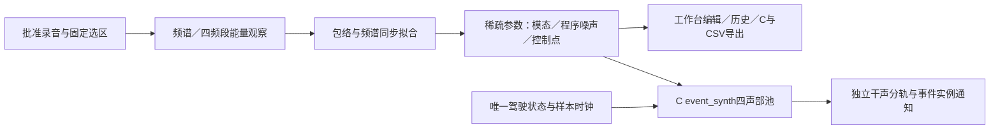

# 车外启动与同步包络提参 V1

2026-11-17。本轮将批准 A 中同一车外启动动作的早期纹理与后续接火阶段提取成纯合成参数，接入现有 C 事件池、独立控制窗口和音色工作台。没有修改实时 C、声源 ABI11／作者 ABI4、89份正式声纹，也没有改动已认可行驶配方。

## 使用

- [试听与下载](http://127.0.0.1:8789/references/analysis/A_exterior_startup_v1/C1/review/index.html)：原录音、两段独立 C、旧／新启动、接火0%／25%、事件／持续层独奏、32秒完整驾驶流程。一个播放器，无自动播放。
- 独立窗口运行 `Launch-Vehicle-Controller.cmd`，停止监听后“载入参数”，选择试听页的 `controller-preset.json`。“独立事件”页可调启动早期、接火、收油各自电平，以及事件音高、时长和纹理；“启动与停机响应”单独控制工程转速曲线。
- “回放行程”载入 `full.take.json`，复现32秒动作；“完整流程”按当前设置生成新的驾驶演示。窗口保留独立于工作台。
- 工作台事件设计器新增可选策略“保持声线：同时匹配频谱与起伏”。输入仍是人工标注的单动作片段及背景，输出可编辑参数、C头文件、CSV和实际 C 试听。常驻旧服务没有重启；代码功能已在自有临时服务实际验证。
- 已保存可编辑工程：早期 `verification5/report.json` 的 `profiles.crank.editable_project`；接火同报告的 `profiles.catch.editable_project`。网页验证后另保存工程 `55bd70346d274651976d679f9cac4954`。原工程、配方和正式默认音色均保留。

证据根：`E:/VehicleSoundLab/references/analysis/A_exterior_startup_v1`。

## 素材与动作边界

先复核47／77／106秒三个车外上下文及94秒车内上下文，共74帧；后两次车外切换有剪辑混合，94秒是车内启动控制操作，不能拿其时间替代车外动作。拟合前固定最早车外一例，之后不移动选区或背景：

| 用途 | A原始解码音频秒数 | 相对背景全频功率 |
|---|---|---:|
| 背景 | 47.00–47.25 | — |
| 早期纹理 | 47.60–48.18，580ms | +23.738dB |
| 后续接火阶段 | 48.18–49.38，1.2s | +30.636dB |
| 原声完整对照 | 47.00–51.00 | — |

原文件 SHA256：`34885942c450127932a25c72a63fdeae59026f30cfe3678a7aba6b1f5f87b964`。选区是粗粒度声学阶段，未物理分离起动机／燃烧，未恢复实车RPM。后续段含持续发动机声，因此叠加可能重复计入DNA；试听专门保留接火0%／25%。

控制台拖转0.588s、220RPM、接火目标1150RPM、怠速850RPM仍是工程参数。实际两类事件起点间隔0.582s，包含原8ms调度延迟与200Hz状态量化；不能称为原车ECU时序。

## 提参方法与模块

| 文件 | 职责 |
|---|---|
| `tools/event_authoring/contour_response.py` | 离线预计算现有线性包络控制的有限波形响应；Hann频带功率为控制点增益的二次型，保留交叉项和未受控成分。不是新的运行时声源。 |
| `tools/event_authoring/contour_joint_response.py` | 可选 `band-contour-v5`：同时匹配归一化时间起伏及六频段功率；固定／自适应控制点布局，比较原六种程序噪声截止频率。 |
| `tools/author_event.py` | job9编排、来源与拒绝报告；旧job1–8策略保留。 |
| `tools/event_designer/workspace.py`、`web/events.*` | 策略选择、实际提取／编辑／历史、导出与 C 试听。 |
| `modules/event_synth`、`event_control`、`vehicle_source` | 现有 C 生成、触发、四声部调度与干声输出；本轮字节不变。 |

每个60–300／300–1200／1200–4500／4500–14000Hz频段仍需至少3dB事件／背景对比度才提取包络，每组最多8点。原六频段检查与每个可靠频段的时间误差不退化要求保留。仅在14个有界候选中选择：两种布局各一次初始联合拟合，再各比较六种噪声高切的校准／联合拟合；每次最多160次迭代。

四个选优序列27431／48271／93931／17389都必须通过原六频段检查；它们是选优数据。另用13007／90419／58211／71237作接火的独立 C 留出核查。

旧顺序拟合的问题有两项：归一化形状目标允许低频控制点缩到约0.0008、高频接近8，后续校准难以恢复；频谱校准还强求匹配极弱的14kHz以上残差。新方法同时约束形状与能量，对弱目标沿用原来的“只限制过量”判定，不强制补出微弱残差。最后比较实际生成结果，不能只信二次模型预测。

接火最终选6000Hz**噪声支路**高切；正弦模态没有该滤波，主行驶DNA也未改变。不能据数值通过宣称高频细节、机械感或整体听感已还原。

## 结果与验证

- 早期 `crank1`：4个实际 C 序列通过六频段核查；接火 `catch7`：4选优＋4留出共8个实际 C 序列通过。C／Python最大差为`5.997324969975182e-8 FS`（约`6.00e-8`）。未缩放接火样本最高`1.319142 FS`，保留浮点原电平；试听固定×0.25，无限幅或逐条归一化。
- 接火四频段归一化时间RMSE由约`0.472 / 0.453 / 1.009 / 1.427`变为拟合序列的`0.402 / 0.370 / 0.419 / 1.286`。这是粗能量曲线改善，不能替代听评。
- 已知双段起伏、非受控常量成分、噪声滤波后的二次功率与导数验证通过；旧响应拟合及旧四频段job参数精确复现。
- 三组8秒与一组32秒实际 C 全流程、独立变长块重放：23原生通道、监听汇总、事件实例及最终状态精确一致。三组启动的19持续通道相同，接火0%／25%只差事件电平；无事件拒绝／日志溢出，声部峰值≤4。
- 实际浏览器完成提取／编辑改变 C 声音／历史恢复精确PCM／无效编辑保护／重载／C头文件编译／CSV／无素材导入；独立窗口参数往返、两次8秒静音回放0欠载。11条试听的哈希、解码、定位、播放中切换、下载及桌面／手机页面通过，截图已查看。

主要证据：`solver-verification4`、`verification5`、`web1`、`C1`、`C-audit1`、`review-web3`、`ui1`。失败的`catch1..6`、`verification1..4`、诊断和旧网页检查保留；其中catch4暴露JSON循环引用，已修正，不能作为可用导出。其他失败包括拟合／序列泛化不足，不能删除后只展示通过结果。

整车配方仍组合A车外DNA、F2怠速、新A启动和E短声，未建立同一车辆全RPM／负载／状态标定。E短声只占收油事件槽，物理回火身份尚未确认；其他缺少素材的事件保持禁用。未新增下载、渲染或ADI优化，完整目标继续。
