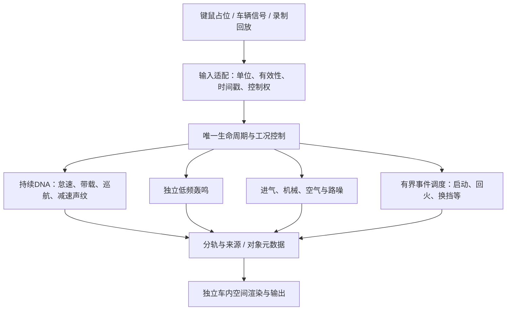

# 车载控制、事件音色与500 MCPS约束

**范围更新（2026-11-16）：** 渲染由另一个仓库承担且另有算力预算，500约束按本仓库声源生成/控制/干声分轨理解。下文含空间的原分配保留为历史，当前生成侧口径见[声源生成边界与算力V2](声源生成边界与算力V2.md)。

2026-11-16。核查基点：`df2f97ae135cfe8a62b2686d24526319aa769e39`。

用户新增约束：ADSP-21569上整套车载声音系统峰值不超过500 MCPS，覆盖启动、接火到怠速、加速/减速、换挡与收油回火；控制输入包括油门、刹车、速度、加速度、模拟挡位、轮胎打滑。当前先确认模块与控制设计，不恢复深层算法优化或新增实时集成。

## 1. 现有代码与完成度

| 功能 | 现有模块 | 核查结论 |
|---|---|---|
| 生命周期 | `src/drive/lifecycle.c`、`src/profiles/lifecycle.c` | OFF→READY→CRANK→CATCH→RUNNING，另有STOPPING。拖转、接火升速与回落有连续RPM曲线；这是工程策略，非实车标定。 |
| 新持续DNA | `modules/sound_dna`、`modules/dna_atlas` | 同一组谐波OSC、确定性相位插值、相关随机幅度细节；没有PCM或录音时间轴。部分行驶配方获认可，全转速/负载库未完成。 |
| 怠速 | `modules/modal_layer`、`modules/fine_idle_layer` | 有可选专用源，RUNNING且IDLE时淡入。细谱候选为13条OSC加相关幅度变化、6个8192tap随机激励滤波器，不是严格纯OSC，尚未取得独立音色认可。 |
| 启动声音 | `src/core/events.c`、`modules/start_texture` | 有旧简化起动机音和可选录音统计谱形OSC纹理。后者只在CRANK门控，已接统一链；仅有特定车内观察，不能直接当作独立物理起动机源。 |
| 接火补充 | `modules/catch_bloom` | 对持续DNA做固定带通和进度包络，补接火低频；不是另一段启动录音，也不是独立OSC。工程过渡存在，真实音色仍需完善。 |
| 低频轰鸣 | `modules/harmonic_body`、`modules/drive_recipe` | 前者在同一DNA内分配低频，后者可用实测相位独立LF配方。只对对应观察语境有效，不自动适配所有目录项。 |
| 加速/减速/换挡 | `src/drive`、`src/core/orchestrator.c`、`modules/atlas_drive` | 唯一200Hz驾驶器产生RPM、负载、切断/恢复和补油包络。新DNA随根音选择声纹；不是完整的RPM×负载×状态声纹库，目录中的减速配方也不会自动在收油时切入。 |
| 收油回火 | `src/drive/drive.c`、`src/core/events.c` | 已有资格判定、延迟、连发、冷却与衰减声源。音色为衰减正弦加少量噪声的工程占位，未按实录拟合，不属于已认可DNA音色。 |
| 升挡瞬态 | 同上 | 有带负载/转速/升挡方向条件的单次短响占位；独立齿轮撞击/执行器声尚无专用模型。 |
| 进气/机械/排气空气/道路/风 | `modules/drive_aux` | 五路可选工程模板，含机械共振与滤波噪声；新驾驶入口默认量为0，未完成素材物理分离/标定。 |

“同一系统”指共享驾驶器、控制、分轨和输出，不意味着所有音色使用同一个OSC核。已允许事件激励/共振；保留OSC主声线与这些独立部件的边界。

当前实际调用顺序见 `modules/atlas_drive/render.c`。配置允许多层合作，但目录中的不同观察/配方互为选择，不能据此声称已经有同一车辆、同一视角的完整启动到高速音色。

### 当前回火如何触发

驾驶器先要求油门大于35%、RPM大于1600并保持至少120ms来武装。快速收油时，需在240ms窗口内降到18%以下、相对峰值下降超过35个百分点、无换挡且满足冷却与回火开关条件，才增加`overrun_events`。刹车本身不会武装回火。

`events.c`消费事件计数，18ms后开始1–4次短响；采用约75–135Hz的衰减正弦加噪声，衰减时间35ms。当前是一个共享瞬态包络，不是独立多声部事件池；升挡瞬态和回火共用`VSL_EVENT`对象。新驾驶混音还需`event_gain>0`才听得到，开关允许并不等于已经出声。未来残余燃油/温度/车型概率等策略尚未实现。

## 2. 信号接口

| 信号 | 当前状态 | 后续接口约定 |
|---|---|---|
| 油门、刹车 | `AdInput.throttle/brake`，0–1 | 保留范围、限速/平滑；记录原始值与采用值。 |
| 模拟挡位 | `AdInput.gear/automatic`，N与1–7挡 | 区分请求挡与实际采用挡，保留换挡完成事件。 |
| 速度 | `VslDrive.speed_kph`，模型输出 | 增加外部速度输入，内部统一单位，保留原始来源。 |
| 加速度 | 模型输出，声学字段为限幅的g值 | 外部接口明确m/s²；若由速度差分则按真实时间戳滤波，不能把旧g字段直接当m/s²。 |
| 轮胎打滑 | 缺失 | 增加打滑标志/强度，可选轮速/滑移率；先做可控占位，不冒充轮胎动力学。现有离合器滑差不是轮胎打滑。 |
| 点火/启动/停机 | `ignition/start_id`及生命周期 | 保留事件序号，避免按住启动键反复启动。 |
| 虚拟RPM/负载 | 台架可设，驾驶时模型给出 | EV没有真实发动机RPM时由虚拟动力总成生成；若有外部值须明确控制权，不能从加速度唯一推断负载。 |

建议未来输入包同时带时间戳、有效位和来源模式。分两种互斥控制权：

- DEMO：键鼠给踏板/请求挡，现有模型产生速度、加速度、RPM与负载。
- VEHICLE/REPLAY：外部信号按约定成为真值，声音适配器消费它们；不能让旧车辆积分器同时覆盖速度和加速度。缺失的虚拟RPM/负载可由明确的映射生成。

当前原生音色目录已有鼠标滑条控制油门、刹车/台架负载、台架RPM、挡位、点火和瞬态开关。旧驾驶窗口另有W/S踏板、Q/E换挡键；这些键尚未接到新目录窗口。速度/加速度外部覆盖、打滑开关/强度、鼠标二维控制区均属于待加控件，不算已完成。

## 3. 统一控制与空间对象设计

图是目标边界，包含尚未实现的输入适配与事件调度增强，不是当前全部已交付。当前已有10个固定对象槽：左右排气、进气、机体、机械、左右排气空气、事件、道路、风。已有2/12通道输出，但不是Atmos元数据或实车声场验收。启动统计纹理/接火补充目前保留观察L/R直送FL/FR，没有专用物理对象。

优先扩展以下独立事件；按发动机/动力形式启用，V10不默认添加涡轮泄压：

| 事件 | 建议触发 | 建议车内对象 |
|---|---|---|
| 收油排气噼啪/重回火 | 已武装后的快速收油；未来加车型/残余燃油策略 | 后部排气出口；事件池内独立包络、声级与种子 |
| 升挡冲击/降挡补油瞬态 | 换挡阶段边沿；补油主体仍驱动连续DNA | 变速箱/传动位置、进气/排气位置 |
| 起动机啮合/脱开、停机末次机械响 | CRANK进入/退出、STOPPING阶段 | 发动机/机舱；需额外素材建立模型 |
| 涡轮泄压/旁通阀 | 有增压压力后快速收油 | 对应增压器/进气位置；自然吸气关闭 |
| 牵引力控制介入/断续失火感 | 打滑且动力请求较高，并有介入状态 | 发动机与排气；控制持续DNA，必要时加短事件 |
| 轮胎短鸣/抓地恢复、传动间隙冲击 | 打滑边沿/抓地恢复、驱动力方向改变 | 对应轮位/传动部位；当前缺少四轮独立声源 |
| 排气阀动作 | 阀位/模式变化边沿 | 排气处机械动作；阀位同时改变连续声线 |

持续胎噪、风、持续增压啸叫属于连续层，不应每帧重触发。车身低频更适合声床/结构传递，避免把所有超低频做成尖锐定位点。对象干声、机体传递与座舱/空间传递应分开；当前录音提取参数仍含原观察传递，不能宣称已消除麦克风/房间影响。不能把双声道录音直接解释成两个气缸列，或对同一信号重复施加房间。

事件目标接口应携带类型、时间、强度、持续参数、种子和对象身份；复用同一调度器、参数资产管理与OSC/共振/噪声部件，但使用各自音色参数。声部数/每块新事件数需要上限，保留衰减尾音；此接口与事件池尚未实现。

## 4. 500 MCPS是新目标，当前未满足证明

现有[V14估算](ADI21569算力复估V14.md)是在充分DSP优化假设下的工程估计，非目标板实测：认可行驶完整链238–443 MCPS；加现有细谱怠速支路314–585；最重目录配方447–795。原900 MCPS是当时分配建议，不能覆盖用户新增500 MCPS硬约束，也不能把它改写成已经达到500。

新增少量控制标量、平滑、状态判定和边沿检测成本远小于持续声源，但未做该接口的21569实测。是否超预算主要由同时推进的锚点/统计/滤波声源、启动与怠速过渡、事件重叠及渲染决定。当前若干层量为0仍持续计算，不能按静音扣掉成本。

可先用以下**设计额度**约束后续方案；这些数字不是当前MCPS测量或可达性证明：

| 范围 | 目标额度MCPS |
|---|---:|
| 持续DNA、低频、必要细节；计入过渡时同时活跃源 | 330 |
| 启动与独立事件的有界重叠 | 50 |
| 输入、虚拟动力控制、状态/事件调度 | 10 |
| 拟采用的轻量对象渲染与混音 | 60 |
| 块内突发/中断与访存等预留 | 50 |
| 合计 | 500 |

若使用长IR、HRTF/BRIR或更复杂7.1.4渲染，必须在同一个500总额中重新分配并测量，不能当作免费附加项。此轮不做DSP裁剪或移植。未来需限制生产配方活跃成本、验证过渡策略和可重启/可恢复的状态管理，不能简单冻结零量支路而破坏随机统计、尾音或相位连续性。

48kHz、240帧/5ms下，500 MCPS等于每块250万核心周期；若核心1GHz，这相当于50%核心时间。对发布配置测最坏块，覆盖启动到怠速、锚点交界、换挡、回火与打滑重叠、统计/FFT更新同块、实际内存/DMA条件。`MCPS = 最大块周期 / 块秒数 / 10^6`。平均值或PC计时不能证明达标；其他整机音频处理若在此系统范围内也必须入账。

## 5. 本轮交付边界

本轮确认现有C实现与缺口、记录用户新信号和500 MCPS约束。没有新增C接口/事件音色，没有把候选默认打开，没有改动认可配方，也没有执行深层算法优化、推送或新的素材下载。
