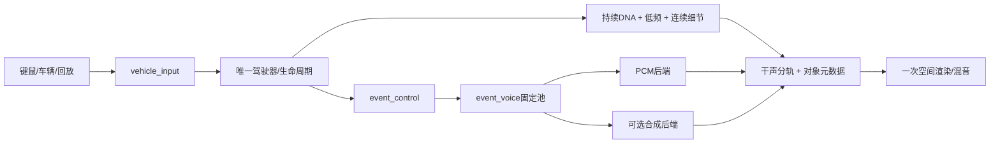

# 车载混合声源实施计划 V1

2026-11-16；基于`df2f97a`和[现状核查](车载控制与500MCPS约束.md)。本文件为设计方案，新增模块、接口与预算均未实现或板测；本轮不修改实时C或认可音色。

## 1. 推荐选择

持续的怠速、带载、巡航、减速主声线保留OSC/DNA；低频及连续细节保留独立层。回火、啮合、换挡撞击等短瞬态优先PCM，连续动作仍由DNA控制。共享控制器、事件调度、分轨、音色资产和空间输出。

| 音色/动作 | 首选 | 选择理由与控制边界 |
|---|---|---|
| 收油噼啪/重回火 | 多变体PCM | 保留爆裂起音与复杂衰减；控制概率、簇内间隔、强度与对象位置。先用现有获批素材检查是否存在可用干净片段，不预设已经有独立回火资产。 |
| 升挡冲击/执行器短响 | PCM | 短且不需持续变调；换挡断扭、扫转和恢复继续控制DNA。 |
| 降挡补油 | DNA，必要时叠PCM短撞击 | 补油本身是RPM/负载轨迹，不是一枚固定短sample。 |
| 起动机啮合/脱开、停机尾响 | PCM | 机械瞬态复杂、长度短、控制维度少。 |
| 拖转到接火前段 | PCM观察片段或起动机循环，按素材可分离程度选择 | 完整启动片段若含明显发动机音高，其时间进度必须与生命周期一致；不允许PCM与虚拟RPM各走各的。循环须做接缝检查，不复制整段怠速循环。 |
| 接火升速→怠速 | DNA主导，可与启动PCM短时重叠 | 保留可控RPM和负载。用同一视角参考校准交接音高、能量、包络和尾音，避免叠出两个发动机；固定PCM无法匹配时先停用该资产。 |
| 涡轮泄压 | 短PCM；长持续啸叫另用合成 | 仅配置在增压车型；自然吸气V10关闭。 |
| 轮胎短鸣/抓地恢复 | 短PCM | 长滑胎需另做可持续层，不能不断重启短鸣；牵引力控制介入应另有真实或模拟介入信号，打滑不等同于已介入。 |
| 怠速、加速、持续排气/进气/低频 | OSC及现有连续部件 | 持续控制范围大，不能用几枚短PCM承担全部工况。 |

PCM可以来自干净实录，也可离线渲染已认可的合成事件；运行成本相近，音质由资产决定。不要把尚未认可的劣质合成器声烘焙成PCM并称其为音质改善。

## 2. 要修改的现有部分

| 位置 | 修改内容 | 必须保留的边界 |
|---|---|---|
| `src/drive/drive.c`、`lifecycle.c`、`shift.c` | 将启动、接火、换挡阶段、快速收油等语义事件输出给统一调度；增加外部车速/加速度采用路径 | 唯一驾驶状态所有者；外部速度模式不再由旧纵向模型覆盖。保留旧默认控制路径。 |
| `modules/atlas_drive/control.*` | 接入统一信号快照、控制来源、打滑强度/标志、有效性与时间戳；区分原始和采用值 | 原g值声学加速度与新m/s²接口显式换算。模拟RPM/负载可派生，不能冒充实测。 |
| `modules/atlas_drive/render.*` | 在源与空间之间调用新事件源；分开启动/回火/换挡分轨和对象身份 | 切换PCM后不再同时叠旧回火占位；同一信号只走一次空间渲染。 |
| `src/core/events.c` | 旧接口继续供冻结版本使用，新链改为可选合成后端 | 不破坏历史DSP身份或旧行程。现有单包络不能当多声部池。 |
| `src/spatial`及路由层 | 新事件带对象身份/位置，第一阶段按同位置聚合至已有10对象再渲染；提供独立事件干声与元数据输出 | 四轮独立对象、额外空间滤波或动态对象数扩大需另列预算。观察L/R不是左右缸列。 |
| `modules/layer_monitor` | 增加启动、回火、换挡等事件独奏/分轨入口 | 完整混音与监听独奏分离；分轨可相加核对，增益只应用一次。 |
| `modules/atlas_take{,_io}` | 新版本控制字段、事件类型/采用帧/种子、PCM资产拥有权和内容哈希；支持自包含开发回放 | 原格式仍由冻结旧播放器读取；不能改旧schema含义或依赖原桌面文件路径。 |
| `modules/drive_catalog`及目录装配 | 每个车辆配方声明可用状态、事件资产、后端、虚拟RPM映射、并发和成本档位 | 空资产控件禁用；切换在非实时线程准备并提交。 |
| `experiments/atlas_monitor_v1/ui.c`与键盘适配 | 统一W/S、Q/E；鼠标开度/二维踏板；打滑开关与强度、模拟速度输入模式、事件试触发与状态显示 | 驾驶模型模式下速度/加速度只读；外部模拟模式才开放输入。窗口失焦释放按键，编辑输入不触发驾驶键。 |

第一轮不改认可DNA的系数、谐波相位策略或深层拟合算法。不将现有重怠速支路直接宣布为500 MCPS生产配置。

## 3. 新增模块的职责

拟新增的路径如下，均为计划名称：

| 模块 | 文件拆分 | 职责 |
|---|---|---|
| `modules/vehicle_input` | `types.h`、`validate.*`、`adapt.*` | 单位、有效性、超时、时间戳、DEMO/VEHICLE/REPLAY来源；按实际间隔重采样/平滑 |
| `modules/event_control` | `types.h`、`policy.*`、`scheduler.*` | 启动/换挡/回火等条件、概率、冷却、限流；事件附带音频帧偏移、强度、种子、对象身份 |
| `modules/event_voice` | `voice.*`、`pool.*`、`envelope.*` | 后端无关的固定声部池；PCM/合成选择、淡入淡出、优先级、状态、干声分轨 |
| `modules/pcm_event` | `bank.*`、`player.*` | 不可变PCM资产/标记、播放游标、48kHz定速播放、离线准备的变体选择；实时不打开文件 |
| `modules/voice_lifecycle` | `policy.*`、`transition.*` | 生产配方启停、有限预热、交接淡变与尾音预算；持续DNA相位和非活跃统计状态如何保持须单独验证 |
| `tools/event_authoring` | `import.py`、`measure.py`、`pack.py` | 裁剪/标记起音、尾音、循环/交接区；频带、能量和直流检查；编译PCM包和清单 |

上述模块通过小接口串联，不能把UI、文件解码、控制策略和音频循环写到同一文件。旧WAV非实时读取器可复用；新PCM实时播放器目前尚不存在。

工具沿用已有“单一状态/动作片段”范式，但连续DNA提取与瞬态资产处理分开：瞬态不要求周期基频，也不假装被编译成谐波参数。用户可在同一工作台选择“持续DNA”或“事件PCM”，导出一个车辆配方包，包含模型、PCM、触发表、交接标记、来源与哈希。

## 4. 并发和PCM资产约束

- 单车、48kHz；先设4个单声道事件声部，总数包含正在淡出的尾音。启动长事件占1个，其余按优先级使用剩余位置。池满时拒绝/延后低优先级事件；不能暗中开启额外淡出声部。记录丢弃事件及原因。
- 自动事件与手动试听按钮进入同一声部池。手动试触发显式标记，正常驾驶策略不因此被绕开；每块提交事件数和队列长度有上限。
- 首版默认原生48kHz定速PCM，无MP3/AAC在线解码、无在线时间伸缩。需要音高变体时先离线带限生成；以后若上实时重采样，必须另计滤波及访存成本，升调不能只做粗糙插值。
- 建议生产资产先用PCM16单声道；保留高精度原始/编辑母版。极弱尾音可用24bit/float32，容量相应增加。不能盲目把双声道相加成单声道，应检查相消；含空间信息的素材可保留立体声声床，但按双通道费用与实际视角管理。
- 同一事件准备多份实录/离线变体，随机选取并避免连续重复；适度改变声级和簇内间隔，禁止靠大范围变调获得所有音色。
- 48kHz PCM16 mono每秒96000B：0.25秒为24000B；20份共480000B，外加1秒启动96000B，共576000B。双声道容量翻倍，24bit容量为16bit的1.5倍。以上仅为示例包，不表示现有素材已经完成。
- 4声部全并发PCM读取载荷为384000B/s（16bit mono），不含描述符、对齐、缓存和其他总线事务。总带宽不大，但随机flash首读可能产生尖峰；短样本预装，或在非实时阶段/DMA准备有界缓冲，不能在音频回调读文件。

启动和DNA交接必须单独试听/验证，建议从80–200ms可调重叠起步。不得认为等功率淡变自动保证无拍频/无双发动机感；应检查重叠处根音、相位/相关性、频带能量与包络。若完整PCM含明显发动机升速，则其进度为启动时间线的约束；禁止靠未计费的实时拉伸消除不匹配。

## 5. 算力模型和变化量

所有新增数字为设计估计/额度，非CCES或板测。仍须使用真实内存布局验证每个最坏5ms块。

### 单个短声音：PCM与合成

先用透明的核成本假设比较：48kHz单声道、定速PCM的读取/转换、包络及累加按8–24核心周期/采样估计，约0.384–1.152 MCPS/声部；4个并发约1.536–4.608 MCPS，不含可选EQ、输入/调度、空间和不可控内存等待。

举例，若机械事件需要32个OSC、每个OSC每采样8周期，仅OSC核约12.288 MCPS/声部，4声部约49.152 MCPS，尚未计统计调制/共振。这个示例不等于现有C或所有OSC算法的实测成本；一两个OSC的简化事件也可能比PCM更便宜。相对于当前单正弦回火占位，PCM主要改善音质，不承诺大幅降MCPS。

建议首版为4声部PCM、包络及少量EQ合计预留5–12 MCPS；新增信号/策略/调度增量按1–3 MCPS预估。暂不从基线中扣除被替代旧回火的成本，避免凭空制造节省。

### 相对认可行驶链

| 情况 | 初步MCPS区间 |
|---|---:|
| V14认可行驶完整链，原有控制/辅助事件/基础空间已含 | 238–443 |
| 上项加新控制与4声部PCM；不额外打开重怠速/启动OSC云 | 244–458 |
| 再从原双声道改为现有10对象的基础12通道 | 254–488 |

增量分别约6–15、16–45 MCPS。原基础空间/控制已在基线里，不再重复全额相加；12通道增加的10–30来自V14同规模轻量渲染估计。额外四轮独立对象、长IR/HRTF/BRIR、在线伸缩、PCM缓存未命中均未因此取得额度。

488只是未板测估计的上端，不能作为“峰值500已达标”；它也只剩12 MCPS名义空间，不满足下面50 MCPS余量目标。加入当前细谱怠速，原估算即可能达到585 MCPS，改短PCM也不能自动消除这个问题。目录最重近795 MCPS更不属于本生产档。

### 生产配置的设计额度

| 部分 | 上限额度MCPS |
|---|---:|
| 持续DNA、独立低频、必要连续细节和辅助源 | 330 |
| 控制、虚拟动力、信号/事件调度 | 10 |
| 4声部PCM与有限包络/EQ | 10 |
| 拟采用的轻量对象渲染/输出 | 50 |
| 状态交接、有限预热、周期任务同块突发 | 50 |
| 整机争用/未知项余量 | 50 |
| 总额 | 500 |

这是由总预算倒推的额度，不是证明能把现有持续源压到330。PCM的5–12估计高端也可能超10额度，需微基准决定EQ/声部预算。已知现有重支路和交接峰值未合格之前，不承诺全系统500。优化/生产配方取舍另行实施并复核音色，不能仅以静音为由跳过统计状态或无限预热。

## 6. 实施顺序与每一步的验收

1. **接口与驾驶占位**：新增信号快照/互斥控制权，统一键鼠。记录实际采用值和状态。复核失焦、模式切换、无效/超时输入、单位换算；旧模式驾驶轨迹保持。
2. **事件框架与PCM后端**：固定池、事件帧偏移、非实时资产拥有、原生48kHz播放；保留合成后端。先用已知测试脉冲核对起点/长度/包络/分轨/并发上限，再接干净素材。
3. **短事件资产与UI**：从已批准本地素材中审出可用片段，做回火/换挡/启动前段第一组；新增素材仍先交用户审阅。提供事件独奏、自动/手动对照、变体/强度/概率/间隔和对象选择。此步才能判断PCM音质收益。
4. **生命周期衔接和录放**：启动→接火→怠速→加速；记录新格式与资产哈希，离线回放复现采用帧/选中变体/输出。覆盖松油回火、换挡中止和打滑恢复，不能只验单一稳定行驶。
5. **生产配置与21569成本确认**：先测连续声源、4声部PCM、空间核，再测统计/FFT和事件/过渡集中在同块的场景；发布版真实存储/DMA布局下测最大块周期。超过450 MCPS有效工作额度则退回配方/调度设计，不能挪走50余量来宣称500通过。

这五步是后续实施顺序，不在本次计划请求中自动开始算法优化或实时集成。最终交付为同一驾驶Demo、一个含DNA/PCM/控制表的配方包、可恢复的素材与编辑工程、以及逐模块和全链最坏块报告。
