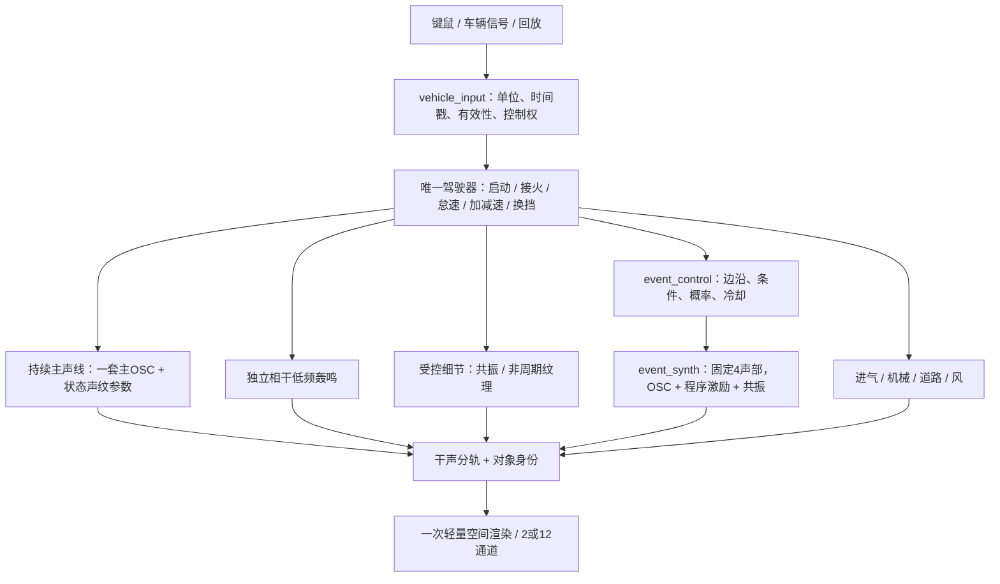

# 车载纯合成实施计划 V1

**范围更新（2026-11-16）：** 用户明确空间渲染在另一个仓库、有独立预算。本计划下文保留V1当时的完整链设计；最新入口/分轨责任和生成侧395工作＋50余量＝445 MCPS额度见[声源生成边界与算力V2](声源生成边界与算力V2.md)。下文含渲染的275–531及500分配不再作为当前生成侧预算。

2026-11-16，代码基点`df2f97a`。本轮只制定方案，不实施C改造。用户要求纯合成、完整驾驶生命周期，并把ADSP-21569车载声音系统峰值限制在500 MCPS。本方案取代此前混合声源草案中的PCM路线。

纯合成的边界：运行时只有参数、OSC、程序随机激励、包络和共振/滤波，不播放原录音、短音频、录音循环或预渲染事件。数学正弦查表属于OSC实现；素材只用于离线提取参数。纯合成不等于每一层只能使用正弦振荡器，沿用用户已允许的事件激励/共振。

## 1. 总体结构

上图是目标结构，包含尚未实现的模块。连续DNA不是每个挡位或状态各开一套发动机；RPM、负载和工况用于选择/插值参数。同一物理主声线共享相位，独立机械非谐波和短事件另分声部。怠速到带载需要各自的素材参数，不能只把同一个声音变调和调音量。

## 2. 改哪些现有代码

| 修改位置 | 工作内容 |
|---|---|
| `src/drive/{drive,lifecycle,shift}.c` | 保留唯一状态所有者；明确输出拖转、接火、换挡阶段、快速收油、停机等事件。增加外部信号采用路径，避免内外车辆模型同时积分。 |
| `modules/atlas_drive/control.*` | 接收油门/刹车0–1、速度、m/s²加速度、请求/采用挡位、打滑强度、启动请求、时间戳与有效位。虚拟RPM/负载缺失时由明确的虚拟动力模型派生。 |
| `modules/atlas_drive/render.*` | 连续层与事件池分开调用；替换旧单包络回火占位，新增启动/回火/换挡分轨；只进入一次空间处理。 |
| `modules/sound_dna`、`modules/dna_atlas` | 增加可选车载执行路径，离线编译常量、整理数据布局、限制音频热路径和参数准备峰值。保留原执行器作为音色对照；不覆盖认可参数。 |
| `modules/drive_recipe`、`drive_resonance` | 低频和细节按实际支持范围工作；非活跃锚点不一律继续做全部音频滤波，新增有界预热/尾音策略。 |
| `modules/fine_idle_layer`及新怠速适配 | 当前6×8192tap细谱保留为对照。研究用有限OSC和短共振/滤波参数替代生产支路，保留低/中/高频，而非直接低通；未经听评不能替换默认。 |
| `src/spatial`、对象路由 | 为事件保留独立身份、位置和干声；第一阶段同位置聚合到现有对象渲染。四轮独立输出为后续显式扩展，不能宣称已有。 |
| `modules/layer_monitor` | 启动、回火、换挡等独奏/电平/分轨；完整混音与监听选择分离。 |
| `modules/atlas_take{,_io}` | 新格式保存实际采用信号、事件音频帧、种子、模型与控制哈希，输出可复现；旧行程使用其冻结播放器。 |
| `modules/drive_catalog`及非实时装配 | 按车辆声明状态声纹、事件类型、可用频域/根音范围、并发与成本档位；模型缺失时禁用控件并显示缺口。 |
| 原生驾驶UI、`tools/sound_designer` | 统一键鼠占位；在现有音色工作台增加持续声/瞬态声参数页和状态配方编辑、导出，分析/参数准备不进入音频回调。 |

## 3. 新增哪些模块

以下均是计划路径，不是已有实现。

| 新模块 | 文件拆分 | 职责 |
|---|---|---|
| `modules/vehicle_input` | `types.h`、`validate.*`、`adapt.*` | 来源互斥、单位、有效性、超时及真实时间间隔处理。 |
| `modules/event_control` | `types.h`、`policy.*`、`scheduler.*` | 产生带音频帧偏移、强度、类型、种子、对象身份的有界事件；回火武装/冷却、换挡和打滑边沿在此管理。 |
| `modules/event_synth` | `profile.*`、`oscillator.*`、`excitation.*`、`resonator.*`、`envelope.*`、`pool.*`、`voice.*` | 固定4声部的纯合成短声音；与触发策略和UI分离。 |
| `modules/voice_lifecycle` | `policy.*`、`transition.*`、`warmup.*` | 声源活跃/预热/淡入/尾音/休眠状态；限制交接重叠和初始化突发，不另建车辆积分器。 |
| `tools/event_authoring` | `measure.py`、`fit.py`、`validate.py`、`pack.py` | 从已裁剪动作片段提取起音、谱峰、衰减、频率运动、噪声谱和簇统计，导出纯参数；无周期回火不要求基频。 |
| `tools/vehicle_recipe` | `schema.py`、`compile.py`、`budget.py` | 把已有单状态DNA任务、事件参数、RPM/负载映射及来源组合成一个车辆配方，并检查资源上限。 |
| `modules/dsp_budget` | `counter.*`、`telemetry.*` | 目标板周期计数、各模块/整块最大值、队列和声部峰值，避免只统计平均。 |

不把现有离线逆问题/高阶研究重新纳入本轮工作；工具先复用现有分析能力，新增短瞬态的参数提取。

## 4. 每种音色怎么纯合成

| 声音 | 声源与控制 | 要从素材提取的内容 |
|---|---|---|
| 拖转起动机 | 旋转阶次OSC＋少量金属非谐波模态＋受控程序纹理；随拖转速度和许可运行 | 稳定/非谐波峰、谱包络、调幅节奏、起落时间；啮合/脱开另触发 |
| 接火→怠速 | 沿连续RPM轨迹变更DNA参数和包络，必要时低频接火凸起；主OSC不重置 | 同一视角的接火升速、能量回落、怠速频带与起伏；不能沿用未经标定的速度曲线冒充实测 |
| 怠速 | 素材主峰与谐波/非谐波OSC、跨阶相关幅度起伏、共享高频细节；额外模态受数量约束 | 周期间变化、相关性、左右关系、弱机械峰；不采用全局随机颤音来伪造不规整 |
| 加速/巡航/减速 | 同一套主OSC，按RPM/负载/工况插值声纹；低频、进气和细节各有包络 | 不同状态和负载下的声纹参数；声学根音不自动等于物理RPM |
| 收油回火 | 8–12个阻尼模态/OSC＋2–4节程序噪声滤波，共同受短起音/多段衰减控制 | 起音锐度、谱峰及独立衰减、噪声占比、频率变化、连发间隔与强弱分布 |
| 换挡撞击、啮合/脱开、停机末响 | 复用事件合成核，各自的模态/衰减/纹理参数 | 各类机械响自己的峰位、衰减和瞬态结构；不能一枚回火音改调后通用 |
| 涡轮泄压、短轮胎鸣叫 | 宽带程序激励经短滤波/共振，必要时少量窄带OSC；长持续滑胎另作连续源 | 频带、窄带峰、起落和调制；自然吸气不启用泄压 |

事件核初始上限为每声部8–12模态、2–4 SOS、1组随机激励与包络。所有声音都走该上限；启动拖转声占同一池中的位置，不另开无限启动层。特定音色若在此上限内不能合格，应先改参数表达/其他模块额度，不能静默超配或把劣质候选宣布为成品。

连续主声线初始保持现有300–320阶容量，不以恢复旧64 OSC作为节约手段。低根音时，320阶本身未必覆盖所需高频；编译器必须报告覆盖，并可用已验证的高阶稀疏OSC/细节部件表示，仍计入主声线/细节数量与预算。不能只补宽带噪声，不能把“能量补齐”当作机械音色还原。

## 5. 节省算力的办法与风险

### 第一类：优先做的执行优化

- **常量离线编译**：固定极点、滤波器、指数系数、模态旋转量、统计缩放等在装载时计算。音频线程不加载文件、不分配、不拟合。V14已假设FP32/SIMD，不能再次把这些假设当作额外打折。
- **一次主载波、多份参数**：相邻锚点共用主OSC，低频的同阶载波复用计算，输出保留独立低频声纹/包络；独立低频统计不能仅因频率相同就删除。
- **非活跃锚点跳过可重建的投影**：保留相位、RNG、AR状态及左右端点潜变量快照；只为当前/即将进入的锚点准备系数。不能直接冻结时间、随机流或共振尾音。快照和预计算队列的额外内存必须计入。
- **有界事件池**：4声部包含启动、当前事件和正在淡出的尾音。每块新事件先设不超过4、队列不超过16；超限拒绝低优先级并计数，不能临时多开淡出声部。高优先级通过预留槽或已计费替换实现。
- **共用空间处理**：同位置对象先相加，再做位置传递/空间处理；DNA不是按扬声器重复合成。第一版不引入长IR/HRTF/BRIR，若后续要求，必须在同一500总额内重分配。
- **任务分散**：把可提前计算的系数/投影分到有界准备任务，并在采用前完成。实时回调不得等待任务；突发模式不能在回调里把整段预热补跑。各任务的DSP周期总量和实际截止时间都要测，不把换线程当成节约。

### 第二类：需音色验证后才能采用的算法简化

- **降低音频热路径的系数运算**：现有每采样/每谐波计算复幅度模和相位插值较贵。候选为自适应1–4kHz准备幅度/相位系数、逐样本插值；1–4kHz只是试验起点，快速变化保留更快/原路径。保留原统计端点、限制误差，尤其检查相位插值产生的边带、AM频谱和高频自然度；不可默认全量降到200Hz。采用与否以A/B和误差验证决定，节约量未证明。
- **怠速长FIR替代**：尝试保留关键窄峰的有限OSC＋6–12节短SOS/AR纹理，合并到全局细节路径。它和6×8192tap不是数值等价；谱纹理、衰减、左右关系和听感未过关就继续保留对照，不直接替换默认。
- **非活跃滤波声源休眠/恢复**：不同于可重建的线性统计投影，有状态滤波不能只靠恢复随机种子就精确恢复。使用可测的重建/预热/淡入策略，预算含重叠；瞬时收油等事件源必须预备可用。
- **分频段运算率**：只有低频层可试12/24kHz生成，再经明确抗镜像插值到48kHz；DNA中高频保持48kHz。滤波费用、相位/延时补偿与相干LF关系都计入预算。未取得验证前，下面预算不依赖此项节约。
- **稀疏分音**：只考虑素材中被证明不重要的分音；先保留频率覆盖、关键阶次和弱机械峰。不可统一砍高频，也不以分音数量少作为完成指标。

算法简化是有损或改变状态规律的候选，不能把“参数一样”当作声音一样；认可版本与新执行器始终可对照、可回退。

## 6. 算力变化：先估直接叠加，再给生产额度

条件：单车、48kHz、240帧/5ms，最多4个单声道事件声部；基础10对象空间处理可输出2/12通道。所有新周期系数均是假设，不是CCES/21569实测。

### 新功能直接叠加的初估

4声部事件池的透明估算：每模态每采样5–8周期，每SOS每采样4–8周期，随机/包络/累加每声部每采样8–24周期。采用8–12模态、2–4 SOS时，合计约10.752–29.184 MCPS，取整为11–30。滤波系数静态或低速更新费用、有限事件建立等由后续突发额度覆盖；实际库函数、内存等待和目标数值方案均待测。

| 相对V14认可行驶完整链的新增项 | 粗估/目标增量MCPS | 限制 |
|---|---:|---|
| 新信号/事件策略与采用逻辑 | +1–3 | 既有驾驶控制不重复计费 |
| 4声部程序合成事件 | +11–30 | 不从基线扣除旧回火占位，保守留着 |
| 轻量怠速额外模态/适配 | +15–25 | 候选目标；高频纹理复用全局路径，不重复再开细谱FIR |
| 原双声道改为现有规模基础12通道 | +10–30 | 沿用V14估算，非完整BRIR |
| 合计新增 | +37–88 | 假设上述轻怠速可达到音色要求 |

认可行驶链原估238–443，因此只叠上述功能约275–531 MCPS。这个区间仍可能超500，且尚未给所有突发留完整余量。沿用现有重怠速则更高：它单独增加约76–142 MCPS，不能用新模块名字掩盖成本。

要把有效工作压到450并保留50余量，以上述估计高端作设计压力，需要相对直接叠加追回约81 MCPS；不能只增加控制信号就指望自然达标。

### 生产结构的分项额度

| 范围 | 设计额度MCPS | 计入内容 |
|---|---:|---|
| 主DNA与锚点统计/系数准备 | 215 | 300–320阶、素材细节与相位；需改热路径才有机会达到 |
| 独立相干低频 | 15 | 独立参数/包络与必要滤波，不复制整套主声线 |
| 高频/非周期细节 | 45 | 包含怠速共享纹理，避免高频被裁掉 |
| 怠速额外模态与交接适配 | 25 | 不再常驻旧长FIR全支路；不是怠速全部声音仅25 |
| 4声部纯合成事件 | 30 | 含启动拖转/机械事件、回火、换挡和尾音；共用固定池 |
| 连续进气/机械/道路/风辅助 | 15 | 工程模板和必要受控声源 |
| 输入/虚拟动力/状态/调度/常规混音 | 10 | 含既有控制与新增信号，不能另重复加基线控制 |
| 基础对象渲染与输出 | 60 | 一次2/12通道处理；含限定延时/滤波，不含未设计的长BRIR |
| 状态重叠/参数准备突发 | 35 | 接火→怠速、锚点预备及有限尾音交接；不能再开第二套完整发动机 |
| 有效工作小计 | 450 | 225万周期/5ms |
| 整机争用/未知项预留 | 50 | 25万周期/5ms，不能事后挪给常驻算法 |
| 总额 | 500 | 250万周期/5ms |

这些是分配上限，不是已经压到该数字的实测结果。与现有最重795估计相比，450有效工作意味着不同的生产执行结构/活跃策略，不表示能无损减掉345 MCPS；现有最重研究/目录配方不自动获得车载资格。

主DNA215是主要风险。以320阶、48kHz计，每个立体声谐波每采样若需10周期，仅该循环为153.6 MCPS，剩61.4用于统计/系数/控制；若实际为16周期则仅该循环245.76，已超分项。此例是敏感度算术，不能证明10周期能实现。V14认可行驶的原DNA＋纹理高端约339.7，压至215需约124.7的成本下降，必须经原声音对照验证。若保持音色无法实现，应明确报告500目标与当前表达结构冲突，再选生产配置，不能暗中牺牲高频。

内存也必须核算：按320阶、16统计分量、FP32，单锚点的均值/基/4×4残差根/rho约106.25KiB，两个热模型约212.5KiB；8锚点双端潜变量快照约81KiB。这些仅为参数/快照示例，不含相位表、OSC、滤波/空间历史、栈和DMA缓冲，不能据此声称已放入目标片上存储。需先输出完整map并规划SRAM/DMA，避免通过外存等待丢掉周期节约。

## 7. Demo和工具怎样呈现

- 简洁主页面：开始/停机、油门/刹车开度、挡位、打滑开关/强度、当前RPM/速度/加速度、状态和峰值声部数。W/S或鼠标控制踏板，Q/E换挡；失焦释放，文本输入不抢驾驶键。
- 高级面板：DEMO/外部模拟来源；外部模式才开放速度/加速度覆盖，DEMO模式显示模型输出，避免互相打架。
- 音色面板：DNA、低频、细节、进气、机械等独奏/增益；选择状态参数与支持范围。瞬态页提供模式峰、衰减、噪声占比、连发间隔、概率、强度与对象位置，不把不支持的参数做成假滑条。
- 手动试触发与自动驾驶事件共用同一个声部池。界面显示事件为何触发/拒绝、是否手动测试，不隐含绕过正常资格条件。
- 工具入口仍是已裁剪单状态/动作片段：持续声编译DNA参数；瞬态编译模态/谱包络/衰减/簇统计。分别试听后打包为一个纯参数车辆配方，保留来源、人工标注与版本。

## 8. 实施顺序与通过条件

1. **冻结对照与成本入口**：固定认可行驶/怠速候选/启动参考、种子和分轨。先做CCES微基准接口，测主OSC、幅相、统计、短共振和空间核；不把PC耗时换成SHARC MCPS。
2. **信号与事件接口**：完成vehicle_input、唯一控制权与有界scheduler、键鼠占位。核对无效/超时/来源切换、换挡和回火资格、实际采用帧；此阶段保留原声源。
3. **纯合成事件**：先从本地获批素材做回火、启动啮合/拖转和换挡三类；审核提取参数和单独试听，再接4声部池/干声对象。新素材仍按先审阅后下载执行。
4. **轻量持续执行器**：逐项验证热路径优化、非活跃投影、怠速FIR候选及状态交接；每次只改一项。高频、机械质感、左右关系与动态细节保留后才进入车载配置，不自动替换认可版。
5. **统一工具/UI与新录放**：导出一个配方，回放复现信号/事件/声音；覆盖启动→怠速→加速→升挡→快速收油→制动降挡→打滑恢复→停机。
6. **500 MCPS验收**：实际发布构建/时钟/内存/DMA环境下，测所有周期任务同块和所有合法事件/交接并发的最长5ms块；有效工作目标≤225万周期，含约定争用后系统≤250万。声部受限不等于允许随意丢关键启动/换挡事件，拒绝统计也纳入验收。

听感与性能分开验收：频带功率、起音/衰减、调制和左右关系用于定位问题，指标接近不能替代用户听评。若音质或周期任一不达标，报告具体失效模块与取舍，不把设计额度当作合格报告。
