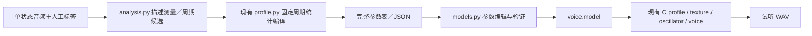

# 音色工作台 V1

双击仓库根目录 `Launch-Sound-Designer.cmd`，打开 **http://127.0.0.1:8791**。这是现有 Sound DNA 的音色设计工具；实际试听由 C 生成。原生驾驶系统通过右上角“打开驾驶试听”进入，两者的工程和参数独立。

当前固化的是已有 C 参数格式、固定声线生成和本工具流程。**任意发动机的自动高保真提取、全转速／全工况建模还没有固化完成。** 本轮没有修改 C DSP、认可声音、驾驶默认值或接入新的算法。

## 第一次使用

1. 先载入“V10 车外 DNA”试听。另有“温暖合成器”“空心合成器”，演示相同模型格式如何产生不同音色。
2. 调整滑条，点击悬浮的“生成 C 试听”，再点击播放器。修改参数不会立即改变已经生成的声音。
3. 用固定随机种子比较参数；每次只改一个维度。首次建议输出增益 −6 dB。
4. “保存参数”保存编辑；“生成 C 试听”另外保存一个不可覆盖的导出版本。左侧“打开本地工程”可重开。刷新恢复上次已保存工程。
5. 下载 ZIP、完整 JSON 或分音 CSV。导入完整 JSON 即可恢复，不需要原始音频。

## 比较和找回版本

试听满意后点 **“B 保留为 A”**，继续调参、生成新的B，再切换A／B比较。两版共用播放器和音量，不自动补偿响度；建议保持输出增益一致。点击切换会回到该段开头，不能当作原声与合成的逐样本对齐。A的标识会保留在本机浏览器，音频仍来自对应工程的已保存试听文件。

“保存与导出”里的 **“参数历史”** 记录保存、参考分析、提取和试听。选择版本后可恢复模型、全部调参和参考选区；有试听的版本还能直接设为A。恢复前的编辑也会保留。重新分析／提取前会保存当前调参，因此新提取重置宏参数后仍可找回旧版。

历史在工程的 `history/` 目录，以独立JSON快照和内容校验保存；原始输入音频和已生成试听文件仍需保留。ZIP只导出当前试听版本，不包含整个工程历史。旧工程从升级后的第一次操作开始留历史，之前已经覆盖的编辑无法补回。

界面另显示 **当前参考是否与模型提取来源一致**。换选区、重新分析只更新参考，不会悄悄改变已有模型；重新“提取参数”才更新声源。导出的 `model_reference` 保存提取当时的选区、基频、参考文件哈希和分析，避免把新选区数据误认为模型的训练来源。旧模型没有这项记录时显示来源未绑定。

## 输入音频范式

使用已裁剪的单一状态片段，建议 **0.7–8 秒**，WAV／FLAC优先。工具接受0.4–60秒、8–192kHz、单／双声道，文件小于48MB。保留原幅度和左右关系，不要先归一化、加混响或扩宽。

怠速、稳定转速、一次加速分别建工程；车内、尾排、机舱也分别标注。标注是元数据，不会自动触发驾驶状态。不要把不同发动机或不同录音视角混作同一个状态。

流程：**导入 → 检查原声／选区 → 确认声学基频 → 提取参数 → 调音 → C试听 → 保存**。

- 工具给出周期候选及相关分数；存在倍频／分频歧义，需要确认。**声学基频不是RPM**，不自动推断气缸数、负载或排气改装情况。
- 频谱、频带功率、峰值、RMS、左右相关和短时音高轨迹保存在分析表中。频谱图的两条曲线各自以峰值对齐，只比较相对谱形。
- 稳定判断只是短窗周期变化小于5%的启发式提示，不是素材质量认证。无周期、风噪、说话或混合声源需要人工排除。
- 默认尽量使用现有核允许的分音阶数。最高分音为 `阶数 × 基频`，并受320阶及最高1.1倍变调带宽限制；低基频时可能远低于20kHz。**上限以外的原声细节不会被保留**。
- 加速片段可以分析、导出音高轨迹；不稳定片段默认拒绝固定音色提取。显式勾选“固定音色草稿”才能继续，它不复现加速轨迹，也不生成驾驶RPM映射。
- 很低的基频或很短的片段可能不足现有编译器要求的16个归一化周期；此时使用更长、周期更稳定的片段。

## 怎样搓音色

| 目标 | 先试的参数 | 判断方法 |
|---|---|---|
| 厚一点 | 低频 +1～3 dB；必要时中频 +1 dB | 增加已有DNA分音，不等同于独立BODY轰鸣层 |
| 明亮尖锐 | 高频 +1～3 dB，倾斜 +0.2～0.5 dB/oct | 如果分音上限太低，增益不能补回不存在的高频 |
| 减少持续音符感 | 细节0.5～0.8，联动0.4～0.8，逐分音0.1～0.4作起点 | 保留平均相位，逐步试听；不能保证参数越大越机械 |
| 更稳定／纯净 | 降低细节、联动、逐分音起伏 | 细节0只留下固定平均声线 |
| 空心／科幻 | 从空心预设开始，逐分音减弱偶数或奇数阶，再调倾斜和左右 | 相同OSC核，区别由幅相和变化统计决定 |
| 改变左右关系 | 宽度0～1；再少量调左右固定相位 | 0为参数域单声道，1保留原关系；不是房间或扩宽混响 |

按钮给出的手法只是起点，不是通过听评的发动机预设。逐分音表可独立编辑L/R幅度、固定相位和残余时间相关ρ；高级JSON还能编辑完整联动基与协方差因子。

| 参数 | 范围与含义 |
|---|---|
| 音高比例 | 0.90～1.10，有限变调；预览时长保持不变 |
| 输出增益 | −36～0 dB，写入导出模型系数；过载会提示，不自动限幅 |
| 低／中／高频 | 各±12 dB；边界250Hz、2.5kHz；改变分音系数，不增加新的频率 |
| 整体倾斜 | ±3 dB/oct，中心1kHz |
| 细节总量 | 0～1，现有C统计幅度变化量 |
| 联动／逐分音起伏 | 各0～2倍，缩放对应统计因子 |
| 左右宽度 | 0～1.5倍，平均声线、联动基和协方差因子一致变换 |
| 时间相关ρ | −0.95～0.95，相关于归一化控制步长，不是振荡频率Hz |
| 预览／种子 | 0.25～12秒；整数种子1～4294967295，可重放比较 |

## 输出与工程接口

本机工程目录：`E:\VehicleSoundLab\designs\<工程编号>`。原输入和每次提取目录保留；每次试听生成独立版本目录。ZIP包含：

| 文件 | 用途 |
|---|---|
| `parameters.json` | `vsl.sound-designer-preset/1`；原模型完整数组＋控件／分音覆盖＋来源／状态／分析／渲染记录；可恢复编辑 |
| `voice.model` | 已应用声线、宽度、统计因子和增益的现有C模型 |
| `harmonics.csv` | 导出模型的各阶频率、左右平均幅相、残余ρ；完整统计矩阵在JSON里 |
| `analysis.json` | `vsl.sound-designer-analysis/1`；当前参考分析、选区、模型提取来源与匹配状态；载入现有模型时分析可为空 |
| `preview.wav` | 48kHz双声道FLOAT，现有C声源生成 |

**C播放约定**：模型中的 `gain_db` 已应用，调用 `sd_voice_init` 时用unity gain；`pitch`和`detail`从JSON控件读取传给C，它们没有再次烘焙到模型系数。按同一模型、种子、音高与细节可重放相同序列。播放器“循环”只是重复这段有限试听，不能当作无限程序生成的证明。

`base_profile`保存原始mean／basis／rho／residual_rho／root，`params`保存宏参数，`rows`／`rho`保存可选覆盖。恢复时从原始数组重新应用宏，避免反复导入导致增益叠加。`source`是来源记录，恢复JSON不会从该路径读取原音频；需要重新分析时重新导入音频。



维护入口：`tools/sound_designer/analysis.py`测量，`models.py`参数格式／调音，`history.py`版本快照，`workspace.py`工程与导出，`render.py`调用C，`server.py`本地接口。`web/audition.js`负责A/B及播放器互斥，`web/history.js`负责历史选择／恢复，`web/app.js`组织编辑流程。C核仍在 `modules/sound_dna/{profile,texture,oscillator,voice}.c`；导出适配器在 `experiments/sound_dna_export_v1/probe.c`。文件I/O和界面操作均在实时C核之外。

现有核使用固定平均相位及随机幅度细节，不是完整机械摩擦、燃烧事件、动态相位或声源分离模型。BODY／DETAIL／EVENT／AUX和驾驶控制仍在原生系统，本工具不会自动给它们生成整套状态参数。录音里的空间、风声等可能进入统计；本工具没有主动添加房间模型，也没有自动去房间。

## 构建与验证

本机已有运行环境。新机器需Python 3.10+，安装 `tools/sound_designer/requirements.txt`，以及CMake／Visual Studio 2022 C工具链。先运行 `Build-Sound-Designer.ps1` 构建现有C导出器，再运行启动脚本。其他数据目录可使用：

```powershell
.\Launch-Sound-Designer.ps1 -Workspace 'D:\VehicleSoundLab' -Port 8791
```

启动器复用已运行的本地服务；失败日志位于数据目录 `designs/server-error.log`。Python也可直接运行 `tools/run_sound_designer.py --workspace <数据目录> --port 8791 --no-browser`。

验证入口是 `tools/verify_sound_designer.py`（公开API／C一致性／JSON恢复／非法输入）和 `tools/verify_sound_designer_ui.cjs`（实际Chrome导入、提取、C试听、保存恢复、桌面／窄屏）。收据见 `research/sound_designer_v1_verification.json`。真实A参考示例只是流程验证，未经新的音色听评，不替换认可版本。

后续版本留痕／A/B验证见 `research/sound_designer_history_v1_verification.json`：重新提取后恢复旧模型、调参、选区，并用同一C导出器逐样本复核旧试听；浏览器实际静音播放验证A/B与原声互斥。历史刷新不改变用户选中的版本。
