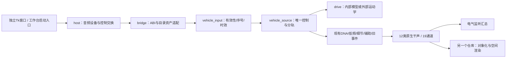

# 驾驶与声源控制台 V1

2026-11-16。独立窗口复用当前 C 声源，通过音色工作台右上角「打开驾驶试听」启动，也可运行根目录 `Launch-Vehicle-Controller.cmd`。窗口打开时不自动发声，点击「启动」开始；首次使用先运行 `Build-Vehicle-Source.ps1`。Windows 主机使用 Python 标准库 Tk/ctypes/WinMM，运行界面不依赖浏览器音频或音频样本播放器。

## 操作

- **驾驶页**：启动、熄火、停止监听；油门／刹车、运动自动挡或手动挡位、输出电平。W/S控制踏板，Q/E换挡；释放按键、窗口失焦或最小化时释放键盘踏板。鼠标滑条保持设定值。
- **音色与分层**：DNA细节、两种低频、共振／残差、怠速声线／起伏／纹理、启动／接火及五种辅助层。缺少实际模型的控件禁用。独奏不修改生成状态；监听静音时生成继续。
- **信号与回放**：外部速度、加速度、打滑占位；固定转速／负载；信号暂停、保存行程、回放。保存参数用于下一次调音，保存行程用于复现已采用的控制序列。

四种模式：踏板驾驶由内部车辆模型产生速度和虚拟RPM；固定转速使用RPM/负载；自动演示运行既有踏板场景；外部模式采用速度/加速度，内部不积分车速，RPM使用独立的工程传动映射。外部速度用km/h显示，C输入为m/s，加速度为m/s²；打滑为0–1。外部信号超过0.5秒未更新，保持速度、输入加速度与打滑归零、释放踏板并禁用新增收油触发；收到新序号恢复。重复序号不刷新时效，倒序或同序号修改信号被拒绝。

打滑参与外部虚拟RPM映射，目前没有独立轮胎鸣叫声。RPM与启动曲线是工程控制，不能当作已测实车遥测。

## 当前声音边界

默认保留已认可行驶配方和既有细谱怠速候选，没有重新拟合音色。目录中的启动趋稳预设提供原有启动纹理／接火补充；默认行驶预设没有该模型，因此相应滑条禁用。旧回火／起动机仍是历史工程声源，需调高「旧回火／起动机电平」才会听到；回火允许开关还受既有高转负载历史和快速收油资格约束。

**新素材驱动的启动／回火音色、四声部事件池和逐事件对象身份尚未完成。** 不把旧单包络声音当作这部分的交付结果。外部信号只是占位输入，不是已实现CAN接口。

## C与上位机分工

- `modules/vehicle_input/{types.h,validate.c,adopt.c}`：输入来源、单位/范围、有效位、单调序号和基于音频帧的时效。
- `src/drive/kinematic.*`：外部轮侧运动学的虚拟RPM/负载映射，不调用轮侧耦合求解或速度积分。原 `vsl_drive_step` 默认路径保留。
- `modules/vehicle_source/{assets,control,driver,source,stems}.c`：资产所有权、控制适配、唯一200Hz驾驶步骤、无空间处理入口及原生分轨。
- `experiments/vehicle_source_v1/bridge.*`：本地C DLL、版本/结构大小检查和目录适配，不包含UI/设备线程。
- `tools/vehicle_controller/{native,device,host,take,render,ui,identity}.py`：分别负责ABI、WinMM、唯一音频所有者、行程、离线分轨导出、界面和参数身份。
- `tools/sound_designer/controller.py`：独立窗口启动与进程复用；旧窗口仍可通过开发接口 `/api/legacy-driver`打开。

信号采用不另建第二个驾驶积分器。声源入口跳过scene、传播、早反射和扬声器路由；历史空间存储/链接依赖仍存在，后续再彻底抽离。观察双声道不等于两个独立尾排。

## 复现与验证

新行程为 `vsl.source-controller-take/2`，记录实际采用控制的音频帧、输入序号、目录、C DLL SHA-256与整个voices参数库身份。声音仍由C重新生成；不会保存音频片段作为运行声源。引擎或参数身份不匹配会拒绝回放。V1实验行程与冻结播放器保留，不静默改格式。

导出命令：`python tools/render_vehicle_take.py <行程.vsltake.json> --output <绝对输出前缀>`。默认导出完整干声与所有原生分轨，`--mix-only`只导出混音。新旧音色不是靠录音音频播放器接入控制。

核查入口：`Build-Vehicle-Source.ps1`、`tools/verify_vehicle_controller_v1.py --output <新的绝对目录> --ui`。证据见[验证记录](../research/vehicle_controller_v1_verification.json)：12预设新旧干声/驾驶/分块一致、空间状态不推进，外部信号不重复积分；旧12份WAV字节保持；3秒控制行程PCM精确复现；窗口自检覆盖超时/恢复、按键/失焦释放、模型缺失禁用及保存。窗口截图按自身HWND捕获并查看，未使用其他应用的屏幕像素作视觉证据。

首次失焦失败和第二次误截记录保留，非目标窗口图片不纳入交付；第三/四次窗口自检通过，参数身份校验在第五次加入，第六次验证最终界面、停机期间重启请求、身份校验与回放。静音WinMM检查与短时UI运行不能证明所有设备或长时间运行无断流；窗口显示PC供声情况，不换算SHARC MCPS。本轮不做深层算法优化或目标板达标承诺。
