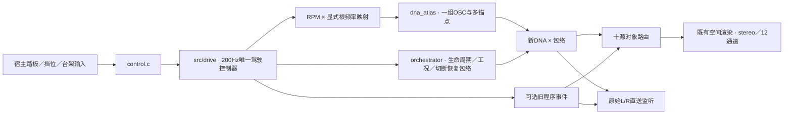

# 新 DNA 驾驶适配器

`control.h/c` 接收踏板、台架、挡位和监听输入；`render.h/c` 将既有驾驶控制器与新 `dna_atlas`、对象路由和空间渲染连接。宿主示例为 `experiments/atlas_drive_v1/probe.c`。

`ad_render_init` 借用独占的 `VslEngine` 存储，初始化驾驶、工况包络与空间状态。不得再把该存储交给 `vsl_process_layout` 或其他监听器。每240样本只调用一次 `vsl_drive_step`；OSC、事件和空间每样本各推进一次。宿主不积分RPM，也不重写换挡结果。`ad_render_set` 对非法／非有限输入整体拒绝。

DNA使用 `voice.dna_gain`，保留现有工况、负载、启动、换挡切断与恢复响应；18ms平滑从控制率接到音频率。它目前仅是**工况增益响应**：没有把原DNA的谱倾斜／截止直接套到新录音模型，也没有训练每种状态各自的声纹。喷油状态由旧控制器推进，未将录音混合声纹整体视作燃烧脉冲门控。

`root_per_rpm` 必须显式配置；E高转车内实验取1/120，来自多谱线／仪表区间的有限假设。此值没有自动推广给A车外或其他车型。`profile`选择原驾驶工程参数；bank选音色。匹配关系仍由有来源的配方负责。

当前连接的是新DNA和可选旧程序事件。`event_gain=0`为默认，RNG和事件调度仍推进；大于0时可听到原有启动机、收油连击和换挡事件。它们没有经过本轮实录瞬态拟合，不属于已认可的新DNA音色。独立低频、进气、机械和噪声对象保持为空。不能为补齐层数叠加整套旧DNA或把A车外LF加到E车内。

原始L/R是录音观察，直送捕获保留它们；对象渲染按显式选择的左／右／中观察投影，等幅分到两个排气对象（各1/2），不是将录音左右解释为发动机左右缸列。源始终持续生成，直送与空间按18ms平滑切换，空间缓存不重置。12通道模式固定走空间；高度只接房间反射，房间为0时高度静音。布局沿用FL/FR/FC/LFE/BL/BR/SL/SR/TFL/TFR/TBL/TBR。

`AdCapture` 可取原始双声道DNA、包络后DNA、可选事件、干声、十源对象和逐样本遥测，均为调用方提供的独立缓冲区。输出float不作限幅或归一化；宿主负责余量、启停淡化和设备。实验宿主另存200HzCSV、配置与性能JSON、IEEE float WAV；模型／代码／输出哈希由离线验证器绑定。

该接口不读取旧take，不更改DSP0.20.0或take schema5。尚未加入原生驾驶UI或设备验证；当前是可重现的C驾驶导出接口。两档模型只覆盖约7276–7782RPM同一车内语境，边界变调、空间及完整驾驶音色尚无用户认可。

后续宿主已扩展为 `FIRST.model SECOND.model PREFIX --anchor NEXT.model`，最多8档、按根频率递增；`--root-per-rpm` 显式选择映射。已有 E 双档命令保留并通过冻结音频回归。新增 `voices/exterior_anchors_v1` 的 A 驻车车外四档使用同一库，但其1/120仅是工程假设，不能转用 E 仪表证据；与已认可 A 移动尾排配方分开。四档运行的5ms超时增多，尚未进入原生驾驶UI，详见[四锚点研究](../../research/驻车车外四锚点V1.md)。
