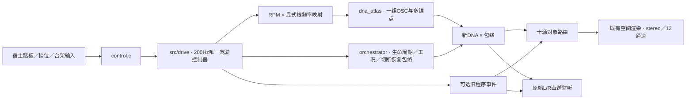

# 新 DNA 驾驶适配器

当前可选接火层：`AdConfig.catch_profile`、`AdMix.catch_gain`、`AdCapture.catch_bloom`。同一200Hz驾驶器给出CATCH许可／进度，完整包络后DNA在互补分层前送入固定滤波组，附加量只路由一次FL/FR。`Launch-Catch-Study.cmd`使用同A启动车内DNA和前段，接火量默认0%，新`.vslrun`为schema5／27字段；旧窗口／播放器保留。45项CTest与短设备／录放通过，完整音色／长期／实际7.1.4未验收。见[接口及证据](../../research/接火低频统一驾驶V1.md)。以下保留原接入说明。

新增可选`AdConfig.scene_mode=AD_SCENE_STEREO_BED`：DNA／互补低频／残差以原观察L/R进入`stereo_bed`，工程辅助与瞬态进入唯一空间渲染器，最后合流。观察声床不再重复写入排气／BODY对象，不额外施加对象的高通、座舱滤波或推测位置。房间／视角／传播只作用于对象；12通道声床只占FL/FR，其余依赖独立对象。默认0保留原投影。宿主支持`--stereo-bed 1`，原生窗口支持`--stereo-bed`；新行程schema3保存模式，详见[声床模块](../stereo_bed/README.md)。

`control.h/c` 接收踏板、台架、挡位和监听输入；`render.h/c` 将既有驾驶控制器与新 `dna_atlas`、对象路由和空间渲染连接。宿主示例为 `experiments/atlas_drive_v1/probe.c`。

`ad_render_init` 借用独占的 `VslEngine` 存储，初始化驾驶、工况包络与空间状态。不得再把该存储交给 `vsl_process_layout` 或其他监听器。每240样本只调用一次 `vsl_drive_step`；OSC、事件和空间每样本各推进一次。宿主不积分RPM，也不重写换挡结果。`ad_render_set` 对非法／非有限输入整体拒绝。

DNA使用 `voice.dna_gain`，保留现有工况、负载、启动、换挡切断与恢复响应；18ms平滑从控制率接到音频率。它目前仅是**工况增益响应**：没有把原DNA的谱倾斜／截止直接套到新录音模型，也没有训练每种状态各自的声纹。喷油状态由旧控制器推进，未将录音混合声纹整体视作燃烧脉冲门控。

`root_per_rpm` 必须显式配置；E高转车内实验取1/120，来自多谱线／仪表区间的有限假设。此值没有自动推广给A车外或其他车型。`profile`选择原驾驶工程参数；bank选音色。匹配关系仍由有来源的配方负责。

当前连接新DNA、互补低频、可选残差、旧程序事件和 `modules/drive_aux` 五路辅助层。事件和辅助量默认0，声源／RNG仍持续推进；后者以同一驾驶状态更新曲轴、机械模态和NVH，独立保留raw／增益后／对象捕获。它们是工程模板，未经过实录分离／瞬态拟合或新听评；不属于已认可的新DNA音色。不能叠加整套旧DNA或把A移动尾排LF加到E车内。

原始L/R是录音观察，直送捕获保留它们；对象渲染按显式选择的左／右／中观察投影，等幅分到两个排气对象（各1/2），不是将录音左右解释为发动机左右缸列。源始终持续生成，直送与空间按18ms平滑切换，空间缓存不重置。12通道模式固定走空间；高度只接房间反射，房间为0时高度静音。布局沿用FL/FR/FC/LFE/BL/BR/SL/SR/TFL/TFR/TBL/TBR。

`AdCapture` 可取原始双声道DNA、包络后DNA、可选事件、干声、十源对象和逐样本遥测，均为调用方提供的独立缓冲区。输出float不作限幅或归一化；宿主负责余量、启停淡化和设备。实验宿主另存200HzCSV、配置与性能JSON、IEEE float WAV；模型／代码／输出哈希由离线验证器绑定。

该接口不读取旧take，不更改旧驾驶DSP0.20.0或旧take schema5。原生驾驶UI、设备和新 `.vslrun` schema5由外层模块提供；新音色、空间与完整驾驶听评仍待完成。E两档模型只覆盖高转车内语境，不能据此宣称全工况标定。

后续宿主已扩展为 `FIRST.model SECOND.model PREFIX --anchor NEXT.model`，最多8档、按根频率递增；`--root-per-rpm` 显式选择映射。已有 E 双档命令保留并通过冻结音频回归。新增 `voices/exterior_anchors_v1` 的 A 驻车车外四档使用同一库，但其1/120仅是工程假设，不能转用 E 仪表证据；与已认可 A 移动尾排配方分开。四档运行的5ms超时增多，尚未进入原生驾驶UI，详见[四锚点研究](../../research/驻车车外四锚点V1.md)。

随后新增原生宿主 `experiments/atlas_monitor_v1`，通过 `atlas_monitor` 淡化与 `win_output` stereo队列监听本接口。短设备测试与采用帧重合成通过，模型和工况覆盖限制保留；见[原生接入](../../research/DNA驾驶原生监听V1.md)。
