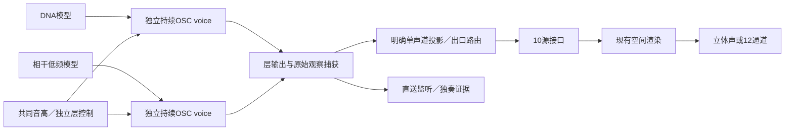

# DNA、低频与空间适配器

此模块将已认可的新 Sound DNA 和相干低频接入现有 `src/spatial`，没有运行旧驾驶 DNA。它是完整系统的连接层；当前只支持固定声学情境的0.90–1.10×音高，不将声学根音解释为实测RPM。

| 文件 | 责任 |
|---|---|
| `source.h/.c` | 两个独立 `SdVoice`；模型与种子显式指定；共同音高、独立细节和层增益；输出原始观察与校准层。 |
| `routing.h/.c` | 明确选左／右／中观察，投影为一个混合单声源，再分配至单侧或成对出口。 |
| `scene.h/.c` | 接收宿主控制快照，平滑空间参数；调用现有对象／传播／房间渲染；捕获干声与十源分轨。 |

接口：`ds_scene_init` → `ds_scene_set` → `ds_scene_process`。初始化在非实时线程；运行控制快照在音频线程采用，调用方负责跨线程同步。profile借用且不可变，必须活得比实例更久。`VslEngine` 存储由宿主独占提供，只作为已有空间API的状态容器；不能同时交给 `vsl_process_layout`。未来可进一步拆出空间状态，当前不复制现有空间算法。

`DsCapture` 可分别捕获原始 DNA／低频双声道、应用增益后的双声道层、直送立体声、空间与主音量之前的十源。各缓冲区互不重叠，由调用方按帧数配置；不需要的捕获置NULL。逐样本核无内存分配、文件或设备操作，无剪裁、限制器或归一化；宿主负责余量和起止淡入淡出。

低频可为空；非空时必须与DNA拥有相同根音、采样率、窗口和步长。两层一起初始化、一直推进，静音不暂停时钟或随机过程；共同音高变化保持相位时钟一致。平均相位属于各自模型，RNG状态各自所有。种子可以分别配置；本次每层显式沿用48271，重现已认可对照，尚未建立联合统计模型。

成对出口每侧分配单声源的一半幅度，使相干求和保持原幅度；它们不是两个独立发动机，也不是录音左右声道的物理分离。此轮将DNA和低频共同投影至出口，以避免未经验证的机体／尾排分离与不同传递。进气、机体、机械、空气、事件、道路、风对象留空，后续分别接入。支持模型变更需要停止并重新初始化；布局、观察投影和路由运行期间固定。

空间复用现有工程模型：监听位置由车外／车内透视参数限定；28Hz高通、120Hz分频、可选几何传播与合成早反射都会影响渲染结果。直送捕获不经过这些处理。12通道顺序为FL/FR/FC/LFE/BL/BR/SL/SR/TFL/TFR/TBL/TBR，WAVE mask为`0x2d63f`；高度只收房间反射。这是通道WAV，不是Atmos元数据，也没有实际扬声器验收。

构建使用根目录 `Build-System.ps1`；`VslDnaScene_probe` 输出浮点渲染、干声和分轨。独立实验构建及复现见 `experiments/dna_scene_v1` 和[研究记录](../../research/DNA空间接入V1.md)。
