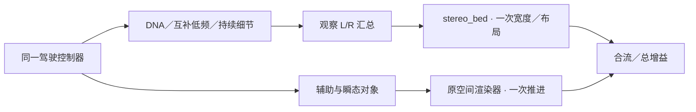

# 观察立体声声床

保留录音模型的 L/R，不把它们解释成发动机左右缸列。这个模块只做输出布局与一次 M/S 宽度控制；不生成新声场、不做几何传播、滤波、响度补偿或房间模拟。

`sb_layout_init` 非实时校验2／12通道，非法输入不改变原布局。`sb_route` 每样本接收已校验的有限左右声道与0..1宽度；宽度1逐值保留原输入，宽度0为等幅中声道。12通道顺序沿用 FL/FR/FC/LFE/BL/BR/SL/SR/TFL/TFR/TBL/TBR，仅 FL/FR 接收此声床，其他通道为0。高度和LFE不会自动复制已有低频。

`AdConfig.scene_mode=AD_SCENE_STEREO_BED` 在 `atlas_drive` 选择新路径：

DNA／低频／残差不会同时再写入排气与BODY对象，避免重复能量；对象捕获只含真正送入空间器的工程辅助与瞬态。`AdCapture.observation` 保存宽度／总增益前的混合L/R，`bed` 保存按布局路由后的声床。原有分层、RNG和源哈希保持独立于布局。

声床包含录音位置与原空间传递，故不再追加一套推测的物理排气位置、28Hz高通或座舱滤波；房间／视角／传播只作用于辅助与瞬态对象。这是观察场与工程对象并存的方案，尚未从录音识别真实声源位置或精确时间对齐。

模式在初始化时固定并随新`.vslrun` schema3保存，控制仍为25字段。默认模式0沿用旧对象投影。旧schema2使用`baselines/system_status_v1`或`stereo_bed_v1/before/bin`匹配播放器，旧schema1继续用原冻结播放器；不放宽身份检查。
