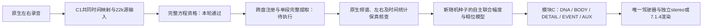

# C1 完整数学核验 V1

2026-11-16。**同一份新声源输入的完整数学核验通过；尚未产生新的持续音色或替换实时 C。** 本轮解决的是提取工具的计算一致性，不能把它当作“电子感已经消失”。

最新听评仍为：左右变化更自然、音色未退化，但与录音相比仍有轻微电子感。下一阶段继续保留左右联合分析，重点恢复声源细节之间的联系。

## 做了什么

在[上一阶段](C1新声源输入与带宽V1.md)已保存的输入上，新增独立审核身份 `vsl.c1-declared-objective/1`。不重新准备录音、不重新拟合，也不修改原失败记录。

参考算子明确固定4096点 Hann／256步长、有限帧覆盖归一化、输入乘归一化后乘窗、每声道 RFFT 及端点权重。独立实现重叠相加伴随，并从原 `metric_target` 独立复核校准，实际目标继续使用原冻结校准。

依次检查完整前向、伴随、法方程、右端项、两种内积、覆盖、原曲率、原目标波形与频谱，以及“原目标＋正的新增上下文”的完整分解。已知案例另建立全部频点的增广矩阵，独立 QR 对照；真实案例禁止走小矩阵求解入口。

| 实际执行 | 结果 |
|---|---|
| 四组完整已知信号 | 左右不等、非线性时钟＋声道延迟、右静音、全静音全部通过 |
| 三组非零完整增广 QR | 相对系数差最大 `1.73073e-14`，原门槛 `2e-7` |
| 已知完整方程／矩阵比较 | 最大 `2.20847e-15`；十种输入／探针破坏均在预期位置拒绝 |
| 同一 FirstLate 真实输入 | 完整规定算子方程与目标分解通过；最大归一化误差 `1.94667e-12 < 2e-12` |
| 真实 RHS | 与保存探针逐位一致；不代表其他方程也逐位一致 |
| 原 SciPy 参考算子 | 仍为 `2.5585096571438003e-12 > 2e-12`，保留失败 |

真实输入仍为 **18430全帧／14334目标帧／288阶／73节点／57原节点／89原始时钟观测**。完整算子为661724行、84096个实参数；没有减少阶次、节点、上下文或源带宽来换取通过。旧校准、新旧音频及全部查询重新绑定核验。

这次通过的是事先明确定义的另一套浮点测量规则。没有补写原 SciPy 审核为成功，也没有建立任意 FFT 实现之间的通用误差界。原审核和新审核必须分别引用。

## 模块边界

| 文件 | 职责 |
|---|---|
| `tools/c1_declared_objective_v1/profile.py` | 原目标校准复核、冻结校准和完整有限帧覆盖 |
| `oracle.py` | 独立完整方程与规定顺序的帧伴随 |
| `dense.py` | 仅已知小案例的完整矩阵／增广 QR，拒绝真实大输入 |
| `audit.py` | 全方程、目标／上下文分解和原算子差异报告 |
| `tools/audit_c1_declared_known_v1.py` | 已知先行及十种破坏拒绝 |
| `tools/audit_c1_declared_real_v1.py` | 同一真实输入的来源、采样、完整方程核验 |
| `tools/inspect_c1_declared_resources_v1.py` | 只读防重复检查与单段资源预算，不注册或启动拟合 |

实际证据在 `E:/VehicleSoundLab/references/analysis/c1_declared_objective_v1/`：`known1`、`real1`、`resources1` 均终止。执行源码和输入哈希随报告留存。

## 后续提取条件

只读检查确认 FirstLate 尚未在两个原 E 盘完整拟合命名空间执行，D 盘仍仅有空资源探测目录。重新验证原124源码／101输入／151条件绑定，以及670个C/H、82音色文件、3个F2文件和C索引／听评。

对同一完整288阶／73节点、1024面板预算，四个文件因子合计 **24.9135 GiB**，保留原余量后要求 **26.9135 GiB磁盘／6.4706 GiB可用内存**。本次D盘可用616.4765 GiB，内存与磁盘均通过；全部阶段／文件算术另行重算相符。这是瞬时资源预检，不是实际峰值、运行耗时或算力实测。

**跨盘运行注册尚未实现，真实拟合尚未启动。** 下一步按 `c1_declared_objective_next_v1_plan.json` 建立原标签防重复记录和同一注册在E／D的绑定，再注册新方法的一段完整提取；FirstEarly、FirstMid不重拟合，其余四段不自动启动。

## 如何通向可控声源

宽带输入保留、数学求解正确、录音统计保真、持续生成自然度，是不同检查。当前只完成前两项中的输入与方程资格，真实完整求解及后两项仍待完成。

优化继续从原录音提取**各阶次幅度、相位和左右关系随时间的联合变化**，随后用新随机序列持续生成；拟合 PCM／系数轨迹不能循环充当发动机。高频细节要依附声源共同变化，不能再靠独立高频 OSC 云或整体增亮填补。房间／IR和最终空间渲染继续独立，不能用它们遮盖干声缺陷。

本轮离线代码不增加当前 C 的 MCPS；现有800MCPS规划／900分配仍属估算。完整的多实际发动机、全工况、可控持续声源和未来物理7.1.4目标继续。
