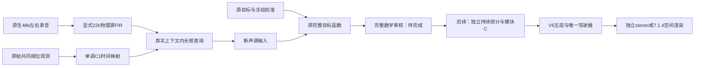

# C1 新声源输入与带宽 V1

2026-11-16。本轮完成新输入适配的四组完整已知信号验证，以及一段真实素材的输入准备和独立采样核验。**真实片段的完整目标函数审核仍未通过，暂未启动拟合或替换实时音色。** 上一轮仅复核 MCPS，没有推进合成；本轮新增了可复用的提取输入、带宽证据和明确的审核差异定位。

研究仍面向原生、可控、持续生成的左右联合声源，以及 V6 的 DNA／BODY／DETAIL／EVENT／AUX、唯一驾驶器和独立未来 7.1.4。拟合系数和录音片段都不能循环当作最终发动机。

## 输入与模块

新契约 `vsl.c1-source-input/1` 明确保存两套源数据：原有 `legacy_audio/target/source_coordinates` 和新 `audio/target/source_coordinates`。`metric_target` 继续使用原目标，只负责校准；weights、sigma、floor、amplitude、scale、全部阶次与拟合节点保持。新音频提供待拟合的数据，不重新定义评估尺度。

| 模块 | 职责 |
|---|---|
| `tools/c1_source_adapter_v1/contract.py` | 拷贝拥有输入，区分新旧数据，核验原观测与时钟 |
| `bandwidth.py` | 三次曲线导数极值、物理带宽及阶次中心范围 |
| `objective.py`、`solve.py` | 保留既有完整方程与文件因子求解后端，仅已知案例执行求解 |
| `tools/c1_source_prepare_v1/source.py` | 1025 taps、22 kHz Kaiser12 FIR，半径2048 Kaiser20 查询 |
| `provenance.py` | 已知资格、素材绑定、旧运行命名空间及保护清单 |
| `audit_sampling.py`、`audit_objective.py` | 独立直接FIR／逐偏移查询和完整目标函数核查 |
| 独立 CLI | 分开运行、审核、诊断、发布、归档，不合并为一个大脚本 |

本轮未新增或改写实时 C。房间、IR、声场和唯一驾驶器保持在原有独立模块中。

## 已完成的已知验证

四种物理解析源：左右不等、右声道延迟0.35 ms、右静音、全静音。旧 PL 与新 C1 查询的是同一个物理信号；完整上下文、非均匀节点、原尺度与正则项不变。

独立核验完整前向／伴随／法方程／右端项、原目标加正上下文的分解，并对三组非零案例做完整增广 QR。最大相对系数差 `1.72734e-14`，低于原 `2e-7`；完整求解历史、因子、修正、双gap和17项指标审核通过。16类非法契约被拒绝，调用方修改数组不会改变已准备输入。

另以原生48k解析信号检查实际22k物理滤波和长核采样，频率覆盖64至23424 Hz，四种声道身份保留。独立解析采样最大差／源系数L1为 `4.75627e-12`，低于事先声明 `2e-10`；全滤波和所有查询逐一核验，8类非法输入拒绝。

## 唯一真实输入

选用此前未执行完整波形文件拟合的 `F3 Fifth First Late`。旧 FirstEarly、FirstMid 不重算；余四段没有批量启动。原始与现有完整拟合命名空间均检查该段不存在，D盘目前仅资源预检目录，无新拟合注册。

保留 **18430帧／14334目标帧／288阶／73节点，其中原目标57节点**，以及89个原始时钟观测。新源使用相同左右时间映射与真正上下文，没有补零、外推、响度补偿或扩宽。

| 独立输入检查 | 结果 |
|---|---:|
| 全18430个C1查询最大时间差 | 2.84217e-14秒 |
| 原观测节点误差 | 0 |
| 全源FIR最大差／滤后源峰值 | 1.08663e-15 |
| 全部sinc源样本最大差／滤后源峰值 | 8.69301e-15 |
| 相位网格采样率范围 | 68.901–70.697 kHz |
| 观测声学根音范围 | 67.2866–69.0399 Hz |
| 288阶载波中心上限范围 | 19.3785–19.8835 kHz |

上述根音不是独立实测曲轴RPM；载波中心也不是严格带宽边界。有限FIR与导数检查不能证明任意非线性时间变换绝无混叠。输入保留到更宽频段，不等于288阶DNA已能承担全部细节，更不等于完成物理声源分离。

## 未通过项及定位

`prepare_audit1` 在完整右端项比较中失败：`2.5585096571438003e-12 > 2e-12`。原失败报告、门槛和执行源码保留，没有改成通过。

在四组已知控制后，对同一真实输入做“参考帧算子 × 校准来源”的2×2检查：

| 独立参考 | 相对最大RHS差 |
|---|---:|
| SciPy参考帧＋独立旧校准 | 2.55851e-12，失败 |
| SciPy参考帧＋冻结旧校准 | 2.55851e-12，失败 |
| 规定FP64计算顺序＋独立旧校准 | 2.98952e-15 |
| 规定FP64计算顺序＋冻结旧校准 | 0，逐位一致 |

差异位于不同浮点帧算子之间，重新选校准不能解决。逐位RHS一致只定位了问题，**不替代完整目标函数审核，也没有建立通用跨FFT误差界**。原审核在RHS处停止，之后的内积和目标分解尚未由该次真实审核完成；不能借已知信号的通过来补写真实通过。

下一步是单独的、已知信号先行的完整“规定浮点算子”数学审核，再消费同一已准备捕获。必须核验全部方程和目标分解，并继续公开原参考算子的失败；通过后才能处理显式新方法注册、跨盘重复标签和资源证明。当前无拟合准入、无持续统计准入或新音色验收。

## 原录音的物理带宽证据

在完全相同的原生48k区间 `161.446875–161.65279166666667秒`、9884帧，比较原声、原14k源FIR、新22k源FIR。这里只比较物理源滤波，没有把时钟、拟合或持续生成混入对照。

| 原生观察 | 原声 | 原14k FIR | 新22k FIR |
|---|---:|---:|---:|
| 14–24kHz LR功率，FS² | 1.721707e-9 | 6.568907e-12 | 1.721707e-9 |
| 相对原声功率变化，dB | 0 | −24.184662 | −0.000001025 |

新输入保住了这段录音的大部分可测超高频功率；22–24kHz依然受到滤波影响，不能称原始全频无损。这里原声最高带本身很弱，不能据24dB比例断言已经解释或解决全部电子感。

所有2049频点、左右复互谱、直接Mid／Side、各带功率CV、协方差及1–8 lag统计独立核验；240个CSV发布数值精确往返。图已实际查看，SVG解析通过。极弱频带的跨算子相对误差仍不作认证声明。

实际图与数据位于工作区 `E:/VehicleSoundLab/references/analysis/c1_source_adapter_v1/review1/`，Git不复制素材及图像载荷。

原124源码／101输入／151条件绑定、670个C/H、82音色文件、3个F2文件、C索引、认可moving35、默认值、单驾驶器、资产拥有／录放／房间／听评保持。本轮无推送、下载、新听评或旧68项CTest重跑。完整目标继续，下一步见 `research/c1_source_adapter_next_v1_plan.json`。
