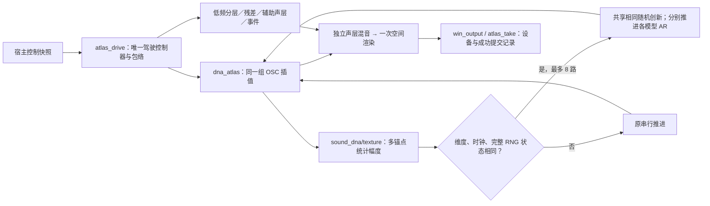

# C 性能核查 V1

本轮保留音色与模块接口，只优化多锚点已经相同的随机创新计算。A 四锚点、E 两锚点三次交替旧／新离线测试，处理耗时中位数分别减少 **5.39%／3.08%**。仍有 5 ms 超时，不能据此宣称硬实时达标。

## 模块与改动

- `modules/sound_dna/texture.c/.h`：新增 `sd_texture_prepare_batch`。先检查实际状态，再复用同一个高斯创新；各锚点保留自己的 AR 系数、完整状态、计数和随机序列。超过 8 路或不兼容时回到原函数。
- `modules/dna_atlas/voice.c`：把逐锚点 prepare 调用替换为批处理；OSC、相位、频谱与混音公式保持原值。
- `experiments/atlas_perf_v1/probe.c`：Windows 离线性能宿主，测 full／DNA／residual／auxiliary／spatial，写逐块时间、线程 CPU 周期与状态轨迹。模型读取、哈希和文件输出在计时外。
- `experiments/atlas_perf_v1/checks.c`：25 组维度／种子／时钟／路数条件，对完整 texture 状态做逐字节比较；零路数合法。

DSP 内无新增分配、文件读取或宿主职责。批处理不会强行同步原本不同的随机流。

## 结果与边界

每次生成 16 秒，48 kHz、240 帧 stereo、开启分轨捕获；三次交替运行的中位数如下。正常优先级离线进程，测量不是设备回调。

| 录音库 | 旧／新处理秒数 | 耗时减少 | CPU 周期减少 | 旧／新 P99 块耗时 | 旧／新 5 ms 超时块 |
|---|---:|---:|---:|---:|---:|
| A 车外四锚点 | 8.182／7.741 | 5.39% | 5.47% | 8.775／7.850 ms | 199／137 |
| E 车内两锚点 | 5.179／5.020 | 3.08% | 3.39% | 7.622／6.755 ms | 76／55 |

A 的一次重复变慢，存在测量波动。独立 4 秒探针中，DNA 约占 1.5 秒，残差约 0.11 秒、空间约 0.14 秒、辅助约 0.057 秒；各探针控制条件不同，不能直接相加解释完整场景。

一致性：15 个对应场景的输出／声层 FNV 哈希匹配；4 组逐块非计时字段一致；已认可固定 DNA 的 8 秒 raw WAV **完整文件字节相同**。这两种检查的强度分别记录，不能把哈希比较写成逐样本数组比较。428 个已有 C/H 完全保留，3 个已有文件作上述改动，新增 2 个 C 文件，总索引 433 个 C/H。

当前还原后的版本通过 39 项 CTest。实际静音设备的短时录制、保存、自包含重合成与取消回放结果见汇总 JSON；它不能代替长时间设备压力测试或听评。

## 两个未合并的方向

1. **幅度缓存候选撤回**：`candidate2` 的 15 组哈希与 39 项测试通过，但活跃 DNA 约从 1.46 秒变为 1.64 秒／4 秒，A 完整场景也回退。执行过的源码、二进制和结果已留存；当前代码没有该缓存。
2. **极小浮点数仅作诊断**：停火后部分慢块 root 约 `1e-80`，且没有 texture 更新。探针局部开启 FTZ/DAZ 后，E 一次运行 P99 从约 7.51 降到 2.77 ms，超时 71→0；A 仍有超时。这是一次未配对干预，支持继续调查极小数开销。生产音频线程尚未启用；后续须验证线程浮点状态恢复、音频误差与录制回放。

## 复现与续接

`Build-System.ps1` 构建并运行 39 项测试。`tools/run_atlas_perf_v1.py` 按计划保存执行前源码和二进制；`compare_atlas_perf_v1.py` 使用已冻结旧／新探针交替测量；`verify_atlas_perf_v1.py` 核对历史结果、轨迹、既有源码与固定 DNA 字节。

证据在 `E:/VehicleSoundLab/references/analysis/atlas_perf_v1`，阶段分别为 `baseline1/2`、`numeric1`、`candidate1`（本次采用）、`candidate2`（撤回）、`paired1`、`verification1`、`device1`。保留 `build_failure1`，以及未及时留存源码的 `exploration0` 限制；`ctest_final_39.log` 对应撤回候选，最终版本以 `ctest_restored_batch_39.log` 为准。

源码改变会更新 `.vslrun` 的严格渲染身份。旧行程继续使用对应冻结播放器，不能放宽校验来强行读取。已认可的 A 移动尾排 DNA／相干低频保持原模型；本轮没有新增工况或音色听评。

下一步：给极小数处理建立局部、可恢复的数值边界，先做保真／行程验证，再测设备负载；音色研究仍按独立声层、录音视角和听评证据推进。

机器可核对结果见 [atlas_perf_v1_summary.json](atlas_perf_v1_summary.json)。
