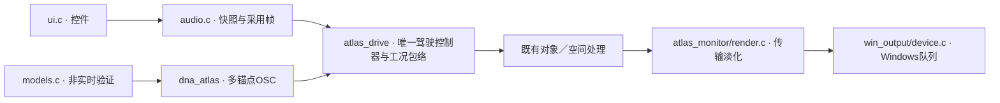

# DNA 驾驶原生监听 V1

2026-11-11。多锚点DNA现有独立Windows驾驶窗口，可选A驻车车外四档／E高转车内两档，操作点火、踏板、挡位、台架转速与空间。**本轮完成工程接入及本机短时设备验证，不增加音色自然度认可，也不代表完整工况声纹已经齐备。**

## 使用

运行 `Launch-DNA-Drive.cmd`，或在重建总入口选择“新DNA驾驶监听”。先开始监听，再点火。默认无自动播放、踏板0、输出约−6dB、直送stereo。开启“空间监听”后可调宽度／房间；“瞬态层”默认关闭，开启后沿用旧程序启动／换挡／收油事件，尚非实录拟合或已认可的新事件音色。台架负载固定0.8，驾驶模式由控制器求解负载。

## C 边界

| 模块 | 文件 | 责任 |
|---|---|---|
| 统计声纹 | `modules/sound_dna/texture.c` | 缓存重复开方值，随机序列与乘加顺序不变 |
| 多锚点／驾驶 | `modules/dna_atlas`、`modules/atlas_drive` | 原有OSC、唯一200Hz控制器、包络与空间；本轮不改声纹映射 |
| 传输淡化 | `modules/atlas_monitor/render.*` | 10ms启停包络，保留原始分轨与12通道接口 |
| 原生设备 | `modules/win_output/device.*` | 512帧×4 stereo队列、MMCSS、提交、耗时与设备时间 |
| 模型／线程／UI | `experiments/atlas_monitor_v1/{models,audio,ui}.*` | 事务载入、快照、遥测和控件分开 |

处理时不分配、不读文件。成功换音色才停流提交，并重新绑定bank到长期模型存储；失败保留原音色。音频线程独占全部模拟状态，UI只改被触碰的参数，不积分转速或覆盖换挡结果。停止监听与熄火不同，重新监听会重建模拟；空间切换不重启声源或缓存。

可移植渲染支持12通道；Windows回调明确拒绝12通道，防止写越立体声缓冲。原始L/R仍是录音观察，不当缸列。未来7.1.4沿用对象接口，本轮没有实际12扬声器验证。四缓冲本身可提前约43ms，另有控制采用和平滑时间；未测低延迟。

## 验证与留痕

- 14组冻结WAV完全相同：A四档×0.9／1.0／1.1，再加认可DNA／相干低频。四次配对12秒驾驶音频也相同；平均处理4.630→4.263秒，约快8.6%。这是计算优化，不是重新调音。
- 最终实际静音设备测试为6秒台架、12秒踏板驾驶、停止淡化和车内模型重启。队列耗尽／10.67ms超预算均为0；最终主场景最坏约6.96ms。首次完整测试最坏8.10ms，也保留。
- 四次捕获按真正采用的控制样本帧离线重现，float逐样本相同。驾驶产生2次挡位事件、1次收油事件；事件音量0时调度仍推进。
- 原生控件检查通过：无自动播放、实时台架RPM、模式启用、模型切换停流、停止／重启、无关参数保持。已查看完整重绘的原生窗口截图。初次测试误选同进程隐藏输入法窗口，后改为核对窗口类；初期截图未完整绘制，最终同步重绘全部子控件再捕获。初期证据保留，不作为布局通过依据。
- 统一30项CTest通过；新契约覆盖启动样本、块大小、停止不可逆、非法输入和12通道源一致性。

最终依据：`E:/VehicleSoundLab/references/analysis/atlas_realtime_v1/device_final`、`ui_final`、`cache`及`build_final.log`。早期测试留在同根目录。程序、源码、输出、命令和哈希见[数值记录](atlas_realtime_v1_summary.json)，本轮冻结位于 `E:/VehicleSoundLab/baselines/atlas_realtime_v1`。

## 待完成

四档／两档音色待听评。A的1/120映射仍是工程假设，低转带宽、锚点间隔、负载／收油／换挡声纹需继续补齐。新驾驶链仅有DNA与可选旧事件；独立低频、进气、机械、噪音未接入，认可A移动尾排低频不直接混入驻车或车内模型。

2048条采用帧记录是调试证据，溢出记计数而不停止合成；不读写旧take，不代表新驾驶链已完成产品录制回放。旧驾驶0.20.0的录制系统保留。本机短测不能代替长期负载、用户听评或实车／扬声器验证。
