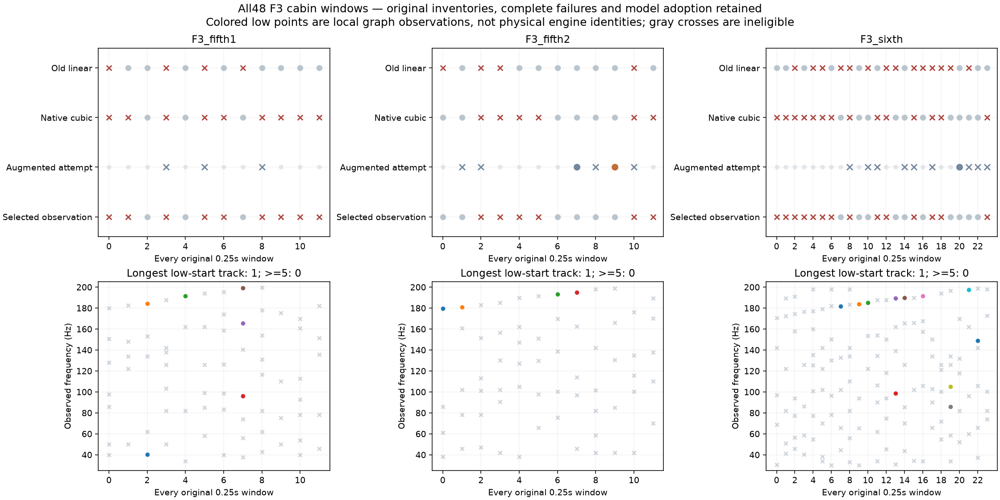
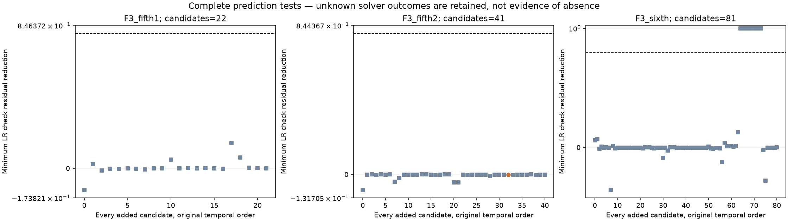

# F3 完整模型与预测 V1

本轮把已知控制中通过的“完整有线／缺线模型＋保留数据预测”应用到**全部48个原F3车内窗口**。它是加速提取方法的真实素材检验，不是新声音或C配方；没有替换怠速候选、认可行驶35%或驾驶默认。

## 方法和边界

两段5挡各12窗、一段6挡24窗，原生48kHz、每窗12000帧。输入与冻结`accel_low_fit_v1/observe2`逐样本相同，保留各窗全部原30–200与200–7000Hz峰、声学比例、前后窗初始化和缺失／歧义；不混入F2尾排或A车外传递特征。

基础模型每线有独立频率和三次相位曲率，左右各自cos/sin/DC系数用QR消去。仍用原频偏2Hz／邻线界、端点变化率±500Hz/s、最多64线、每个假设60次评估和原秩／触界／相对功率／0.8局部支持条件。多线模型每窗恒定幅度；不是已分离的发动机或实测RPM／负载。

按时间顺序，只有前一个新选择结果可提出当前观察清单未含的候选。每个扩充窗完整计算一次全窗扩充模型、一个前9000帧有线模型，以及每条新增线对应的独立缺线模型。后者都重新优化其余全部参数，随后固定参数预测末3000帧。仅所有新增线均通过原最终支持条件、训练秩／参数条件及双声道预测收益≥0.8才采用整个扩充模型；否则保留原基础观察，失败明确记未知，所有尝试保留，不尝试候选子集或按最低成本暗中择优。

全窗峰清单和前后窗初始化已观察，因此这里是**有条件的参数预测**，不是未见录音留出或在线因果预测。一次K候选的最坏预算连同基础拟合可达`60×(K+3)`，不是总预算相同的性能比较。四工作线程／BLAS2仅是离线执行方式，不代表实时可用。

## 全48基础拟合

| 段落 | 旧线性相位成功窗 | 新三次相位成功窗 |
|---|---:|---:|
| F3_fifth1 | 8/12 | 3/12 |
| F3_fifth2 | 8/12 | 6/12 |
| F3_sixth | 10/24 | 10/24 |
| 合计 | 26/48 | 19/48 |

29个新基础失败窗均为原60次评估耗尽，所有结果保留；617条局部线触及原边界。新模型各段左声道Hann加权相对残差中位数约0.349／0.368／0.389，旧模型约0.356／0.387／0.407。**残差稍降不等于持续性、精度或听感提高**，不能通过增加曲率就宣告加速提取已完成。

## 扩充和持续性结果

19个窗口尝试扩充，共144条候选：**0条完整支持、143条因假设求解／容量失败而未知、1条检验不支持，0窗采用扩充**。未知不是不存在；数值上的预测收益即便很高，也不能跳过假设成功、参数和原最终支持条件。原基础局部观察保留，并非用失败扩充模型覆盖。

最终有1942条局部拟合线，238条满足本次局部条件。三段按原相切连接或新三次边界连接，低于200Hz起点的最长轨迹均为1窗，没有至少5窗的轨迹，没有前后半各3窗的低频预测。旧消元模型仅第二段在新边界规则下有2窗，仍无可预测低轨迹。**当前方法不能提供可持续控制的加速低频声源**，也不能把断线解释成实车没有低频。

状态图灰叉为不合格观察，彩点只表示局部图节点，不是物理声源身份；预测图方块为未知，橙点为不支持，虚线为0.8条件，不能单凭越线认定通过。

## 后验频带覆盖检查

执行期间原基础拟合已经全部落盘，检查其残差后另立`accel_candidate_prediction_v1_coverage_plan.json`。这是明确的后验描述，不参与拟合、候选或参数选择，也不称独立预选模型。

固定原生0.25秒周期Hann窗，按30–200／200–1200／1200–4000／4000–7000／7000–14000Hz统计双声道原声与基础模型残差；包括所有失败窗。残差／原声功率不是可相加的物理缺失声源预算，可能因交叉项大于1。中心频率计数也不能取代整个调频声线的频带功率。

| 段落 | 30–200Hz残差功率中位比 L/R | 200–1200Hz | 1.2–4kHz | 4–7kHz／7–14kHz |
|---|---:|---:|---:|---:|
| F3_fifth1 | 0.226 / 0.238 | 0.0286 / 0.0246 | 0.226 / 0.416 | 均约1.000 |
| F3_fifth2 | 0.335 / 0.353 | 0.0222 / 0.0247 | 0.337 / 0.375 | 均约1.000 |
| F3_sixth | 0.323 / 0.319 | 0.0443 / 0.0438 | 0.351 / 0.432 | 均约1.000 |

当前基础模型仅尝试30–7000Hz峰；7–14kHz位于清单外。4–7kHz即使在当前范围内也几乎未被覆盖，不能把它直接归为噪声或认定没有发动机声线。下一步应检查遗漏上频段的原始结构，而不是继续只改低频优化器或直接加一层任意高频OSC。

全部48个原观察清单在4–7kHz的峰计数为0，拟合中心计数也为0。这定位了当前模型的覆盖缺口，**不是“这个频段不存在车声”或“全系统高频都没有”**；这份加速研究不是当前完整C混音。细节应独立分析后再与主声线协同，不能将上述总残差直接转换成增益或噪声层预算。

## 独立核查与留痕

独立审计全部48输入／峰清单／初始对应、1942条基础线、2021条原始尝试线、1942条最终线，以及163个掩码模型的8001条线；同时重建全部局部波形、秩／界／条件支持、3000帧预测成本、144候选判断、最终数组选择和6组对应图／源内预测。容量失败的空模型与全部未知同样保存。未重跑优化或筛选较好片段。

原样本误差为0；全窗最大波形重建误差8.073e−14FS，掩码模型8.116e−14FS，掩码成本误差1.11e−16。后验频带检查另用已知五格点音调、Parseval及独立periodogram归一核对所有48窗／左右／源与残差，绝对频带功率最大差3.34e−16、Parseval差2.09e−15。这些是实现和报告核查，不能证明真实声源身份或听感。

两个全窗图已目视，完整证据／精确源码／所有失败冻结`E:/VehicleSoundLab/baselines/accel_candidate_prediction_v1`；摘要`accel_candidate_prediction_v1_summary.json`为最终审计索引。原观察报告仍保存执行结束时“待审计”的历史字段，不改写过去记录。

## 工程位置

`native_phase_patch_v1`负责已有局部模型／对应；`candidate_presence_v1`负责观察候选与条件支持；`candidate_prediction_v1`负责完整掩码假设和明确采用规则。`observe_accel_candidate_prediction_v1.py`是本次素材宿主，`audit_`／`plot_`／`package_`入口分别核对、显示和归档；新增`accel_candidate_prediction_v1/coverage.py`仅负责描述性频带核查，不写入任何声源或控制器。

612份C/H、67份旧voice配置、旧播放器／take／空间入口保持；没有重复无关的61项旧驾驶测试。怠速继续使用已交付的[颗粒激励对照](http://127.0.0.1:8789/references/analysis/idle_excitation_moments_v1/review1/index.html)等待听评，本轮不再盲调或重复提问。原共同相位36／17／33／逐线14k／原E资格仍须满足，独立局部声线研究不豁免这些条件。完整加速、多发动机及总目标继续。
