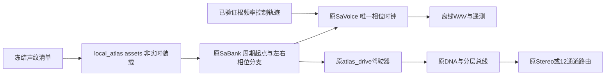

# F3连续局部声纹库 V1

**两次五挡升速各自的前／中／后三点，已组成两个可连续控制的局部库，并复用原C声源和唯一驾驶器通过工程核查。** 它们尚未进入实时音色目录，也未获得新的连续听感验收。

前一目标轮完成五个局部声纹的提取、核查和冻结，是实质进展。本轮直接使用这些冻结参数及此前冻结中点，不重新拟合或移动观察窗口。

| 独立分组 | 前部 | 冻结中点 | 后部 |
|---|---:|---:|---:|
| F3第一次五挡升速 | 61.36080 Hz | 64.80444 Hz | 67.95806 Hz |
| F3第二次五挡升速 | 60.81944 Hz | 64.01487 Hz | 67.36432 Hz |

三点来自同一次升速，两次分别建库；六挡候选保持分开。所有模型288分音／12统计分量，均低于旧加载边界。该局部范围不代表高根频率实录验证、全转速或负载覆盖；1/120根频率／RPM映射仍为工程假设。

## C链路与控制

新增`experiments/local_atlas_v1`的8份C/H分为资产、轨迹、有界整数读取、导出宿主和两个契约检查。没有修改原656份C/H；`sound_dna`／`dna_atlas`／驾驶／分层／空间／录放均保持原实现。新增清单与轨迹都是**离线实验输入**，没有变更实时preset／take格式。

清单拥有三份模型并修复bank借用指针，失败事务保持原对象；所有加载、分配与文件读取在开始处理前完成。轨迹按事件帧拆分音频块，调用原18ms参数跟随，不把块边界当成控制时钟。

沿用32阶共同L/R周期起点对齐；它修正分析坐标的任意原点，不识别曲轴或物理排气传播。原SaVoice仍在相邻声纹间插值幅度及左右相位，所有锚点统计状态持续推进。相同种子／相同抽样数具有相同创新序列，不表示不同模型的SVD潜变量已有物理配准。

两组都使用12秒工程轨迹：低点保持1秒、3秒升至高点、保持1秒、3秒降回、保持1秒、2秒再升、保持1秒。三种子1／23117／61927；每种子比较三锚点与只用冻结中点的变调，共12条12秒持续声，另外两条用于37／512块长复现。没有循环原声、EQ、房间或新增高低频层。

## 实际验证

- 首次`build1`因新增一层嵌套后超过Windows工具的可用路径长度，出现`DirectoryNotFoundException`；源码／日志原样保留。仅将新实验二进制子目录缩为`p`，`build2`成功，未改共享DSP。后次构建无警告，新增两项CTest均通过；未重复未修改的原70项。
- 三个解析双声道锚点先于实录运行，完整576000帧输出对独立理想波形最大误差1.54e-7 FS，满足预定3e-7。排序错误、轨迹重复／越界、无效浮点、整数溢出／符号、seed／block无效均拒绝；已有输出不被覆盖。
- 两个真实局部库的周期对齐分数，由独立有限Fourier导数多项式根和8192区间极值搜索核查。最大分数差约2.77e-14，小于固定1e-10条件；这是数值极值核查，不是符号全局最优证明。
- 全部12条声源输出的200Hz及分支切换CSV，与独立逐样本根频率跟随／相位时钟计算一致；保存CSV处根频率和相位差为0。两次三锚点生成全程均位于各自首尾根频率之间；这是输入范围，不是实录连续状态覆盖。
- 每库固定80个采样位置，含所有实际分支切换前后及各轨迹转折附近；12条音频经独立PRNG／逐锚点统计状态／直接三角与解析正弦网格插值求和核查，最大误差约2.98e-8 FS，满足0.5001 FLOAT ULP＋2e-9 FS。第一／第二库分别推进3104／3076次统计更新，全部锚点与参照一致。它是稀疏随机声核查，不是全样本随机oracle或听感证明。
- 每库seed1的37帧与512帧输出WAV和CSV整文件完全相同。
- 原`atlas_drive`对已知库及两个真实库各跑240123帧，切换低／中／高根频率和正负工程负载。2／12通道的原始DNA、六条干声总线、驾驶及DNA状态逐样本／逐块精确相同，三锚点均实际经过；每个渲染实例内源帧、驾驶帧和宿主帧一致。12通道数值核查不代表物理7.1.4监听或标定。

首次失败、两次构建源、已知输入／拒绝日志、六份冻结参数绑定、所有生成音频、遥测、二进制、独立核查、试听及浏览器记录均冻结。原656份C/H和76参数/F2精确保持，新增8份后索引664；没有新媒体下载或推送。

## 听感与系统边界

试听页`references/analysis/F3_local_atlas_v1/review1/index.html`只有一个播放器：两组各三种子、三锚点／单中点共12片段，共同0.5增益与首尾5ms淡化，无逐条响度补偿。自动静音浏览器验证全部时长／6秒定位／播放／切换暂停／快速切换竞争／原参考链接／手机布局通过，比较图与三张界面图已目视；没有进行人工听评。

三锚点相对单中点不仅改变幅度，还改变平均相位与其任意周期原点，不能把两者直接相减当作音色误差。生成左右功率差曲线只用于观察控制结果；当前高频／非谐波和车内环境缺口仍在，空间改善仍需独立细节和路由工作。

这一步把冻结声纹变成了受轨迹控制的连续C声源，也验证了同一驾驶框架能够驱动它。下一步将两组作为**明确标注局部支持范围的可选音色**接入原统一窗口、owned参数与录放，保留默认及旧行程；继续用同一驾驶器和分层总线，不新增平行系统。宽转速工况、其他真实发动机、各状态细节与物理7.1.4仍需继续。

F2怠速与F3叠加细节的独立听评仍待答，不重复问题、盲调强度或自动迁移。E反馈“左右关系有改善，音色仍明显电子”保持；新数值验证不覆盖这一听感。

复现顺序：`build_local_atlas_v1.py`→`run_F3_local_atlas_v1.py --stage known`→`--stage source`→`audit_F3_local_atlas_v1.py`→`review_F3_local_atlas_v1.py`；全部需显式工作区／构建证据参数及新输出目录。[实验输入与C接口](../experiments/local_atlas_v1/README.md)，冻结包`baselines/F3_local_atlas_v1`，摘要`research/F3_local_atlas_v1_summary.json`。
