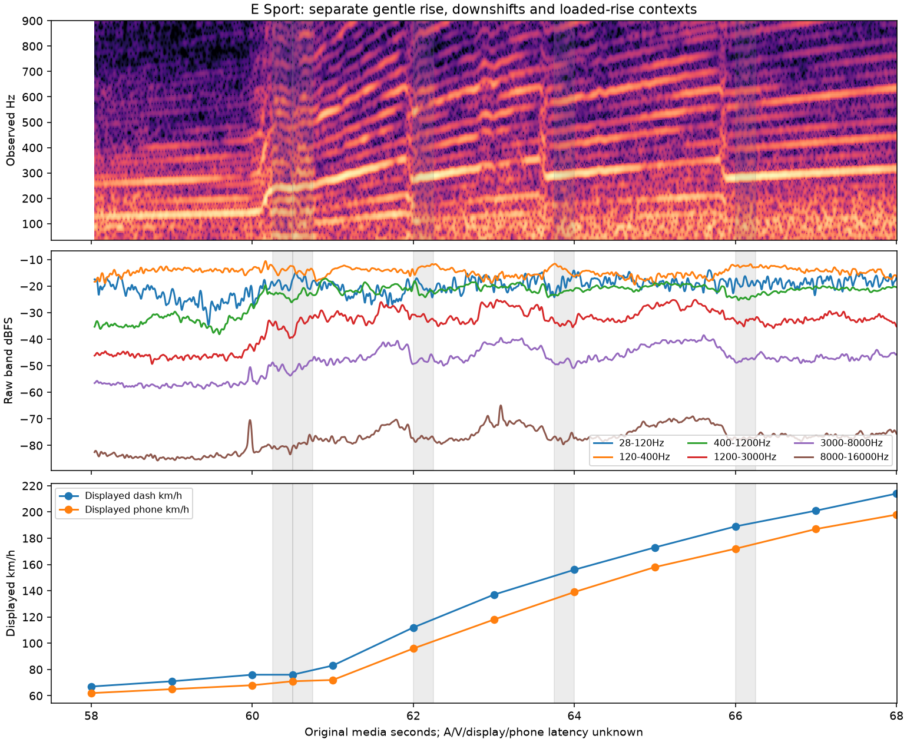

# Sport 降挡与低转依据 V1

2026-11-12。检查已批准E素材中另一段Sport加速，新增动作／录音上下文及一次预定低转声学诊断。**没有导出新DNA、改自动挡策略或完成加速音色。**

## 视频中实际看到什么

两轮解码48个帧文件／7张联系表，58s重复一次，不称48个独立时点。57.75–58.00s存在明显剪辑：Corsa改为Sport仪表布局与画面，时钟14:12→14:17，表速95→67km/h。不能跨剪辑沿用连续轨迹或AV时差。

| 仪表变化 | 最后旧挡→首次新挡，原视频秒 |
|---|---|
| 4→3 | 60.25→60.50 |
| 3→2 | 60.50→60.75 |
| 2→3 | 62.00→62.25 |
| 3→4 | 63.75→64.00 |
| 4→5 | 66.00→66.25 |

58–60s表速67→76、4挡；61s为2挡／83km/h，62s为2挡／112km/h。手机和仪表读数不同，例如62s为96／112km/h，不能拼作同一测量。视频支持“先较缓4挡加速，连续降挡后再升挡”；是否踏板触发kickdown、负载、真实RPM、切扭或执行器时间均未测到。注记见[sport_acceleration_v1_annotations.json](sport_acceleration_v1_annotations.json)。

当前`src/drive/drive.c`的动力降挡主要依据`RPM < 1800 + 1000×throttle`等阈值，尚无按本段标定的多挡kickdown目标策略。此观察不直接修改控制器，也不将58–66s错误归为固定挡位声纹。

## 一次固定计划的低转诊断

看完动作后、声学拟合前固定58.6–59.6s，初始声学根音25Hz，主参考5、交叉参考3／7；每项只运行原两周期修正器一次，不换窗／换参考搜索到通过。假设显示相对音频偏移±.6s，该窗仍在显示4挡的58.00–60.25s内；这只是敏感度范围，不是测得的AV对齐。

主参考根音修正26.110–28.292Hz、约25周期，最多6个不重叠四周期窗；独立载波7／10／15的相位相干约.950／.978／.955，通过该项内部检查。但是交叉参考3和7均缺粗路径，无法比较独立路径，所以**总局部门槛失败**。原通用`phase_clock_v1`资格也仍未通过，不输出新参数、RPM映射或状态EQ。

另按固定绝对频带测58.6–59.6、60.5–61.5、62.5–63.5、64.6–65.4s原立体声预算，未做相位变换；它们含不同挡位、转速和机位传递，不能直接叫同RPM负载差异。谐波颜色诊断使用共同46.875Hz坐标，与原始绝对Hz预算分别解释。

## 工程结论和留痕

素材证明了需要区分“固定挡位带载升转”和“降挡后加速”，未证明现有系统已还原其中任一全过程。共用一个控制器与参数化生成核的边界保持：先补独立中低转／动作证据，再建立转速及负载参数；录音视角与行驶35%车外配方分开。

`tools/local_voice_v1/qualification.py`包装原分析核，仅执行固定计划；`analyze_sport_acceleration_v1.py`绑定批准源、原PTS、动作注记和原始预算。两次analysis数值观察相等，第二次只使C索引校验允许新模块增长。未改原生成／驾驶C或默认音色。

证据`E:/VehicleSoundLab/references/analysis/sport_acceleration_v1/{inspect1,inspect2,analysis1,analysis2}`，全部执行版本保留；摘要[sport_acceleration_v1_summary.json](sport_acceleration_v1_summary.json)。随连续共振C核冻结至`E:/VehicleSoundLab/baselines/resonant_detail_c_v1`。不重复怠速候选的待答问题，也不继续同源参考／窗口搜索以迫使相位门槛通过。
