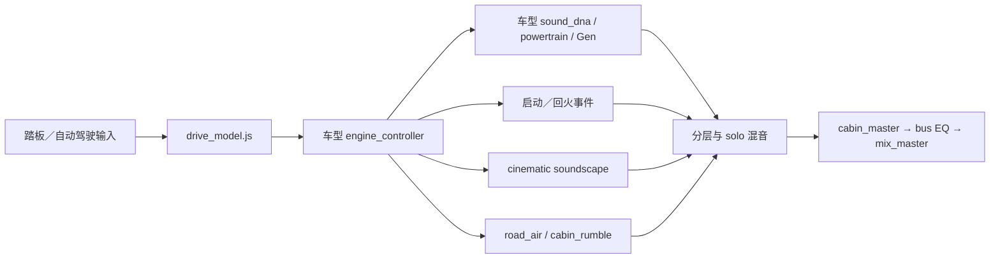

# V6 公开链路核查 V1

2026-11-12。V6 值得沿用的是**驾驶控制、连续 DNA、事件、铺底／道路／座舱、混音各自独立的接口**。当前公开 V10 的 DNA 直接使用程序合成；历史纹理循环与可选启动采样需分别理解。此次只核对固定版本文本和连线，没有在 Max 中执行或新增听评。

上游版本：`ac2b37d8639027d79934a2023cf8d1d37d3b2f96`。快照含129个 Max／Gen／JS／预设等文本，共32,658,127字节，逐文件核对 Git blob 和 SHA-256。没有下载新音视频。首次取回有一个 V12 文本超时；失败记录、128个已取文本和恢复后的完整快照均保留。

## 实际入口和声音路径

`main.maxpat` 当前公开打开 EV、V10、V12、IONIQ6N 四页；仓库另有旧通用 `vehicle_engine~`。这是当前入口盘点，不限制项目未来的音色数量。四种 powertrain 各有自己的 Gen 文件，共享的是分层接口和组织方式，不能说只改一组系数就已验证所有发动机。

| 核对项 | 固定版本的证据 | 工程含义 |
|---|---|---|
| V10 连续 DNA | `v10_sound_dna~` 的 `obj-4 v10_powertrain~` 左右输出直接连 `obj-5/6`；再进入 `gen/v10_powertrain.gendsp` | 连续 DNA 不依赖历史纹理循环 |
| V10 内部分层 | Gen 有双 bank 脉冲、阶次、shared low、进／排气色彩、residual、idle、M/S 与饱和；`run` 由 running × combustion gain × shift cut 平滑得到 | 采用共同时间／工况控制，分开各层幅度与色彩；这些具体频率比和左右差异是合成配方，不是实录物理分离结果 |
| 历史循环 | `reference_texture~` 的13个 `groove~` 可由旧通用 wrapper 到达；它及 `v10_state_renderer~`、`v10_fallback_renderer~`、`v12_texture_renderer~` 在四个公开入口的本地静态图中不可达 | 不能用这些历史文件推断当前公开 DNA 是循环播放 |
| 公开启动采样 | V10 `transient_v10~` 有两个 `play~`；V12 有一个。EV／IONIQ 的本地可达图中没有显式读样本候选 | “连续主声源程序合成”与“所有可达功能都纯 OSC”是不同结论 |
| Cabin IR | 四页均可达 IR buffers | IR buffer 的存在不能单独证明源音频循环 |

## 启动采样的触发与增益

新增 `inspect_v6_startup_v1.py` 对 V10／V12 分别核对14／12组带端口连线，机器结果在 `startup1/report.json`。

1. 新开页面 `loadmess 0 → 菜单 → start_style cinematic`；transient 本身也有 `loadmess cinematic`。`sel cinematic realistic` 将1／2写入 `int 1` 的冷入口，切换样式本身不会触发采样。
2. `starter 1 → sel 1 0 → int → sel 1 2`。值1走程序化启动，值2才向 `play~` 发送 `start`。控制器还先结合 ignition／start／可启动资格；不是油门变化就触发启动。
3. V10 realistic 同时启动 `starter_v10` 和 `ferrari_startup`。后者的 `info~` 第6出口经 `>500` 控制两路互补增益；此处只核对写出的选择逻辑，没有执行元数据查询或验证媒体加载。普通 starter 经 `lores~ 1800 0.65`、0.75缩放，本地立体声采样分别0.65缩放。
4. 启动总增益初始为−5dB，再进入 transient 输出、wrapper 的 solo gate、座舱／EQ／master。实际可听还取决于文件、设备、其他增益和运行状态，未由静态图验证。

另外两处需要保留为移植注意点：`starter 0` 在此只连接程序启动包络，没有给 `play~` 发送停止；样式切换没有接采样音频门。已经启动的采样可能继续播放，不能把默认 cinematic 解释为随时都保证没有采样尾音。注释提及的 starter 平滑节点 `obj-15 rampsmooth~` 也没有后续连线，不能依据注释认定门控已经生效。本轮不修改上游。

## 对本地 C 的应用

| V6 职责 | 本地维护位置 | 当前界限 |
|---|---|---|
| 驾驶／启停／换挡资格 | `src/drive`、`atlas_drive/control` | 一个控制器；行为契约不等于实车每个状态的音色已拟合 |
| 连续音色与音高 | `sound_dna`、`dna_atlas` | 保留已认可固定相位与幅度变化；A驻车／A移动尾排／E车内分别建模 |
| 低频与高频细节 | `harmonic_body`、`sound_residual`、`residual_atlas` | 原始声、增益后声与对象分轨独立；已认可固定相干 LF 不自动等于驾驶低频已认可 |
| 启动／换挡／回火 | 既有 events 与工况包络 | 可选工程事件与实录拟合分开；不把连续 DNA 换成单一事件声源 |
| 进气／机械／道路／风 | `drive_aux` | 五层默认0，是程序工程层，未获得新的音色认可 |
| 空间、监听、行程 | `dna_scene`／既有 spatial、`atlas_monitor`、`atlas_take` | 声源只做一次空间渲染；录音L/R和未来物理源对象分别保存 |

本轮436个C/H、运行模型、UI及行程协议保持原值，没有新增工况映射。后续应借用这些明确的层接口逐层补证据；无需把所有 Gen 公式或历史采样支路照搬到 C。

证据根：`E:/VehicleSoundLab/references/analysis/upstream_route_v1`。静态图只解析本地实例／字面引用，排除 dependency cache；没有执行外部 BEAP 内部、任意用户保存状态和动态运行命令。总校验见 [reference_audit_v1_summary.json](reference_audit_v1_summary.json)。
