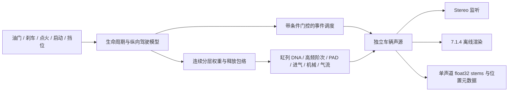

# V6 方法论到 C 驾驶声浪系统

本轮版本：0.2.0。目标仍是自然吸气 V10 的车外／尾排声线；车内素材独立使用。0.1.0 源码与音频保留在 `baselines/v0.1.0`。

## 从 V6 参考了什么

重新查询 GitHub 最新提交，仍为 `ac2b37d8639027d79934a2023cf8d1d37d3b2f96`，提交说明为 `chore: release accepted sound as V6 baseline`。新增的 34 个文本文件快照与哈希在 `v6_control_snapshot.json`，对象摘要在 `v6_patch_summary.json`。没有运行、修改 Max patcher，也没有下载其音频资产。

公开 V6 的 `main.maxpat` 入口当前列出 EV、V10、V12、IONIQ6N 四个独立 runtime；旧通用图也在仓库内。它们共享控制接口和分层方法，但不是所有车型都使用完全相同的 DSP。V10 的公开标定语境还是 Ferrari reference，不能把其数值直接称为 Lamborghini 参数。本工具的 V10、V8、Flat-six、SCI-FI、V12 五个模板共用 C 核心；它们不是五款实车的完成标定，也不表示已移植 IONIQ6N 的全部声音设计。

| V6 证据 | 方法 | 本地职责 |
|---|---|---|
| `code/drive_model.js` | 固定控制时钟、启动锁存、车速积分、挡位耦合、自动换挡 | `src/drive/drive.c`，200 Hz 控制时钟由音频采样计数驱动 |
| `engine_controller_v10.maxpat`、独立 runtime | 点火不等于燃烧；区分启动、运行和关闭 | OFF → READY → CRANK → CATCH → RUNNING → STOPPING |
| `v10_powertrain.gendsp` | 两缸列、怠速权重、进气／排气／残差、运行和换挡门控 | `dna.c`、`detail.c`、`orchestrator.c` |
| `v10_pad_host~.maxpat` | 机体低频、负载跟随和收油后的重量感 | `pad.c` 与独立的慢释放包络 |
| `v10_cinematic_soundscape_host~.maxpat`、V4 factory | 燃烧、腔体、金属结构、空间分别可调 | 声源拆分、细节窗口、短 IR 与独立空间渲染 |
| `backfire_burst.js`、backfire host | 先门控，再调度有限个事件；关闭时取消待发事件 | `events.c`；固定种子；收油连击与单次换挡事件分开 |

这是按方法重新实现的 C 模块，不是把 Max 文本机械翻译成一个大文件。Gen 的样本数时间常数也没有直接当成毫秒沿用。

## 真实驾驶输入已经进入声音控制链

生命周期与运行工况分开维护。运行工况有 IDLE、FREE REV、PULL、CRUISE、OVERRUN、SHIFT CUT、SHIFT RECOVER；工况名称供观察，声音由平滑的连续权重控制，避免状态跳变时硬切音色。

- 油门与负载是不同变量；负载支持 −1～1。相同 5000 RPM 的轻载、重载和倒拖会有不同频谱包络、机体比例与气流激励。
- 踏板驱动车速积分，挡位与车速决定耦合转速；低速有工程化离合衔接，N 挡可以驻车补油。自动模式编排的是踏板，不直接绘制 RPM。
- 换挡经历切断、转速衔接、恢复，并有再换挡锁定时间和降挡超转限制。
- 回火需要高转、先前足够油门、快速松开、短释放窗口和冷却时间。未启动、低转、慢收油、单独刹车不会触发。
- 机体在松油后慢于进气衰减；路噪和风噪跟随车速，即使关闭发动机也可随滑行继续。

这是声音研究用的纵向操控模型。传动比、质量感、阻力、离合及状态阈值是工程设定，没有 CAN、实车扭矩曲线或整车动力学校验。

## 新的素材证据和修正

`state_evidence_v02.json` 逐项记录可见动作、音频推断、不能证明的内容，以及未完成的标注。画面抽查图在 `references/analysis/v02/A_state_context.jpg`。

1. A 原 208–213 秒切片的末段切到驾驶位；新增 208–211 秒的尾排片段。原 313.5–319.5 秒片段从驾驶位开始；新增 316–319.5 秒的尾排移动片段。旧文件保留，标记含切镜头，不继续当成固定声学位置的标定数据。
2. A 33–40 秒提供启动控制动作与仪表变化语境；新切片可供复核。画面不足以测出精确拖转／接火时长，当前 0.28 s 拖转、0.65 s 接火，以及换挡时间都是工程参数。
3. B 只有用户提供的 MP3，没有在本地检查其视频。B 的油门／挡位名称仍是音频工作标签，不能写成视频确认事实。
4. 未找到已经核实的独立熄火、失败启动和精确换挡阶段片段，因此不能宣布全生命周期已经按视频逐帧标定。

新的 Welch 频段数据在 `references/analysis/v02/stereo_state_metrics.json`。S/M 指侧声道相对中置声道能量，不是空间真实性评分。

| 片段 | 28–120 Hz S/M | 3–8 kHz S/M | 3–8 kHz 幅度平方相干度 |
|---|---:|---:|---:|
| A 新尾排驻车 208–211 s | −40.2 dB | −22.5 dB | 约 1.00 |
| A 新尾排行驶 316–319.5 s | −64.2 dB | −51.1 dB | 约 1.00 |
| B 车内动态 218–230 s | −14.0 dB | −0.2 dB | 约 0.02 |

A 的移动尾排录音几乎是 mono；B 的中高频空间差异明显，低频仍更相干。不能根据 A 还原原始宽声场，也不能把 B 的全部差异都归给发动机：路面、风、车厢、录音和有损编码都在其中。因此低频保持相干，排气缸列、高频气流和反射分别处理。

## 高频细节与正弦重建的经验

先前的 16／64 指峰值跟踪轨迹数量，不是发动机阶次数量。原 C 基线用 128 个 720° 周期分音，850 RPM 的上界只有约 907 Hz；低速时这套表达无法独立承担中高频。V0.2 保留低阶燃烧结构，增加稀疏高阶点火分量、固定机械共振的受激成分和独立的带限气流残差。各层依赖负载和工况，并保留用户 DNA 路径。

`tools/hybrid_experiment.py` 另外对 B 同片段做 64 条轨迹／声道的离线重建，再以六频段包络和相关性生成全新的随机残差。它不回放残差波形，采用非负能量拟合限制重叠频带的过填。它仍是同片段拟合，**不是实时 C 驾驶模型，也不能把误差全称为物理噪声**。

实验的具体数值和局限在 `references/analysis/v02/hybrid/results.json`。增加残差仍不能纠正已经错误的谐波相位或全部瞬态，而且可能过填高频；需要听音决定。此轮没有宣称真实度百分比，没有把频谱接近当成听感验收。

## 空间化接口已落地

十个声源：左右排气、进气、机体、机械、左右气流、事件、路噪、风噪。保留车辆坐标、独立 mono float32 stems，以及监听视点。Stereo 是其中一种渲染方式；两种回放布局不会改变驾驶状态或原始声源。

7.1.4 导出是 48 kHz、float32、WAVE_FORMAT_EXTENSIBLE，顺序为 **FL FR FC LFE BL BR SL SR TFL TFR TBL TBR**，speaker mask `0x2d63f`。高度声道来自小比例合成早期反射，干排气没有复制到顶部。LFE 是 120 Hz 一阶低频馈送，不是影院校准或完整低频管理。声源及通道说明在 `renders/v0.2.0/scene.json`。

这不是 Atmos 对象封装，当前 waveOut 仍监听 stereo。7.1.4 已做文件格式、路由与数值验证，尚未在真实 7.1.4 扬声器阵列上试听。默认短反射和 Cabin preview 也只是工程预览，尚无实测车厢／尾排 IR。

## 操作与验证入口

双击 `Launch.cmd`，选择 Pedal driving，按 Start。W／S 控制油门／刹车，Q／E 换挡；也可用滑杆。Ignition 关闭后发动机停机，Monitor 单独控制监听。RPM / load bench 用来比较同转速不同负载；Auto drive 是可重复的 30 秒踏板场景。

Sound detail 可调亮度、高频阶次、进气、机械、怠速机体、循环不均匀、收油机体保持时间和事件电平。主面板保持八个滑杆。预设、音频设备、驾驶面板、细节窗口分别维护。

构建和三个 CTest 覆盖生命周期、启动锁存、负载符号、换挡、收油条件、空挡、种子、块大小、高转分音边界、mono 折叠、声源方向、7.1.4 输出，以及布局间声源／驾驶状态一致性。设备内部 smoke test 另检查实际 waveOut 提交、运行、手动换挡、关闭和导出；并记录每个 512-frame 块的处理用时、设备播放位置和墙钟。

设备计时额外发现了一个实时回放问题：原 256-frame 轮询后端在隐藏 smoke harness 中，10.72 秒墙钟只有 5.22 秒音频进度，出现 36 次整队列耗空。事件唤醒消除了耗空，但 256-frame 下进度仍落后；改为事件唤醒、MMCSS Audio 调度与四个 512-frame 缓冲后，10.71 秒墙钟对应 10.59 秒音频，耗空为 0，平均合成约 1.62 ms／10.67 ms 块。原观察在 `backend_polling_observation.json`，最终值以 `renders/ui_smoke.json` 为准。此结果验证设备进度和调度，不冒充麦克风／声卡环回听音证明，也不据此宣称所有设备都有相同延迟。

`renders/v0.2.0/verification.json` 是实际导出文件的峰值、频段能量、声道统计、控制日志摘要和哈希。`research/V02试听.html` 汇集旧版、新版、同转速负载与离线实验。原始文件电平保留；仅明确标出的 mono／stereo 试听副本作非加权 RMS 对齐，不能冒充 LUFS 匹配。

## 仍需完成的验收

本轮已把控制链、分层和声源接口接通。仍未完成 Lamborghini 的 RPM × 负载 × 状态声纹标定、精确的视频状态时间标注、主观自然度验收，以及 7.1.4 实机试听。下一轮应依据新版本试听反馈，先锁定最明显的一类偏差，再细化各状态频谱与瞬态；不把新模板直接宣布为真实 V10 的完成复刻。
