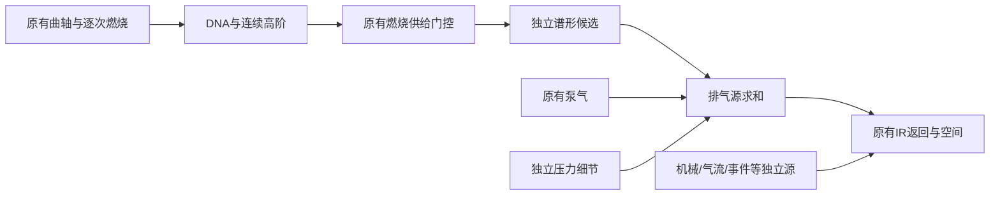

# 主排气谱形实验 V1

本轮将[谱包络核查](主排气谱包络坐标核查V1.md)落实为独立 C11 候选：只对燃烧排气支路应用有限的固定频率谱形调整，保留原有逐次燃烧、点火时序、泵气、机械、气流、事件和空间结构。原声／一半／完整三种设置可在[试听页](主排气谱形试听V1.html)切换并保留位置。

它是受批准参考启发的工程音色尝试，尚未得到主观认可。静态 EQ 没有新增逐次随机细节，也不能证明电子感已解决。原生 V016、默认配方和此前试听均保持冻结。

## 参考与限制

A 车外补油 238.18–238.52 秒的分析帧用于提出宽频调整方向；来源通过 `reference_segments.py` 验证。相同录音的 238.70–239.00 秒和另一次下降的 241.22–241.62 秒只作后续检查，不参与参数选择。它们不是独立录音或匹配转速／负载的台架验证。

使用冻结 C 输出的 4000／8000 RPM 排气两源 2.5–4.8 秒作为工程代理。trace 确认它们为 FIRE、`firing_excitation=1`，燃烧／机械新增层均为 0。后续又核对实际 C 分支 tap 与这些拟合输入在该稳态范围一致。观察声道是麦克风信号，源对象是合成缸列；拟合只同时利用各自的 log PSD 形状，不把 L／R 视作实车缸列。

600–14000 Hz 对数网格、1/8 octave log-PSD 平滑用于分析，评估范围为 1500–8000 Hz，每条曲线去掉 dB 均值。因此此处拟合的是宽频相对形状，排除了整体电平，未拟合波形相位或空间。参考是混合录音，C 是排气代理，条件也未匹配，所得曲线不能称为实车排气传递函数。

## 有限配方

三只宽 peaking bell 的中心频率与 Q 是工程选择。每只增益限制在 ±3 dB；完整串联响应限制在 ±6 dB，48 kHz 下 400 Hz 以下变化限制为 0.3 dB。对两种工程 RPM 的代理误差等权拟合，并用小增益惩罚约束调整。未按后续片段重新选择增益，也未提高边界以追求指标。

| 中心 | Q | 完整设置的单节增益 |
|---|---:|---:|
| 1800 Hz | 0.7 | +3.000 dB |
| 3500 Hz | 0.7 | −3.000 dB |
| 6500 Hz | 0.7 | −0.671 dB |

一半设置将每只滤波器的 dB 增益减半，重新计算系数；它不等同于干湿波形相加。两个参数达到预设边界，说明这是受限提案，不是已找到物理最优值。

实测整个串联响应在 48 kHz 下最大绝对变化约 **2.224 dB**，400 Hz 以下约 **0.219 dB**。串联的相互作用使它不等于三个单节增益直接相加。三个采样率均验证有界稳定。它还包含自身的因果相位响应，未叠加上一轮全通相位实验。


## 信号链与维护边界



| 文件 | 职责 |
|---|---|
| `experiments/exhaust_envelope_v1/biquad.c/.h` | 可移植二阶因果 peaking 滤波器与逐实例历史 |
| `profile.c/.h`、`recipe.inc` | 独立频率／Q／增益配方和三种强度 |
| `transfer.c/.h` | 工厂 V10 资格、两源独立历史、旁路与历史清空 |
| `CMakeLists.txt` | 从冻结 V016 生成调度、供给和 take 的副本，显式传入滤波实例与诊断 tap |
| `probe.c` | float32 混音、十源、燃烧支路前后 tap、trace、冲激和场景元数据 |
| `checks.c` | 原声一致、燃烧／供给／其他源独立、块大小、布局和旁路契约 |
| `tools/prepare_exhaust_envelope.py` | 有边界的参考启发配方，不处理运行时音频 |
| `tools/render_exhaust_envelope.py` | 相同 take 重建、实际分支独立卷积、共享增益试听与页面 |
| `tools/verify_exhaust_envelope.py` | 实际导出谱形、来源／历史核验与冻结 |

插入点在 `excitation` 的 fired gate 之后、pumping 求和之前，故泵气没有被整体 EQ。原供给方程、计时、RNG、角色事件和原生源码均不修改。两排气源使用相同系数、各自独立的历史，保留原缸列关系；此轮不作随机左右 detune 或声场扩宽。非工厂 V10、导入 DNA 和 Pure OSC 均旁路，资格切换时清空历史，防止旧响应进入新音色。

滤波响应可以在燃烧门控归零后短暂衰减，这不是新燃烧事件。原机械／气流等源仍按各自状态发声；排气驱动的 IR 返回有意随处理后的排气改变，所以 body 分轨不要求保持相同。

## 实际导出和验证

七组相同 schema2 take：低／中／高转、空挡补油、收油恢复、30 秒运动自动挡，以及保留两层各 65% 的高转。每组导出三个完整混音，另有中高转的燃烧两源独奏，共 **27 个试听文件**。它们都由固定种子 48271 的 C 核心产生，运行时没有参考波形、残差样本或录音回放。

每组三版使用相同固定增益，不分别归一化、压缩或降噪。完整设置的全片混音 RMS 比基线高约 0.12–0.40 dB，4000 RPM 约 +0.28 dB、8000 RPM 约 +0.40 dB；试听保留这些实际电平差异，不能把较响直接当作音色更真实。

- CTest `fired_exhaust_envelope_contracts` 通过：16／48／192 kHz 稳定性、DC 和尾声；原声与原生逐位一致；完整 drive／excitation／combustion／character／DNA／high-order 状态一致；原有额外声层独立；块大小和 stereo／12ch 一致；资格恢复不带旧历史。
- 七个基线混音与冻结 V016 逐字节一致，所有三版 trace 相同，滤波前的实际燃烧 tap 相同。
- C 实测九个冲激与独立 Python 频响计算的最大误差小于 `3e-6 dB`。实际最大绝对变化在 16／48／192 kHz 下分别约 2.09／2.22／2.23 dB。
- 全部燃烧支路输出与“原始 tap × 实测 C 冲激”的独立 FFT 卷积一致，最大绝对误差约 `7.58e-8`。最终排气源去掉该支路后的泵气／细节余项保持一致，量化误差最大约 `5.96e-8`。
- 高转完整设置的 stereo 与 7.1.4 十源、燃烧前后 tap 和 trace 逐字节一致，场景坐标来自 C。未进行物理扬声器阵列试听。
- 浏览器实际静音检查加载了 27 个比较和 2 个参考，切换保留位置及播放状态，参考与合成互斥，无脚本错误或手机横向溢出。桌面、手机页面与频响图均已查看。

配方对几组未参与拟合的参考区间给出了较小的宽频谱形代理误差，但高转第一段后部的一半／完整设置并非严格单调。验证另保存实际 C 分支导出后的结果，避免把解析响应加到谱形上的近似当成最终混音结果。所有这些都是不匹配条件下的代理比较，不是感知真实度或实车识别结论。

手动参考继续采用批准 A 的低转 208–211 秒和补油 238–248 秒，只有固定 −6.0206 dB、5 ms 端点淡化和 PCM24 量化；原音、float32 主文件及 stereo 保留。没有新素材下载。

## 复现与下一步

```powershell
cmake -S experiments/exhaust_envelope_v1 -B build-experiment-exhaust-envelope -G "Visual Studio 17 2022" -A x64
cmake --build build-experiment-exhaust-envelope --config Release --parallel
ctest --test-dir build-experiment-exhaust-envelope -C Release --output-on-failure
```

实验依赖冻结 V016 源码和对应 `vsl_core.lib`。完成的配方、渲染与冻结工具均拒绝覆盖已有结果。证据为 `renders/exhaust_envelope_v1/recipe.json`、`results.json`、`actual_shape.json`、`browser_qa.json`、`verification.json`；快照为 `baselines/exhaust_envelope_v1/manifest.json`。此前 22 个快照、原生源码／二进制和批准素材重新校验。

先听中高转完整混音，判断中频鼻音、排气厚度和尖锐声线，再用支路独奏确认原因。此轮决定的是有限谱形调整是否有收益，逐次波形、机械细节、目标车与工况标定仍需继续；不能靠静态 EQ 宣布整个电子感问题已经解决。
