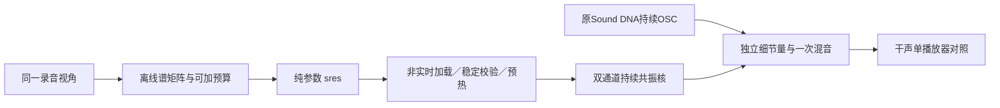

# 低转双声道连续细节 V1

2026-11-12。新增可维护的C双声道连续共振核，用于补原DNA遗漏的中高频与左右关系。**已有可试听候选，尚未完成热怠速或带载加速标定。** 行驶35%配方保持。

## 素材和动作

使用已批准A的38.48–39.51秒：启动后的车内稳定段，沿用已交叉核对的局部慢声学坐标和原256谐波DNA。它不代表车外尾排，也没有新的实车RPM标定。

另复看E的17个原PTS帧／三张图：46–47秒虽车速0，转速指针已升至约4500，随后起步；因此不能把它当成怠速。`Thrust mode mogelijk`只证明画面提示，踏板／刹车／控制激活和音画偏移未确认。记录见[idle_target_v2_annotations.json](idle_target_v2_annotations.json)。

## 算法与模块

原连续细节核用共同信号乘R/L增益，适合此前近单声道尾排情境，不能表达这里一般的复数左右互谱。新核每带采用双通道24阶向量自回归：

`y[n] = Σ A[k] × y[n-k] + L × 新独立高斯激励`

`A[k]`是2×2矩阵，保留跨声道、跨延迟关系。再经过素材拟合的带通与增益。没有PCM、原录音系数时间轴、稀疏固定OSC云或新的RPM时钟；主声线仍由原Sound DNA连续OSC生成。

| C模块 | 职责 |
|---|---|
| `stereo_resonance/profile.*` | 参数结构、SOS及离散Lyapunov稳定证书校验 |
| `stereo_resonance/voice.*` | 双通道递推、持续激励、带通、18ms量平滑；静音仍推进状态 |
| `stereo_resonance_io/profile.*` | 非实时事务文本加载；运行期借用不可变profile |
| `experiments/stereo_resonance_v1` | 离线导出、独立计时和契约核查 |

拟合8带400–8000Hz。600–850Hz的“录音矩阵−原DNA矩阵”不是正半定，独立附加声源无法精确补齐，故跳过该带拟合，保留缺口；相邻滤波器仍有少量泄漏。没有裁负特征值、自动压低原DNA或逐文件补增益。本轮不启用周期包络或新增房间处理，录音／座舱传递仍可能包含在拟合参数内。

## 验证与限制

- 52项CTest通过；多阶跨通道递推／非平凡SOS、预热、静音、量平滑、非法稳定证书和事务IO均有核查。原521份C/H字节保持，新增8份，共529份。
- 已知VAR3恢复系数误差1.67e−16；已知延迟方向、声道交换及理论Welch检查通过；实际C对独立Python递推＋SciPy滤波最大误差1.39e−16FS。
- 3个种子各48秒持续C生成，对理论带功率最大差0.115dB、复相干差0.01393。同一原DNA向前生成50秒，前8秒与冻结音轨逐样本相同，没有循环。
- 完整混音的8个可补频带对短训练录音最大功率差0.221dB、复相干差0.02246；600–850Hz仍约低3.0–3.36dB。20–300Hz改变小于0.000022dB。
- 独立细节核512帧块最高约1.20ms，只是离线计时；没有本轮设备／整套驾驶预算结论。

短录音前后半段功率差最大3.85dB，当前平稳模型没有还原这部分动态。训练均值接近不能说明机械质感、空间真实性或跨发动机泛化。新核尚未接原生监听、驾驶、schema6行程或实际7.1.4，不能据此宣布怠速完成。

试听：[同增益单播放器](http://127.0.0.1:8789/references/analysis/stereo_resonance_v1/review1/index.html)，原DNA／细节50%／100%／细节独奏／1.03秒录音，长生成6秒。27文件通过HTTP／解码／JS语法核查，人工浏览器操作与听感尚未验收；不重复原车外低转的待答问题。

与V6沿用相同分层接口思路：一个驾驶控制器，主DNA、低频、细节、事件、空间分责。新双声道核可通过参数换声纹，但当前只拟合这一种语境；录音L/R不是两个缸列或两个实测物理源。未来仍通过既有观察声床单次路由，物理对象与7.1.4布局在外层处理。

下一步优先补明确的目标怠速／中低转带载证据、同RPM负载轴及该中频缺口，再把合格参数接入唯一驾驶器与拥有模型的行程。模型加载、预热和文件操作继续留在非实时层。

全部尝试：`references/analysis/stereo_resonance_v1/{fit1,fit2,verify1,review1,final1}`。fit2将计划常数显式绑定、抽出可独立验证的块方程求解，参数文件与fit1逐字节相同；初次configure/build日志保留。摘要见[stereo_resonance_v1_summary.json](stereo_resonance_v1_summary.json)，冻结于`baselines/stereo_resonance_v1`。
