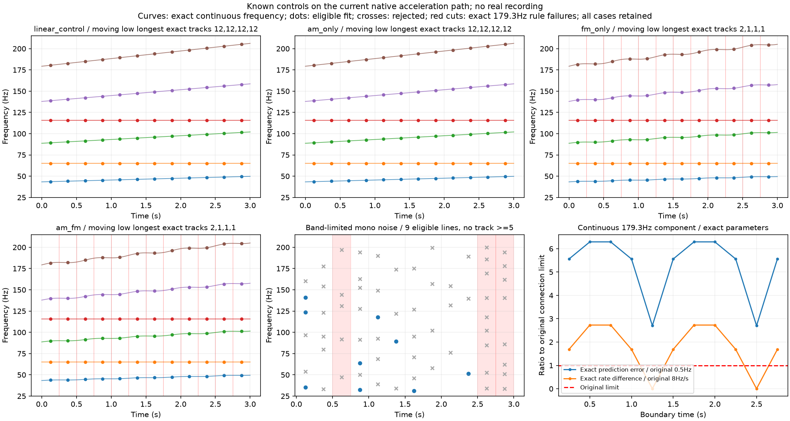

# 低频断线机制 V1

**当前连接规则会把持续存在的非线性变频声切碎；局部“支持度合格”也不能识别发动机声源。**本轮在当前加速原生分析路径上分离验证这两个问题，没有重读素材、修改C声音或替换怠速候选。

## 为什么做

上一轮48个F3窗，即使等价线性消元增加了数值成功窗，最长低频轨迹仍只有1窗。旧0.5秒单线试验曾发现非线性FM断线；本轮改用**当前0.25秒、多移动/固定邻线、完整频段清单和实际初始化路径**，检查同一限制是否仍存在。不是重跑旧单线反例或继续增加迭代。

## 固定试验

全程只生成已知信号：48kHz、3秒、12个相邻12000帧窗。10条连续声线中，43.3/88.7/137.9/179.3Hz四条移动低线与65.1/115.7Hz两条固定低线同时存在，还有上频邻线。四组只分别开关两项机制，不搜索强度、窗口、阈值或种子：

```text
f_j(t) = b_j + 0.05·b_j·moving_j·t
         + moving_j·(b_j/179.3)·1.2·sin(2π·1.6·t) [FM开启时]
g(t)   = 1 + 0.2·sin(2π·0.8·t)                  [AM开启时]
```

相位使用频率的解析积分，左右幅相独立保持已知关系。第五组是预声明单种子、30–200Hz带限、R=0.67L的纯噪声，检查低频噪声在64线容量内的行为；不使用任何发动机片段。

原30–200加200–7000Hz峰清单、邻线图初始化、QR消元声线拟合及频偏/变化率界、60次预算、秩/触界/功率/0.8条件支持门槛都保持。guide来自每窗实际检测到的最强峰与首窗之比，**没有把真实频率或导数交给初始化/求解器**。

拟合完成后才查看真值。另将精确瞬时频率和导数输入原连接器，只作诊断：若这个“知道精确参数”的路径仍断线，问题不能全部归于求解误差。它不属于真实素材提取器、置信度或运行参数。

## 结果

| 已知信号 | 优化成功 | 局部合格线 | 四条移动低线的最长精确轨迹 | 两条固定低线 |
|---|---:|---:|---|---|
| 线性升频基准 | 12/12 | 120 | 12 / 12 / 12 / 12窗 | 均12窗 |
| 仅20%幅度起伏 | 12/12 | 120 | 12 / 12 / 12 / 12窗 | 均12窗 |
| 仅非线性频率起伏 | 12/12 | 119 | 2 / 1 / 1 / 1窗 | 均12窗 |
| 幅度＋频率起伏 | 12/12 | 119 | 2 / 1 / 1 / 1窗 | 均12窗 |
| 单声道带限噪声 | 9/12 | 9 | 无真实音调；合格拟合最长1窗 | 无 |

线性基准通过原0.06Hz、0.15Hz/s、相对波形1e−5及10条完整12窗轨迹前置条件。AM的拟合最大频差0.00612Hz，变化率误差可达0.807Hz/s，说明恒幅拟合也会吸收部分幅度变化，但这组仍保持连续。

两组FM在66条低频同一真实成分相邻边中，42条违反原双向0.5Hz线性频率预测，22条违反变化率差8Hz/s；两类可重合，不能相加当边数。实际拟合的低轨迹碎裂形状与精确路径一致。**在本组信号中，主要断线已经出现在连接假设本身；这不是F3真实断线原因的唯一解释或实测抖动量。**

低频纯噪声峰数3–9，未触发64线容量拒绝，却有9条局部声线合格。它们没有形成五窗轨迹，所以不能称当前完整规则已把该噪声认作发动机；但足以否定“局部支持度高就是发动机音调”。也不能据此随意放宽连接门槛。



## 验证与工程结论

独立复数声源求和/另一FFT实现复核全部原生输入；独立扫描全部频谱峰、最强峰guide、邻线图初始变化率；独立重建60窗548条拟合线的波形/界/秩/功率/支持，以及全部真实/拟合轨迹、误差、排除和汇总。最大输入波形差9.694e−13FS、拟合重建差4.346e−14FS、峰频差2.842e−14Hz；这些是实现核对误差，不是车声还原率。完整图已目视，全部失败和反例保留。

离线代码分为`signals.py`已知连续源、`diagnostics.py`拟合后诊断、`audit_inputs.py`独立输入核对，以及observe/audit/plot/package入口；没有把研究代码塞进C驾驶或空间模块。612份C/H、67旧voice配置逐哈希保持；行驶35%、怠速待听候选、旧二进制/take不改，没有重复旧61驾驶测试。

下一步应研究**能表示频率曲率的局部连续相位模型，以及有噪声反例约束的跨窗对应**，再检查跨窗预测/缺线/近邻/遮挡。原规则留作对照；先通过已知控制，再回到声明好的素材范围。不能只增加求解次数、放宽频差、补断线或用随机低频掩盖问题。

当前用户优先的怠速[主声线带动细节候选](http://127.0.0.1:8789/references/analysis/idle_conditioned_detail_v1/review1/index.html)仍待听评，不重复提问或盲调推广。新独立声线方法不豁免原共同相位提取资格，也不建立真实RPM/负载/发动机身份；完整加速、多发动机和物理7.1.4仍未完成。完整留痕冻结于`E:/VehicleSoundLab/baselines/chirp_motion_controls_v1`。
