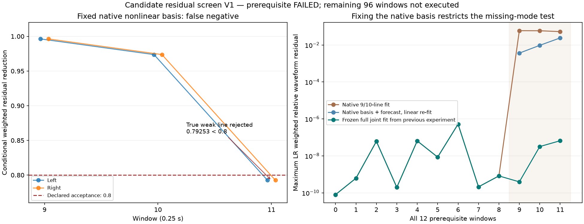

# 候选残差预筛选 V1

**前置验证失败，未用于真实素材或实时声音。**本轮尝试在扩充非线性拟合之前排除错误预测；已知弱声线在最后一窗被误拒绝，因此按预声明停止，后96窗没有执行。没有降低门槛或改参数重试。

## 方法与模块

原`candidate_presence_v1`的跨窗候选生成、三次相位拟合及最终存在/唯一前驱检验均保持。新增`tools/candidate_residual_v1/screen.py`：

1. 固定当前原生拟合的频率/变化率/曲率，将上一窗观察声线的三次相位预测加入；每条候选以自由cos/sin系数表示，不导入原录音时间相位。
2. 同时求解全部原生与有效候选的线性幅相系数。逐候选删除cos/sin列，再重解所有其余系数，比较双声道加权残差。
3. 要求双声道条件收益≥0.8、原秩/−42dB功率条件及原生求解成功。检查同时进行，不逐个挑选重试。通过者才进入原扩充拟合；扩充求解失败仍保留，不事后回退选原生。

这项新接受条件针对**固定非线性参数下的全局加权残差**，与原局部频带支持不同；不能称统计置信度或完整重新优化的缺失模型。每个非线性假设仍限原60次，另有预筛选线性求解成本。

`observe_`负责先保存12窗再检查原前置；`audit_screen.py`以独立物理坐标/复指数和SVD复核；`audit_`核对输入、原峰、初始、全部波形、图与评分；`diagnose_`独立重建当前模型和上轮冻结的完整联合模型；`plot_`和`package_`负责展示与冻结。

## 失败证据

沿用全部原控制和门槛。首个10线×12窗控制中，前9窗原生即完整；115.7Hz弱线在末3窗都仍然存在。预筛选结果：

| 窗（从0计） | 最小LR条件收益 | 预筛选 | 最终结果 |
|---|---:|---|---|
| 9 | 0.996284 | 接受 | 10线恢复，原前置通过 |
| 10 | 0.973720 | 接受 | 10线恢复，原前置通过 |
| 11 | **0.792532** | 拒绝，低于原0.8 | 仅9线，无权相对波形误差9.60%，原前置失败 |

最后一窗，原生模型的加权相对残差约5.316%；固定其非线性参数、加入预测弱线并重解线性系数后仍约2.421%；上轮实际观察初始化、完整联合优化的10线模型约6.58e−8。这里比较三种已保存模型，不使用真值初始化或新拟合，也不把数值误差当还原百分比/自然度。

缺线时原生模型已改变邻线参数来吸收遗漏成分；恢复弱线需要相关频率参数一起恢复。末窗108Hz候选的原生与完整联合模型曲率差约1189.89Hz/s²，全部共同声线差异均保留在诊断。**冻结一个已有偏差的模型，再检查残差，会把真实弱线误判成缺乏支持。**这只证明本已知控制的失败机制，不能据此认定真实F2/F3有相同数值。

因此暂不采用这条预筛选路线。后续需要另行声明并验证完整有线/缺线模型的比较及独立预测，明确候选求解失败与“不存在”的区别；不能靠放宽门槛、加预算、选择性丢窗或隐藏回退取得通过。

## 留痕与边界

独立核对12窗117条原生＋119条本轮拟合线、3项预筛选、2项最终存在检验、全部原生峰/初始、六套连接及评分。最大波形差4.81e−14FS、预筛选成本差3.94e−19、条件收益差4.33e−15；另独立重建全部12窗旧完整模型与固定模型，最大波形差5.22e−14FS。图已目视。实现核对通过，算法前置失败，两者分别登记。

完整证据冻结到`E:/VehicleSoundLab/baselines/candidate_residual_v1`。612份C/H和67旧voice逐哈希不变，行驶35%/怠速候选/旧二进制/take保持；没有新音频、真实源读入、运行profile或旧61驾驶测试重复。现有怠速主声线带动细节候选仍待原试听反馈，不重复提问或盲调晋级。这不是新的怠速音色改善结果。原共同相位36/all17/full33/individual14k/originalE资格，以及完整驾驶/多音色/物理7.1.4目标仍未完成。
