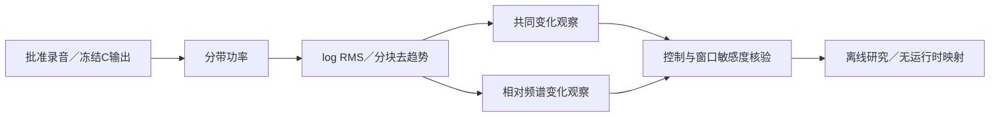

# 共同响度与声线变化 V1

2026-11-12。**大幅动态录音里的共同起伏，不宜直接做成持续DNA的随机起伏；但共同响度也不能解释固定参考与生成器之间的全部差异。** 本轮只做测量，保留已认可的固定相位DNA／相干低频；高频幅度候选的既有听评仍待回复，没有生成或接入新配方。

## 分开测什么

48kHz原音，2048点Hann、480帧步长、八带1.2–8kHz，与上一轮一致。对每个频带的RMS取自然对数，按块去均值／线性／二次趋势，再作等权分解：

`x_b(t) = c(t) + s_b(t)`，其中 `c = 各带x的平均`、`s_b = x_b − c`。

共同项表示八带一起变化的部分；声线项表示各带相对比例变化。二者在这个坐标中正交，平方能量可相加。它们是**数学投影**，不是物理源分离：转速扫动、拍频、录音传递和真实源幅度变化都可能影响两项，去掉共同项也可能删掉真实发动机变化。

0.5／1／2秒块、三个起点偏移、三种去趋势构成敏感度检查。每种长度／偏移内按不重叠块统计；不同配置和重叠谱窗不当独立试验。慢变化只累加`0 < f < 4Hz`的可用离散频点，实际最低频率约2.17／1.04／0.51Hz；固定短参考不能识别亚赫兹过程。

## 结果怎样解释

以下为**1秒、零偏移、线性去趋势、左观察声道**的块中位数。dB RMS表示对数幅度变化量，不是平均声压或响度；表内各列分别取中位数，不能将中位数直接做能量加法。

| 情境 | 块数 | 共同项占总变化 | 声线变化 dB RMS | 慢声线变化 dB RMS |
|---|---:|---:|---:|---:|
| 固定坐标A参考 | 1 | 23.9% | 1.343 | 1.068 |
| 已认可DNA＋LF | 7 | 41.8% | 1.095 | 0.584 |
| 幅度候选50% | 7 | 32.3% | 0.999 | 0.526 |
| 幅度候选100% | 7 | 30.9% | 1.429 | 0.744 |
| A原始拟合附近316.10–317.25s | 1 | 24.5% | 1.200 | 0.957 |
| A较后移动317.5–319.5s | 2 | 86.1% | 1.803 | 1.173 |
| A驻车补油238–241s | 3 | 80.4% | 1.494 | 0.940 |
| B车内218–230s | 12 | 22.5% | 1.253 | 0.733 |
| D台架20–32s | 12 | 26.2% | 1.297 | 0.630 |
| E车内88–94s | 6 | 25.8% | 1.222 | 0.687 |

1. A后段移动／驻车补油的大幅变化主要在共同项。两者1秒不同起点的共同占比分别约86–91%／80–82%；它们与固定短参考不同，不应仅为追平CV就增深持续随机AM。既有画面证据确认相应视角，但不能证明音轨未编辑或负载不变，本轮没有重复提帧或新增事件标签。
2. 固定参考去掉共同响度与线性趋势后，慢声线变化仍为1.068dB，原生成器约0.584dB。候选100%升至0.744dB，总声线起伏却已高于短参考。**继续统一加深幅度不能同时修正变化强度与速度分布**；下一步应区分频谱变化的时间尺度及其来自声源、音高、分析还是工况的贡献。当前只检查首个预先指定的试听种子78283，不推断所有种子。
3. 短参考的慢声线量对窗口很敏感：0.5秒、线性去趋势的三个起点中位数为0.323–0.837dB；1秒去均值／线性／二次趋势为1.144／1.068／0.832dB。这个单块目标不足以设定通用随机过程。E共同占比也随块长明显变化，不能从一套窗口复制通用驾驶包络。

50%候选仍有上一轮记录的高带平均能量降低；该表不消除试听的能量混淆。所有录音视角分别保存，四份录音并不代表四种发动机；也没有将录音L/R解释成两个物理发动机声源。

## 验证与模块边界

八组已知控制：恒定正弦、共同增益、纯频谱变化、二者混合、三个平稳高斯种子、恒幅逐谐波扫频。共同增益投影约100%，纯声线控制的共同项约`1.51e-7`，已知包络误差最大约0.00258dB。平稳高斯本身仍有约1.15–1.20dB的有限窗变化；固定谐波幅度扫频也产生约0.501dB变化。因此这些测量不是额外源AM的直接读数。

实际原音／冻结输出的频带功率均经直接三角DFT核对。另用不调用原测量模块的标量正交多项式、两两频带log比例及直接调制DFT，复核**1707条**配置记录；最大相对差异`1.90e-12`。分解能量和Parseval检查通过；详细阈值与误差在机器摘要中。

| 模块 | 职责 |
|---|---|
| `tools/common_envelope_v1/features.py` | 分带测量、数学分解与窗口敏感度 |
| `tools/common_envelope_v1/controls.py` | 已知增益／声线／平稳与扫频控制 |
| `tools/analyze_common_envelope_v1.py` | 批准素材和冻结音轨读取、哈希及观察保存 |
| `tools/verify_common_envelope_v1.py` | 独立标量／两两比例／DFT复核 |
| `tools/summarize_common_envelope_v1.py`、`freeze_common_envelope_v1.py` | 证据绑定、交接与冻结 |

436份C/H和认可模型哈希保持一致，未重跑未改动的40项CTest。没有C、正式模型库、驾驶状态、UI、空间或行程协议修改。冻结位置：`E:/VehicleSoundLab/baselines/common_envelope_v1`；完整观察在`references/analysis/common_envelope_v1`，执行源码随每阶段保存。方案／摘要分别见[plan](common_envelope_v1_plan.json)与[summary](common_envelope_v1_summary.json)。

后续先结合[已有幅度候选试听](http://127.0.0.1:8789/research/谐波幅度统计V1.html)判断收益，再考虑独立C幅度声部。真实慢状态包络仍应由唯一驾驶控制器管理，随机纹理保持独立；本轮尚未识别足以标定二者的因果证据。
