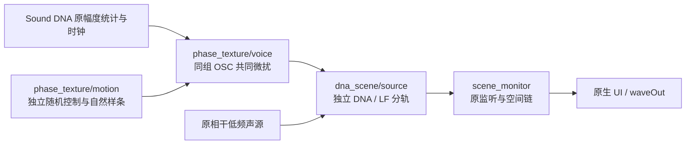

# 共同微扰 C 接入 V1

2026-11-12。用户对上一轮“认可原版／轻量”反馈：**“更接近机械声，保留这条方向”**。已单独登记于[听评记录](phase_texture_v1_acceptance.json)，原冻结音频、失败记录和当时 pending 报告保留。

本轮将该方向接入固定情境 C 联合监听。**原离线轻量已认可；本次 C 随机序列与原生连续监听尚待听评**。

## 优化思路

独立高频 OSC 云虽然补了平均功率，却被听出劣质合成器感；不再把它作为这条音色的补强方案。改为保留原 DNA 幅度统计、谐波平均相位和相干低频，让同一主声线的高谐波共享一个很小的随机时间坐标。

`x[k,c] = A[k,c] × {cos(φ[k,c]) + mask[k] × [cos(φ[k,c] + 2πf[k]τ) − cos(φ[k,c]) ]}`

mask 在1.2–1.9kHz平滑过渡。所有高谐波和左右声道共享τ，避免每根谐波各自摆动。原幅度流仍由原 Sound DNA 生成；独立低频不参与此变动。

仅开放已试听轻量的范围：20–70Hz随机控制，设计尺度2微秒、硬界4微秒。强度0–1只表示关闭至轻量，不开放未认可的中量。该控制频带与强度仍是工程参数；录音共同相位标定此前没有通过，不改称“实测燃烧抖动”，也不表示全部丢失的高频已还原。

## C 模块

| 文件 | 职责 |
|---|---|
| `modules/phase_texture/motion.c/.h` | 独立RNG、187.5Hz带通控制、流式自然样条、tanh限幅 |
| `modules/phase_texture/voice.c/.h` | 沿用SdVoice幅度／时钟，在原谐波内应用共同位移、18ms强度跟随 |
| `modules/dna_scene/source.c/.h` | 可选控制接入与分层，不生成第二驾驶器 |
| `experiments/phase_texture_c_v1` | 独立C核对／离线分轨宿主 |
| `experiments/scene_monitor_v1` | 复用原设备／UI；研究模式仅增加一个轻量开关 |

音频核不分配内存、不读文件、不读取录音时间轴。样条使用24节点边界余量、每256控制节点重算，连续生成，无8秒循环。位移用实际声学频率计算；音高只支持原固定声源的0.90–1.10×，不自行解释为RPM。

C使用独立xorshift64*/Box–Muller序列；离线试听原版使用NumPy PCG64。滤波、插值、强度和共享关系一致，**两者不是逐样本相同的微扰轨迹**，因此新增C试听供核对，不能把离线认可自动扩展到原生版。

## 验证与入口

- 47项CTest通过。已知多谐波直接余弦计算、零量完整声源状态、1／257分块、低谐波及独立低频回归均通过。
- 三个随机种子的C流式位移与独立SciPy全长样条最大差小于2e-20秒；实际录音DNA的C输出与直接OSC求和最大差小于6e-8满幅。零量DNA float与冻结原版精确相同；开启后的低频float仍精确相同。
- 3组轻量的平均频带功率变化最大0.00173dB，仅用于确认没有靠增益补偿取得差别；不把该数值作为自然度验收。
- 四次短时静音设备检查：队列耗尽0，512帧渲染最高4.7443ms，预算10.6667ms；实际采用控制的离线float回放精确相同，停止／重启通过。程序内UI消息自检通过，截图已检查，未做人工鼠标操作验收。
- 478份C/H，原472份中466份不变；6份修改属于scene声源适配和监听宿主。原`src/`、`sound_dna`、模型与低频算法不改。旧二进制／schema5播放器已另存；新源身份按源码更新，旧行程继续使用匹配旧播放器。没有把共同微扰加入驾驶控制或27字段行程协议。

运行[Launch-Shared-Phase.cmd](../Launch-Shared-Phase.cmd)，窗口 **Vehicle Sound Lab · Shared Phase**，默认停止、1×、轻量开启。取消勾选可回查原版，切换约需半秒充分收敛。低频、空间与电平仍用原控件。

[C试听对照](http://127.0.0.1:8789/references/analysis/phase_texture_c_v1/review1/index.html)包含原版、已认可离线轻量、C默认及0.90／1.10×。共用0.5增益与首尾淡化，无逐条响度补偿。

本地证据：`E:/VehicleSoundLab/references/analysis/phase_texture_c_v1`。`before`保存旧源码／播放器，`verification1`保存独立核对，`build1/2.log`与`ctest1/2.log`保存构建和测试，`device1`／`ui1`保存设备及控件检查，`final1`绑定当前源码和二进制。完整驾驶工况、跨车型和7.1.4实际回放仍未由本轮验证。
