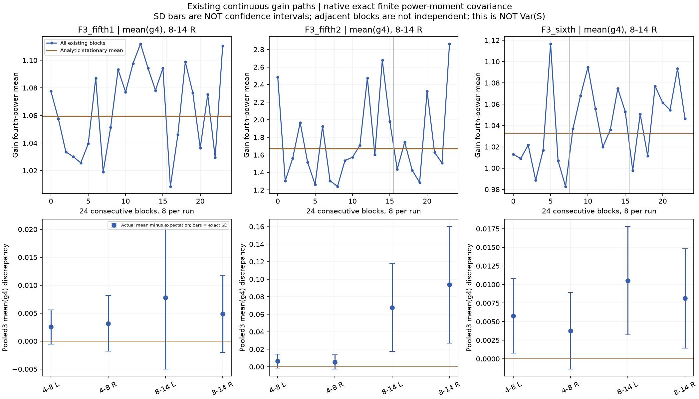
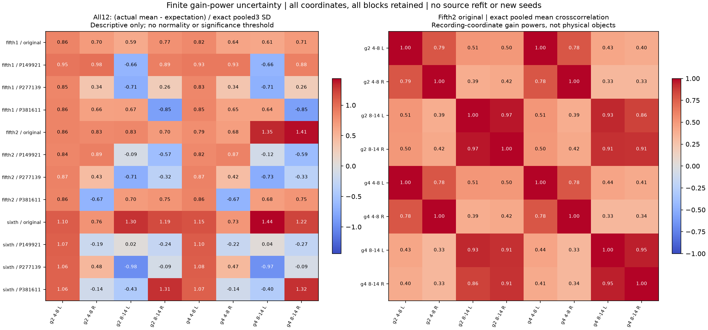

# 力度有限波动 V1

本轮给既有高频力度支路建立了**原生采样率下的有限功率矩预算**：同一套联合生成模型，计算四路力度的二次／四次平均量及全部相邻片段的相关性，再重放原三条持续运行核对。没有换种子、改强度或生成新音色。

五挡第二段右侧8–14kHz的`mean(g⁴)`，理论为1.670573，现有三次运行合并为1.764260；这项平均量的理论标准差为0.066611，差值为1.406倍标准差。**这不是正态检验或置信区间，也不能证明该段完整声音的能量偏差已经合格。**它说明不能只看到一次高次平均量偏高，就将其当成确定的实现故障并裁峰或压强度。

## 模型与模块

沿用`g_i = exp(u_i − Γ_ii)`，联合OU潜变量协方差为：

```text
Cov(u_i[n], u_j[n+t]) = Γ_ij × exp(−|t|/(Fs×τ))
Z_(p,i) = g_i^p，p∈{2,4}
μ_(p,i) = exp((p²/2 − p)×Γ_ii)
Cov(Z_(p,i)[n], Z_(q,j)[n+t])
    = μ_(p,i)×μ_(q,j)×expm1(p×q×Γ_ij×exp(−|t|/(Fs×τ)))
```

在原生48kHz上保留完整时间支撑，将这个协方差与原片段长度的矩形窗逐采样收缩。每个模型有四坐标×两次幂＝八个统计坐标；保存八个片段滞后的8×8矩阵及完整64×64块协方差。三个独立运行的均值协方差为单次连续运行的1/3。一次运行中的八块保持相关；同种子在不同模型之间复用，不把12模型当作额外独立重复。

| 文件 | 职责 |
|---|---|
| `tools/accel_gain_moments_v1/model.py` | 有限矩形窗协方差与完整块矩阵；现有增益轨迹的二／四次平均 |
| `tools/accel_gain_moments_v1/known.py` | 高斯求积、显式原生矩阵、负相关／独立／零／退化秩及输入控制 |
| `tools/observe_accel_gain_moments_v1.py` | 先控制后读取全部12模型，含原8191采样前历史，重放原三种子 |
| `tools/audit_accel_gain_moments_v1.py` | 几何分块递推重建增益，以累积和及平稳增量方差二阶差分独立重建矩形窗协方差 |
| `tools/assess_`、`package_accel_gain_moments_v1.py` | 全量汇总、两图、旧代码保护与归档 |

四路仍是两个高频带×录音左右声道坐标；不能直接当作四个气缸、声源对象或7.1.4扬声器。此处只观察力度支路，不处理房间或声场。

## 实际结果

全部12冻结终点×三次持续运行×八块＝288块，每块八项；九个旧拟合不可用对照仍仅作诊断。完整重放每次22.4或46.4秒，没有块间重置。下表为三个原始模型右侧8–14kHz的`mean(g⁴)`。

| 原素材段 | 理论均值 | 实际合并均值 | 三次合并均值的标准差 | 差值／标准差 |
|---|---:|---:|---:|---:|
| 五挡第一段 | 1.059659 | 1.064550 | 0.006892 | 0.710 |
| 五挡第二段 | 1.670573 | 1.764260 | 0.066611 | 1.406 |
| 六挡 | 1.033007 | 1.041149 | 0.006693 | 1.217 |

这些是**合成增益的统计量，不是录音音量或听感分数**。第二段的单块值明显起伏，不能把单个短片段与平稳期望直接等同。对这一坐标，正确连续块预算的方差是把八块视作独立时的1.003160倍，约多0.316%；相关性已计入，但不是当前大差值的主要解释。





已知高斯求积在读取源模型之前完成，最大差3.55e−15；显式窗口矩阵与三角收缩通过。独立审计重建全部36条旧增益、288块、12份完整64×64协方差；矩阵相对差最大1.69e−13，全部块均值差最大1.20e−13。两种矩形窗实现不同，标准差及全部有符号跨坐标项一并核对，没有用独立块假设或方差地板。两图已目视，本轮无失败重试。

## 尚未解决的部分

上轮的`E[S|g]`包含不同时刻增益的乘积；`mean(g⁴)`不是它的方差。这轮**没有完成`Var(E[S|g])`或完整`Var(S)`**，也没有证明旧0.076914能量偏差属于正常波动。全部11滞后／跨坐标的输出观察不确定性、再滤波后非高斯四阶、慢谱色与工况分布仍未完成。标准差误差棒不提供正态分布、置信区间或机械归因。

下一步需要完整二次型观察器的不确定性，或另行资格验证由素材支持的增益分布，才能决定是否替换模型。不能用本轮较容易计算的功率矩代替这个要求；也不据此推广到其他发动机或完整驾驶状态。

619份C/H、67份旧声音、行驶35%／默认、旧行程及怠速联合起伏待听保持。未新增声音、运行配方、C、素材下载或听评问题。怠速“节奏太规整”的候选仍先听评再决定独立C接入。原相位资格与全频MSC失败保留，完整驾驶／多音色／stereo到7.1.4目标继续。

冻结：`E:\VehicleSoundLab\baselines\accel_gain_moments_v1`；全量索引：`research/accel_gain_moments_v1_summary.json`。
