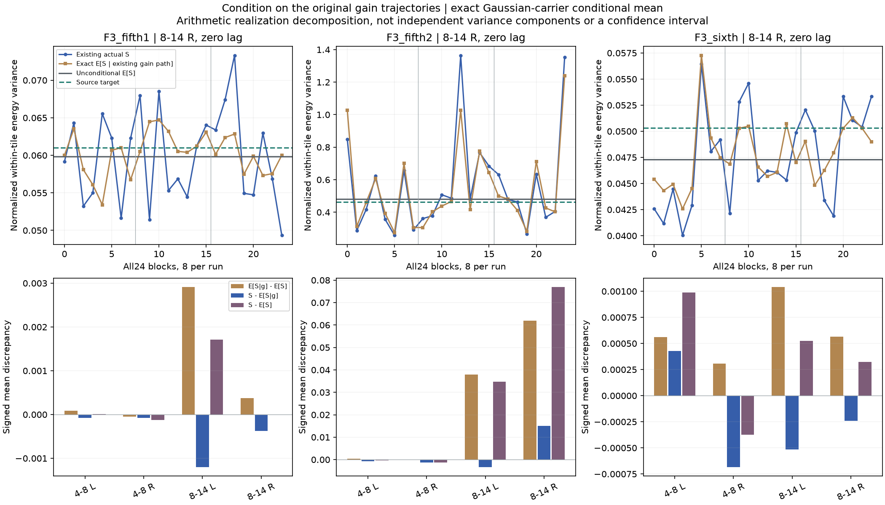
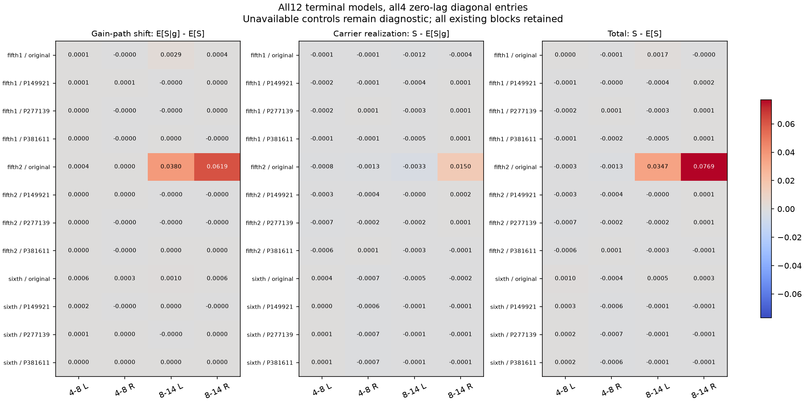

# 力度轨迹条件核查 V1

本轮定位加速高频生成中的有限片段偏差，**没有改音色或实时 C**。沿用全部12个冻结模型、三个既有随机种子和每次八个连续原长片段，不重拟合或添加种子。

结论：五挡第二段右侧8–14kHz的零滞后能量方差，理论均值为0.479942，实际均值为0.556856。固定已有力度轨迹后，其条件均值已达0.541821；总偏差0.076914可写为**力度轨迹条件均值偏移0.061879＋载体实现剩余差0.015036**。因此下一步应先检查力度轨迹的有限观察波动与分布，再决定是否修改生成模型。这些加数不是独立方差分量，也不能解读为机械声源贡献比例。

## 方法及范围

当前模型是 `y[n] = g[n] × c[n]`：正增益`g`来自既有联合OU过程，`c`为独立的、素材频谱编译出的高斯载体。保持生成时完整8191采样前历史并裁去，重放同一增益序列。只计算**再滤波之前、零滞后、四个对角坐标**；4–8kHz／8–14kHz与左右声道仍是录音坐标，不是四个物理声源。

设每个480采样窗的归一化能量为`e_w = mean(y²)/P`；`P`为冻结载体理论功率。原有限分组内去均值后的统计量为：

```text
S = (1/N) × Σ组 Σ窗 (e_w − 组内平均e)²
q[n] = g[n]²
K[a,b] = (Rc[b−a]/P)²

E[S | g] = 组内 window_mean(q) 的方差
           + 2/(N×480²) × [Σ窗 q窗ᵀKq窗 − Σ组(q组ᵀKq组 / 组内窗数)]

S − E[S] = (S − E[S|g]) + (E[S|g] − E[S])
```

第一项保留固定增益轨迹自身的变化，第二项是给定这条轨迹时高斯载体造成的条件期望。保留载体全部线性相关支撑、原不等长分组和带符号的差值，不截负值。生产实现用补零FFT自相关收缩；独立核对用反向全卷积，另行重建全部载体相关与增益轨迹。

## 实际结果

共12模型×3次×8块＝288块，四坐标共1152项；所有块均保留。九个此前拟合不可用的相位对照仍只作诊断，不能当作通过的音色。

下表均为各原始模型右侧8–14kHz坐标的24块平均值。数值为归一化能量方差统计量，不是音频幅度、百分比或音质评分。

| 原素材段 | 无条件预测 | 固定增益条件均值 | 实际生成均值 | 条件均值偏移 | 载体剩余差 |
|---|---:|---:|---:|---:|---:|
| 五挡第一段 | 0.05984458 | 0.06021946 | 0.05984428 | +0.00037489 | −0.00037519 |
| 五挡第二段 | 0.47994207 | 0.54182075 | 0.55685629 | +0.06187868 | +0.01503555 |
| 六挡 | 0.04728937 | 0.04785321 | 0.04761242 | +0.00056384 | −0.00024079 |

第一段有明显正负抵消，说明不能将两个加数除以总偏差作“贡献率”。五挡第二段左侧8–14kHz也有条件均值偏移：+0.03796347，载体剩余差−0.00330583；不是只在右声道发现问题。全部四坐标、每次均值和24块值见JSON及冻结NPZ。





## 模块及验证

| 文件 | 职责 |
|---|---|
| `tools/accel_upper_conditional_v1/model.py` | 逐窗／逐组二次型及精确条件均值 |
| `tools/accel_upper_conditional_v1/known.py` | 白输入显式矩阵、常增益四次缩放、独立延迟、零／符号及精确高斯求积控制 |
| `tools/observe_accel_upper_conditional_v1.py` | 先已知控制，再重放12模型的旧增益并读取旧实际统计量 |
| `tools/audit_accel_upper_conditional_v1.py` | 独立增益重建、全卷积收缩、全部原始统计与分解核对 |
| `tools/assess_accel_upper_conditional_v1.py` | 全块汇总和绘图，不生成声音 |
| `tools/package_accel_upper_conditional_v1.py` | 核对所有报告／NPZ／来源，保护旧代码及声音，冻结与留痕 |

已知控制在读取源模型之前完成，误差最大约1.33e−15。独立审计覆盖437760个原生窗口二次型、全部288块／1152坐标；条件均值相对差最大7.38e−14，原实际统计与有符号分解核对一致。本轮没有失败重试。两图已目视；精确执行源码、实际消费的父输入、全部报告和数组一并冻结。

**条件均值不是`Var(S)`验证**：未给出完整有限观察不确定度或置信区间，未验证全部11滞后／跨坐标方差，更未解决再滤波后非高斯四阶矩。既有三次独立运行不够支撑置信声明。理论与实际对源仍有偏差，原慢谱色／工况／相位资格及全频MSC问题继续保留。

下一步量化力度轨迹经同一有限观察器后的不确定性，或单独资格验证由素材支持的新增益分布，再考虑低延迟表示及实时接入；不靠换种子、裁峰或盲调强度消除当前结果。

怠速“节奏太规整”是另一条仍在推进的声音任务；[已有联合起伏候选](怠速联合起伏V1.md)等待听评，此处加速统计不替代怠速听评，也不作为C晋级依据。619份C/H、67份旧声音、行驶35%／默认及旧行程保持。完整驾驶、多发动机、stereo到7.1.4目标仍未完成。

冻结：`E:\VehicleSoundLab\baselines\accel_upper_conditional_v1`；索引：`research/accel_upper_conditional_v1_summary.json`。
