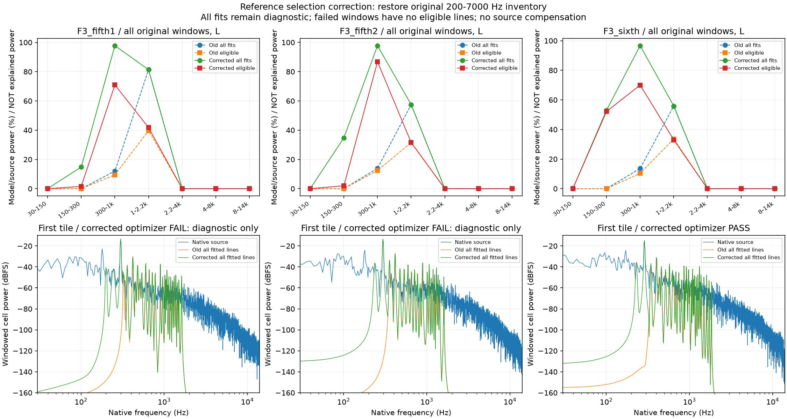
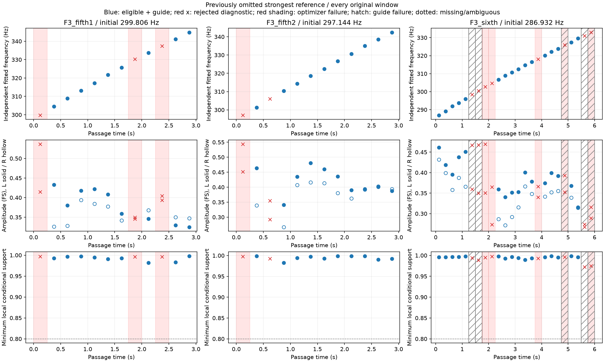

# 加速主声线漏选修正 V1

发现并修正了**分析参考声线的筛选错误**，没有更新驾驶音色。旧参考清单从300Hz开始，三段F3加速的最强已检测峰却分别在299.806、297.144和286.932Hz，因此后续幅度分析从一开始就漏掉了主能量。原200–7000Hz谱峰清单已经包含它们，本轮直接恢复完整原清单，没有重新找峰或放宽原拟合门槛。

## 结果和限制

使用同一批48个原生0.25秒窗口、原声学比例与一对一对应、原独立声线拟合器。参数限制仍为原±2Hz／邻线界限、±500Hz/s、60次评估、原秩／0.8局部支持／−42dB条件。

| F3车内片段 | 原最强参考Hz | 旧300–1000Hz模型／原声功率 | 修正后全部拟合 | 修正后合格声线 | 优化成功窗 |
|---|---:|---:|---:|---:|---:|
| 第一次5挡 | 299.806 | 11.97% | 97.80% | 71.00% | 9/12 |
| 第二次5挡 | 297.144 | 13.90% | 97.78% | 86.79% | 11/12 |
| 6挡 | 286.932 | 13.65% | 96.66% | 70.05% | 19/24 |

表为左声道、全部等长窗口原始功率相加后的比值，**不是还原率、解释能量或发动机声源占比**。保存了源、模型、残差和有符号干涉项，满足源＝模型＋残差＋干涉，不能将残差直接叫作风噪或机械层。

原41/48成功，本轮39/48；9个失败窗完整保留，不因能量更接近而晋级，失败整窗没有合格声线。第一次5挡失败0/7/9窗，第二次0窗，6挡7/8/15/19/23窗；6挡原5个比例未确定窗也不补接。新增主线的“合格＋比例支持”分别覆盖9/12、10/12、16/24窗，不是连续完整发动机相位。

独立复核55个已知／真实窗口、1189条拟合声线、原生对应图／初始化／复数波形／右声道最小二乘／秩／边界／条件支持及全部分带功率，最大波形差1.692e−13FS、支持差1.260e−12、功率差1.527e−16。补充已知299.8Hz强声线＋5条弱线先行通过，并重现原300Hz筛选会漏掉最强线。数值通过不是音色验收。

低于200Hz的主体仍未覆盖；2.2kHz以上也基本没有被这组局部声线表达。F3车内该频段功率较小，不表示听觉细节可忽略。先前`accel_amplitude_v1`的跨片段幅度结论**没有包含这些最强声线**，不能直接迁移为新主线配方。

## 同轮否决路径

原生覆盖检查前曾尝试以线性chirplet字典减轻升速频谱展宽。预声明的已知控制要求高频检出优于原生分析，但两者都检出64/64，因此资格失败；没有启动真实素材的补偿变换，也没有调整范围、alpha或门槛强行通过。

`accel_wideband_v1/observe1`保留AssertionError和执行源码；`diagnose1`留下8组数组后因NumPy整数JSON序列化失败，**没有原始report.json**。`diagnose2`只修正JSON整数转换，重现同一原断言，保留全部8组对照及错号／缺线／噪声反例。打包生成的恢复元数据明确标记为事后记录，不伪装成原运行报告。

另立原生覆盖计划后，对旧48窗独立重建，最大波形差1.665e−16FS、功率差1.249e−16；第一窗图暴露这次300Hz漏选。原chirplet资格失败不因这个独立检查而取消。

## 模块与交接

- `tools/accel_wideband_v1/coverage.py`：原生模型及有符号功率分解；`chirplet.py/checks.py`为本轮否决实验，未接C。
- `observe/audit/plot_accel_coverage_v1.py`：冻结旧结果的覆盖检查，无重新拟合。
- `observe/audit/plot_accel_full_inventory_v1.py`：恢复原完整清单，原拟合器调用／独立核对／全部窗口可视化。
- `package_accel_reference_selection_v1.py`：一并冻结三条路径、失败、精确源码和不变性证据。

全部612份C/H、67份旧声音配置、已认可行驶35%、怠速候选、驾驶器、空间、旧二进制与take保持；没有新音频／模型、默认替换、旧61项驾驶测试重复或新听评问题。原共同相位资格仍须独立满足，本轮不是实测RPM／负载／物理声源分离或完整加速完成。

当前人类优先事项仍为怠速。已有[F2主声线带动细节候选](http://127.0.0.1:8789/references/analysis/idle_conditioned_detail_v1/review1/index.html)，保持待听评，不重复提问或继续盲调。加速下一步应检查新增主线的跨片段源内预测和失败窗模型误差，再处理未覆盖频段；不能仅凭这张功率表导出完整发动机音色。

完整留痕：`E:/VehicleSoundLab/baselines/accel_reference_selection_v1`。
