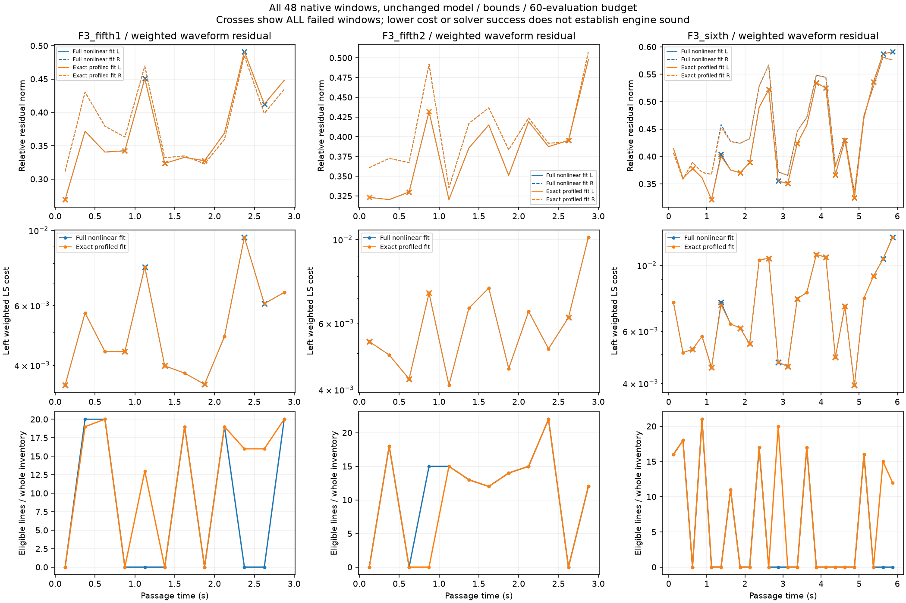
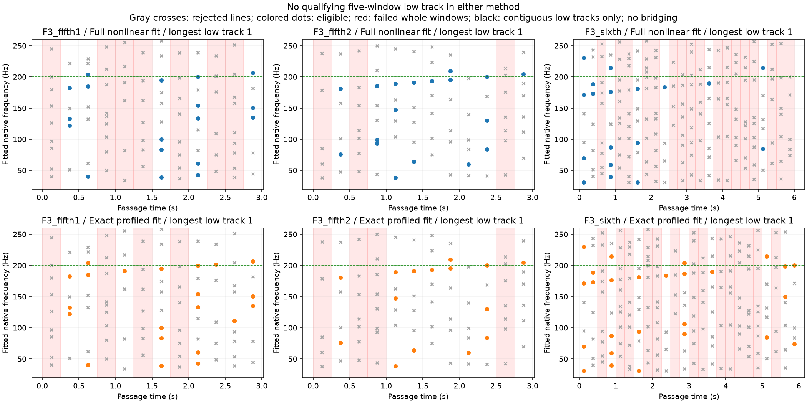

# 加速低频联合拟合 V1

本轮收尾已启动的F3低频研究，**没有导出新声音，也没有替换怠速或行驶配方**。全参数求解21/48窗成功；等价消去线性幅相系数后26/48成功，但两者均没有连续五窗的低频轨迹，不能据此构造完整加速轰鸣层。当前用户优先的怠速候选仍在[主声线带动细节试听页](http://127.0.0.1:8789/references/analysis/idle_conditioned_detail_v1/review1/index.html)，听评未决，不重复提问或盲调推广。

## 输入和方法

使用已批准F3同一车内录音的原生48kHz立体声：两段5挡各12窗、一段6挡24窗，每窗12000帧。合并冻结的30–200Hz低峰与**各当前窗全部**原200–7000Hz峰；固定及移动邻线同时拟合，不只挑第一窗参考或移动查询命中的线。原Opus解码不等于恢复无损原声，风噪与机位影响也没有物理分离。

初始频率用原生FFT格；变化率来自前后完整清单的一对一观测对应，有两侧取中心差、单侧取单边差、无唯一对应取0。使用原声学比例作对应坐标，它不是实测RPM、负载或发动机共同相位。

两次试验采用完全相同的左声道Hann加权最小二乘目标和独立右声道幅相系数：

```text
x_c(t) ≈ DC_c + Σ[a_jc cos(2π(f_j t + q_j t²/2))
                  + b_jc sin(2π(f_j t + q_j t²/2))]
```

原频偏±2Hz/邻线界、变化率±500Hz/s、最多64线、60次函数评估、1e−10求解容差保持。仅全窗优化成功、满秩、该线不触界、相对功率≥−42dB及双声道局部条件支持≥0.8才可连接；失败窗所有线均不合格。

- **全参数版**：沿用原`accel_chirp_v1.fit`，每线频率、变化率、cos/sin系数加DC一起搜索。
- **消元版**：每步给定频率/变化率，用QR直接解出cos/sin/DC，只搜索2M非线性参数。残差Jacobian含投影项及残差相关系数导数；目标、模型、原界和评估预算不变。它改变优化路径，不保证与原有限步结果相同。

连接仍沿用原规则：相邻窗双向频率预测差≤0.5Hz、变化率差≤8Hz/s、两端唯一；不跨失败窗、不补线或断线重接，至少5窗。额外记录唯一边的双声道前向/后向相位推进误差，**只作报告，没有相位资格门槛或共同钟结论**。

低于200Hz起点轨迹需前半和后半各至少3个合格且guide支持窗，才比较源内幅度及频率预测。后半以前已观察过，并非独立新录音；本次没有轨迹进入比较，不能报告预测精度。

## 全部实际结果

| 段落 | 全参数成功窗 | 消元成功窗 | 全参数合格线 | 消元合格线 | 两版≥5窗低轨迹 |
|---|---:|---:|---:|---:|---:|
| F3_fifth1 | 5/12 | 8/12 | 98 | 142 | 0 / 0 |
| F3_fifth2 | 9/12 | 8/12 | 136 | 121 | 0 / 0 |
| F3_sixth | 7/24 | 10/24 | 116 | 163 | 0 / 0 |
| 合计 | 21/48 | 26/48 | 350 | 426 | 0 / 0 |

两版各拟合1942条实际局部声线。消元版6窗由失败变成功，1窗反向变化；34窗成本较低。全窗波形残差曲线大体重叠，低频最长轨迹均仅1窗，没有低频相位推进边。**优化状态增加并未解决持续性；不能将断线当成没有发动机低频，也不能靠放宽门槛拼出声源。**恒幅线性局部模型、噪声、频率曲率、混合声源和密集邻线都仍可能影响结果，本轮没有确证单一原因。





## 控制、独立核对和失败留痕

12个连续已知10声线窗同时包含移动/固定低线及上频邻线；两版均恢复10条完整12窗轨迹，沿用原0.06Hz、0.15Hz/s、相对波形1e−5条件。缺失180Hz槽加199.7Hz邻线被拒绝。完整同源单声道噪声/独立噪声的峰数超过64，属于**容量拒绝**，不证明噪声不会误检；此前单声道与非线性FM反例的限制继续成立。

`accel_low_fit_v1/observe1`在已知负例把180原生格误当180Hz，实际应为45格；检查180Hz行时`StopIteration`失败。12个正例已经落盘，尚未读取真实源；原执行源和`known_progress`全部保留。只修正单位后的`observe2`完成48窗，不改变范围或阈值。

独立复核两版各64个已知/真实/空与容量例、2073条拟合线，重建原生复波形、左右系数、秩、界、成本、原算术分组下支持度、所有轨迹及未预测原因。全参数最大波形误差6.119e−14FS；消元版6.201e−14FS。另以独立SVD检查非零残差Jacobian/条件LS，消元版左LS法方程误差3.207e−16、缩减坐标界缩放梯度误差7.585e−17；这是实现一致性，不是非线性全局最优证明。两图已目视，失败窗完整显示。

## 工程位置和后续

`tools/accel_low_fit_v1/{observe,checks}.py`负责观测初始化与控制；`tools/native_profiled_chirp_v1/fit.py`只负责等价求解；`tools/native_chirp_audit_v1/{wave,temporal}.py`及独立审计入口负责核对。它们都是离线研究，没有写入声源、驾驶器、空间或IO模块。

两套完整证据分别冻结到`baselines/accel_low_fit_v1`和`baselines/accel_low_profiled_v1`，包括原单位错误与执行源。612份C/H及67旧voice配置逐哈希保持，旧二进制/take、行驶35%及怠速候选不动，没有重复旧61驾驶测试。

先处理怠速候选听感；加速低频后续应先用已知幅度/非线性频率与同源单声道噪声检验局部模型和连接规则，再决定表示法，而非增加迭代/扫界/扫种子或导出不完整的薄声。原共同相位提取资格继续保留，不能由本次独立声线拟合代替。完整加速、多发动机和物理7.1.4目标仍未完成。
