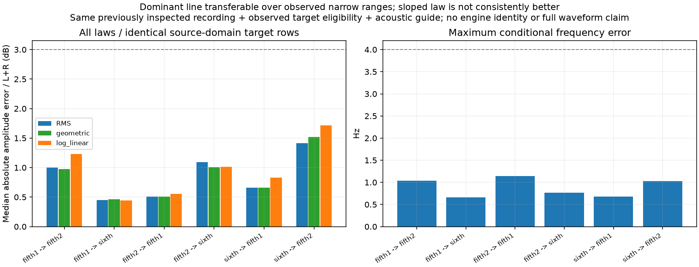
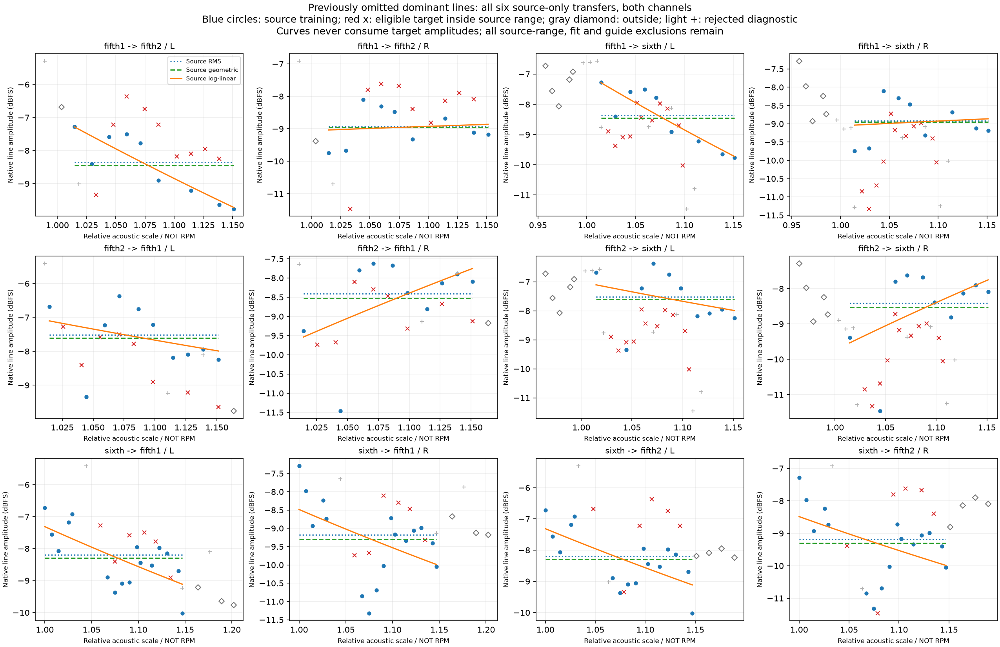

# 加速最强声线跨片段验证 V1

上一轮恢复了被300Hz参考下限误删的三条最强声线。本轮确认：**它们在三个F3车内加速片段间有可复用的窄范围频率／幅度关系；不必为这条主声线增加复杂幅度曲线。** 这不代表完整加速音色、独立发动机身份或共同相位已成立。

## 怎么检查

三段各取原第一窗清单中左右功率和最大的参考：299.806／297.144／286.932Hz，选择不依赖本轮比较结果。关联图仍使用全部原清单，邻线、缺失、多义与失败不删除。

复用原已独立审计的第一窗声学比例；原拟合、原guide支持和原声线合格条件不变。每条源模型只读取本片段全部合格行，至少3行、音高对数跨度至少log1.03。保留三种独立左右声道模型：RMS常量、几何常量、log幅度对log音高的直线。没有目标幅度训练、目标增益补偿、提高阶数或搜索门槛。

全六个有方向的片段对都检查，仅在源训练范围内预测。目标仍要求至少3行、覆盖至少一半合格目标行。共3份模型／35行源训练、51行域内预测、19行域外观察；原拟合失败和guide失败不补接。三个片段以前都观察过、guide来自整段、目标合格性来自目标实录，所以这是**带观测条件的同录音检查，不是未见素材或自主轨迹预测**。

## 全部结果

幅度为同一组域内行的左右声道绝对dB误差中位数。频率误差是源基准频率×声学比例与目标局部频率的最大差。

| 源→目标 | 域内／合格目标行 | RMS常量dB | 几何常量dB | 斜率模型dB | 最大频率差Hz |
|---|---:|---:|---:|---:|---:|
| 第一次5挡→第二次5挡 | 9/10 | 1.002 | 0.973 | 1.231 | 1.038 |
| 第一次5挡→6挡 | 11/16 | 0.449 | 0.463 | 0.447 | 0.662 |
| 第二次5挡→第一次5挡 | 8/9 | 0.510 | 0.510 | 0.556 | 1.141 |
| 第二次5挡→6挡 | 11/16 | 1.090 | 1.005 | 1.013 | 0.770 |
| 6挡→第一次5挡 | 6/9 | 0.657 | 0.663 | 0.832 | 0.678 |
| 6挡→第二次5挡 | 6/10 | 1.414 | 1.521 | 1.716 | 1.026 |

全部六组、三种模型都通过原来的“幅度中位误差≤3dB＋最大频率差≤4Hz”诊断。中位数不表示所有时刻都达到3dB；每行每声道误差及最大值另存。斜率只在1/6组优于几何常量，不能认定更复杂就更真实。六组完整清单关联均指向目标本身的最强参考，但这仍只是声学对应。

## 工程含义与边界

这条主声线可继续作为有限音高范围的连续OSC参数候选；现有简单常量幅度是有依据的对照。其左右斜率并不一致，录音机位、车内传递、载荷与估计误差尚未分离，不将某条斜率直接绑定油门／RPM／发动机负载。

它也不能代替低于200Hz主体、细谱／高频、机械时间结构、换挡／回火等状态，更不能只输出它和旧中频线就宣称完整发动机。下一步应先检查遗漏低频的移动声线与固定／非音调部分，再形成分层配方。原共同相位提取资格仍需独立满足。

入口`tools/observe_accel_dominant_transfer_v1.py`复用原通用训练／预测核；`audit_`入口独立标量训练、全清单图、域判断与每项预测；`plot_`只读画出六组双声道、域外及不合格目标；`package_`统一冻结。原功率律／常量／换目标律／缺线／邻线／噪声自匹配控制保留，补充含299.8Hz的完整图缺线／邻线反例。源和目标冻结输入逐项按父manifest验证。

独立复核通过：模型最大差4.441e−16、预测／dB算术差1.916e−15；两张图目视。612份C/H、67旧配置、怠速候选、已认可行驶35%、驾驶器／空间／旧take原样，没有新音轨／运行声音模型／默认替换／旧61项驾驶测试或新听评问题。当前怠速候选继续待听评，不凭这些加速数值推广。

完整证据：`E:/VehicleSoundLab/baselines/accel_dominant_transfer_v1`。
